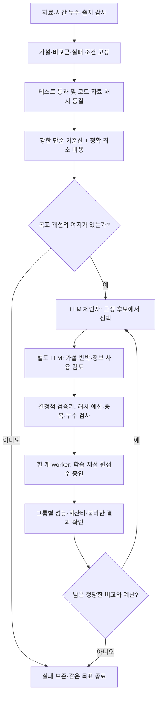

# 활현 연구를 위한 제한된 에이전틱 연구 루프

> **현재 실행 안내:** v1 파일럿은 개선 상한7.77% 때문에 원래10% 목표를 달성할 수 없어 종료했다. 실패를 보존하고 `engine_v2`의 별도 전체480열 진단으로 넘어갔다. **v1을 재개하지 않는다.** 실제 최신 결과는 [실행 현황](docs/EXECUTION_STATUS.md), 자동화의 남은 작업은 [작업 큐](docs/WORK_QUEUE.md)를 읽는다. 아래의 v1 명령들은 첫 구현의 재현 기록이다.

**현재 버전의 실행·상태·중지:**

```bash
cd "$HOME/violin-bowing-boundaries"
# 다음 검토된 실험 한 단위; STOP 또는 관문 실패 시 추가 실험 없음
bash agentic_research/scripts/research_tick.sh
# 실제 상태
bash agentic_research/scripts/run_v2.sh status --campaign development480_20261030_v2
# 중지
bash agentic_research/scripts/run_v2.sh stop --campaign development480_20261030_v2
```

앱에 **‘활현 AI 연구 루프’** 30분 간격 반복 작업을 생성했다(automation ID `ai`). 이 대화에서 작업 큐를 따라 진행한다. **v2도 개선 상한5.83%로 종료되어 위 tick 명령은 현재 STOP을 반환한다.** 후속 `forecast_v3`의 감사·설계는 앱에서 깨어난 에이전트가 작업 큐를 읽고 수행한다. tick 스크립트가 v3 학습까지 자동 실행하는 것은 아니다.

앱 자동화와 직접 실행은 같은 캠페인 파일·잠금을 사용한다. 잠금은 캠페인별이며 서로 다른 캠페인을 동시에 띄우는 전역 잠금은 아니다. 수동으로 전체 연구를 쉬려면 캠페인 STOP과 함께 앱의 반복 작업도 일시중지한다. 노트북이 꺼져 있거나 실행 환경이 이용 불가능할 때 작업 완료를 보장하지 않는다. `status`의 종료 코드만 보지 말고 `integrity_ok`, `stopped`, `safety_halt`도 확인한다.



v2는 v1 파일을 덮어쓰지 않은 별도 엔진이다. v2에는 정확 공동 하한의 사전 관문, 캠페인별 후보 목록, 인증 오류의 즉시 영구 중단이 추가되었다. 아래에서 설명하는 v1의 per-rule 최대 하한과 v2의 정확 공동 하한을 혼동하지 않는다. 동일 OS 사용자를 신뢰하는 로컬 구현이며, 서로 다른 LLM 호출이 통계적으로 독립된 과학자라는 뜻도 아니다.

2026-10-30. 현재 버전은 **학습 모델이 파형 확인 순서를 정하고, 정확한 계산으로 경계를 인증하는 AI 연구**의 첫 실행 가능한 버전이다. 기존 물리 연구의 성과를 보존하면서 별도 후속 실험을 수행한다. 최고 수준 성과를 보장하지 않으며, 개선이 없다는 결론도 정상 결과다.

빠른 안내: [연구 계획](docs/RESEARCH_PLAN.md) · [최신 문헌 검토](docs/LITERATURE_REVIEW.md) · [현재 자료·상태 감사](docs/CURRENT_STATE.md) · [참고 루프 코드 감사](docs/REFERENCE_LOOP_AUDIT.md).

## 1. 무엇이 AI이고 무엇이 자동화인가

**연구 방법:** 공개된 힘·속도·접촉 위치에서 파형 판정 확률을 학습한다. 신경망에는 경계 구조를 반영한 손실도 비교한다. 그 확률을 정확한 first-K-run 동적계획에 넣고, 다음에 확인할 파형을 선택한다. 별도의 종료 인증기가 모든 판정 규칙의 경계가 확정되었는지 확인한다.

**연구 도구:** 제안 LLM과 검토 LLM은 어떤 통제된 비교를 다음에 실행할지 고른다. 실제 학습과 숫자 계산은 고정 평가기가 한다. LLM을 많이 호출했다는 사실은 AI 방법의 novelty가 아니다.

현재 구현에서 등록된 모델·정책은 선택할 수 있지만, LLM이 임의 Python을 생성해 평가기와 같은 권한으로 실행하지는 않는다. 새로운 알고리즘은 검토·테스트 후 새 버전의 고정 평가기에 추가해야 한다. 이 제한은 첫 무인 캠페인의 검증 가능성을 위한 설계이며, 자유로운 전체 연구 자동화를 완성했다는 뜻은 아니다.

## 2. 실행된 것과 아직 검증할 것

| 단계 | 내용 | 의미 |
|---|---|---|
| 구현 검증 | 수학 전수 검사, 누수 방지 인터페이스, 큐/변조/중단 테스트 | 계산과 실행 코드의 정확성 |
| 첫 파일럿 | A/B 학습, C1/C_T2/D1/D2의 고정16열, 규칙9개 | 동작·비용·초기 경향; 최종 성능 아님 |
| 후속 개발 평가 | 후보 동결 후 전체480열·시드0/1/2·같은 기준선 | 현재 자료의 회고적 그룹 성능 |
| 가까운 선행 비교 | EC2/ECED, 작은 문제의 최적 정책 등 | 단순 조합 이상의 기여 검토 |
| 외부 확인 | 미사용 외부 자료 또는 새로 확보한 자료 | 현재는 없음; 새로운 일반화 주장에 필요 |

현재까지 모든 첼로 자료는 과거 연구에서 이미 노출되었다. 미래 창을 잘못 섞거나 개발 라벨을 직접 넣는 누수는 막을 수 있지만, 과거 노출 이력을 없앨 수는 없다. 기존 보고서를 새 성능 결과로 덮어쓰지 않는다.

## 3. 구조

```text
agentic_research/
  configs/pilot_v1.json       과제·평가 열·규칙·예산·중단 기준
  candidates/*.json          실행 가능한 등록 후보
  prompts/                   읽기 전용 제안자/검토자 지침
  planner.py                 제안→독립 검토→정적 검증→큐 등록
  control.py, cli.py         SQLite 작업 원장·무결성·예산·보고
  worker.py                  고정 평가기만 실행하는 subprocess
  harness/data.py            공개 입력/비공개 oracle·그룹 분할
  harness/models.py          prior 학습과 MLP 구조화 손실
  harness/run_distribution.py DP·정보이득·정확 인증·하한
  harness/experiment.py      질의 실행·원점수·예측 저장
  tests/                    수학·운영·제안 검토 테스트
  state/<campaign>/          원장·STOP·LLM 제안/검토 기록
  runs/<campaign>/<sha>/     요청·모형·원점수·예측·봉인
  reports/<campaign>/        원점수에서 생성한 보고
```

외부 무결성 기준은 `~/.violin_research_loop/locks/<campaign>.json`이다. 같은 OS 사용자에게 쓰기 권한이 있으므로 이는 실수·변경 탐지이며 공격자에 대한 완전한 sandbox가 아니다. 실제 후보는 허용 JSON 값만 받으며 `eval`, 외부 명령, 동적 Python import 경로를 받지 않는다.

## 4. 이 Mac에서 상태 확인

```bash
cd "$HOME/violin-bowing-boundaries"
bash agentic_research/scripts/run.sh status --campaign pilot_20261030_v1
bash agentic_research/scripts/run.sh report --campaign pilot_20261030_v1
```

`status`는 작업별 queued/running/completed/failed/interrupted/invalid 상태와 누적 시간을 보여 준다. `report`는 봉인을 확인한 결과를 `agentic_research/reports/pilot_20261030_v1/results.json`으로 만든다. 실패한 실행도 보존된다. 두 이름이 같다고 서로 다른 코드·설정·시드 결과를 합치지 않는다.

원점수는 각 run의 `worker_result.json`이며 `metrics.json`도 평가기가 생성한다. `predictions.npz`에는 각 예산의 경계 분포, 목표, 질의 순서와 열 ID가 있다. `stdout.log`는 실패 원인을 확인하는 곳이다. JSON의 `columns`와 `groups`에서 불리한 사례도 확인한다.

## 5. 한 번의 에이전트 라운드 실행

```bash
cd "$HOME/violin-bowing-boundaries"
bash agentic_research/scripts/agent_round.sh --campaign pilot_20261030_v1 --execute
```

대기 중인 작업이 있으면 하나를 처리한다. 큐가 비어 있으면 등록 후보와 모든 완료/실패 결과의 요약을 제안자에게 주고, 별도 읽기 전용 LLM 호출로 검토한다. 검토자는 정확한 후보 해시를 돌려줘야 한다. 이후 프로그램이 후보·입력·코드·계약 해시와 예산을 다시 검사하고 한 작업을 실행한다.

LLM은 설치된 Codex CLI와 사용자의 기존 로그인을 사용한다. 모델은 CLI 기본값을 따르며, 별도 모델 이름이나 API 키를 파일에 박아 넣지 않는다. `codex login status`로 확인할 수 있다. 인증 토큰을 저장소에 복사하지 않는다. CLI 호출은 읽기 전용·임시 세션이며, structured JSON을 사용한다. 출력 프롬프트·응답·이벤트는 `state/<campaign>/agent_rounds/`에 남는다.

이 명령은 한 라운드 뒤 끝난다. 앱의 이 대화에 붙인 반복 자동화가 다음 라운드를 이어갈 수 있다. 터미널에서 동시에 실행해도 worker와 planner 잠금이 중복 소유를 막는다. 자동화의 활성 여부는 이 문서가 아니라 앱의 실제 설정과 `status`로 확인한다.

## 6. 수동으로 고정 비교 실행

```bash
cd "$HOME/violin-bowing-boundaries"
bash agentic_research/scripts/run.sh enqueue --campaign pilot_20261030_v1 \
  --config agentic_research/candidates/entropy_mlp_boundary.json
bash agentic_research/scripts/run.sh run --campaign pilot_20261030_v1 \
  --max-jobs 1 --max-seconds 600
```

같은 설정은 이름을 바꿔도 중복 실행되지 않는다. 완료된 run을 덮어쓰거나 실패한 run을 같은 ID로 자동 재시도하지 않는다. 버그를 수정하면 코드 해시가 바뀌므로 새 캠페인을 만들어야 한다.

## 7. 중지와 재개

```bash
bash agentic_research/scripts/run.sh stop --campaign pilot_20261030_v1
bash agentic_research/scripts/run.sh status --campaign pilot_20261030_v1
# 다시 진행하려는 경우에만:
bash agentic_research/scripts/run.sh resume --campaign pilot_20261030_v1
```

STOP은 새 작업을 막고 현재 worker도 중단한다. 중단 기록과 사용 시간은 남는다. 현재 LLM 호출은 제한 시간 내에 끝날 수 있으나 후속 enqueue 단계에서 STOP을 확인한다. 앱의 반복 자동화도 함께 일시중지하면 다음 깨우기가 사라진다.

프로세스를 잃은 경우 다음 worker가 먼저 단일 잠금을 얻은 뒤 원장을 확인한다. PID뿐 아니라 정확한 worker 경로와 run ID가 같은지 확인하고, 이전 시도는 interrupted로 보존한다. 다른 프로세스의 PID로 확인되면 자동 종료하지 않고 검토를 요구한다.

## 8. 새 머신·Ubuntu에서 준비 — sudo 불필요

현재 새 코드가 GitHub에 올라갔다는 보장은 없다. 먼저 이 폴더와 기존 입력이 있는 저장소를 같은 버전으로 옮겨야 한다. 자동 push는 하지 않는다.

이미 저장소가 있고 Python3.11 이상의 환경이 있다면:

```bash
cd "$HOME/research/violin-bowing-boundaries"
python3 -m venv .venv-loop
.venv-loop/bin/python -m pip install -r agentic_research/requirements.txt
export VIOLIN_LOOP_PYTHON="$PWD/.venv-loop/bin/python"
"$VIOLIN_LOOP_PYTHON" -m pytest agentic_research/tests -q
```

이 단계는 CPU 실험이다. CUDA·sudo·새 장비가 필요하지 않다. `run.sh`는 `VIOLIN_LOOP_PYTHON`, 기존 `.venv-mac`, `.venv`, python3 순서로 환경을 고른다. 에이전트 제안은 Codex CLI 설치·로그인이 추가로 필요하지만, 고정 후보의 학습과 채점은 LLM 없이 실행할 수 있다. 서버 CUDA 학습이나 대형 음향 모델은 별도 버전의 실험으로 준비한다.

새 머신은 경로와 소스가 달라 기존 외부 잠금 파일을 재사용하지 않는다. 테스트 후 새 캠페인 이름으로 init/freeze한다.

```bash
bash agentic_research/scripts/run.sh init --campaign pilot_server_v1 \
  --data research/2026-10-19_protocol_audit/novelty/joint_rule/input_joint.json.gz \
  --protocol agentic_research/configs/pilot_v1.json
bash agentic_research/scripts/run.sh freeze --campaign pilot_server_v1
```

freeze 전후에 지표·분할·코드를 바꾸지 않는다. 날짜가 지난 계약은 자동 실행이 거절된다. 새 종료 날짜가 필요하면 기존 결과를 보존하고 새 계약과 캠페인으로 만든다.

## 9. 결과 해석과 승격

1. `certificate_error_count=0`, `all_certified=true`를 먼저 확인한다. 실패를 성능 표에서 숨기지 않는다.
2. 모든 후보의 평가 ID, 규칙 수, 입력 해시, 코드 해시와 시드가 맞는 비교만 사용한다.
3. full-grid 대비 감소뿐 아니라 가장 강한 단순 탐색 대비 감소를 본다. 50개보다 적다는 것만으로 새 방법의 우수성을 주장하지 않는다.
4. HGB uncertainty와 HGB entropy를 비교한다. prior가 같을 때 구조적 획득 기준이 실제 도움이 되어야 한다.
5. MLP BCE와 MLP boundary를 비교한다. 학습 일정은 같고 추가 DP 비용은 따로 기록한다.
6. 평균 개선을 그룹별·최악 조건·계산 overhead와 함께 읽는다.
7. 파일럿16열의 성공은 전체480열 평가로 승격할 근거일 뿐이다. 전체 평가의 최고 결과를 또 반복 선택에 쓰면 그 자료는 개발자료다.

외부 검증 전까지 제목과 보고서에는 ‘운영상 경계 재현’, ‘회고적 개발 평가’라는 범위를 유지한다. 새 물리 법칙, 참 진동 라벨, 바이올린 실측, 보편적인 최신 모델 우위로 표현하지 않는다.

## 10. 자동 루프가 반드시 멈추는 경우

다음 숫자는 **보존된 v1**의 한도다. v2는24시도·18LLM라운드·worker2700초이며 실제 동결 계약이 우선한다. 후속v3의 실행 제어는 아직 구현되지 않았고, 검토 전 학습을 시작하지 않는다.

- STOP 파일 또는 종료 날짜 도달.
- 총36개 작업, 누적 worker2700초, 작업당600초 한도.
- LLM 라운드12회; 실패 호출도 1회로 기록.
- 반복 worker 실패, 무결성 실패, 인증 실패.
- 등록 후보 소진 또는 반박 가능한 다음 가설 없음.

45분은 worker 실험 예산이며 LLM 응답 대기 시간과 프로그램 준비 시간을 포함한 전체 벽시계 시간이 아니다. LLM 호출은 각180초 제한이며 한 라운드 제안/검토2회다. 계정 사용량은 모델·문맥에 따라 달라지며 토큰 무제한을 약속하지 않는다.

## 11. 참고 구현과 공식 명령 근거

- 참고 저장소: https://github.com/jeehoo0507/Loop-Research-for-MaskedKD (검토 커밋8b9703e). 구조를 참고하되 코드 해시 혼합·잠금·적응적 선택의 한계는 별도로 감사했다.
- Codex 비대화형 실행·읽기 전용·structured output: https://learn.chatgpt.com/docs/non-interactive-mode
- 반복 작업: https://learn.chatgpt.com/docs/automations?surface=app

새 소스와 결과의 최종 위치·실제 실행 여부는 `docs/EXECUTION_STATUS.md`를 참고한다.
