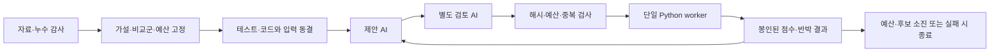

# 활현 AI 연구: 재현 가능한 미래 예측과 에이전트 루프

**현재 상태 — 2026-11-03 고정12학습·독립 재계산 완료, 이번 탐색 STOP:** [null 결과](null_conditioning_learning_v1/RESULTS.md)까지 완료했다. 제안 null loss0.541000 대 Markov0.542081로0.1994% 개선에 그쳐2% screen 실패, random0.538427보다0.4779% 나빴다. 보조 단계의 확률 보존은 확인됐으나 성능 성공이 아니다. 독립 재계산 오차 최대3.33e-16, 승격0개다. [종료 기록](null_conditioning_learning_v1/CLOSURE.md), [독립 검토](null_conditioning_learning_v1/EXECUTION_REVIEW.json). 추가 학습3/3batch·수치 감사2/2회 소진으로 자동화는 **PAUSED**이며 현재 예산의 미완료 실험은 없다. 높은 novelty와 독립 예측 개선은 미확보다. 모든 원결과/가중치를 보존하며 아래 준비·run 명령이나 과거 자료 수를 현재 작업으로 해석하지 않는다.

**현재 상태 — 2026-11-03 구현·누수 검증·전체동결 완료:** [null conditioning](null_conditioning_learning_v1/README.md)의 합성 기능시험30개와 별도 소스 검토를 통과했다. 원train34명1442개·invalid15개,8입력/37소스/전체계약을 동결했고 별도 검토자가 행정렬·사람분할·3fold의 train-only 통계/label/73prefix를 독립 재계산해 일치했다. [준비 결과](null_conditioning_learning_v1/PREPARATION_RESULT.json), [동결 검토](null_conditioning_learning_v1/FREEZE_REVIEW.json). 실제 모델 학습/실제자료 model forward/새 채점은0이다. 다음은 **[고정12개 실제 학습의 한 번 실행](null_conditioning_learning_v1/NEXT_EXECUTION_GATE.md)**이다. `.venv-mac/bin/python -m agentic_research.null_conditioning_learning_v1.runner check` 후 state·다른 worker가 없을 때만 같은 module의 `run`을 한 번 실행한다. 준비를 반복하거나 기존 STOP을 재개하지 않는다. 높은 novelty/예측 개선은 아직 미입증이며 마지막 학습1batch·12job/1800초/개별180초를 넘기지 않는다. 아래 ‘최신’·선점·대기 문구는 과거 이력이다.

**현재 상태 — 2026-11-03 새 가설 서면 검토 완료:** 사용자 재개 요청 뒤 세 축과 핵심 직접 선행6개를 검토해 [함수보존 conditioning](research_reframe_v1/METHOD.md) 하나만 **코드 준비 후보**로 남겼다. 고정 readout 앞 adapter의 추가 단계는 현재 사건 확률을 보존하지만, 이후 학습 성능은 미검증이다. 새로운 정보·용량이나 새 투영 원리라고 주장하지 않는다. [결정](research_reframe_v1/DECISION.md), [독립 검토](research_reframe_v1/REVIEW.json), [다음 준비 작업](research_reframe_v1/NEXT_PREPARATION_GATE.md). 이번 서면 단위 새 fit/forward/gradient/실제 자료·가중치 열람/hash/다운로드/추가 수치 감사0이다. 기존 모든 STOP/부정 결과는 그대로이며 마지막 학습1batch·12job은 아직 미사용이다. 다음은 별도 `null_conditioning_learning_v1` 코드·기능시험·독립 검토·전체 계약 준비이며, 이 준비에서는 실제 학습하지 않는다. 자동화의 실제 상태는 [설정 기록](research_reframe_v1/AUTOMATION_STATUS.json)을 확인한다. 아래 ‘최신’ 문구와 실행 대기는 모두 과거 이력이다.

## 과거 작업 이력

**최신(2026-11-03 진단완료·학습루프일시중지):** [저장결과분석](donor_postmortem_v1/CAUSE_ANALYSIS.md)과별도재계산을완료했다. 제안삭제법은donor의존/확률민감도를줄였지만양성손실증가로일반검색보다나빴다. **NO_JUSTIFIED_NEXT_LEARNING**: 마지막1batch는쓰지않고보존한다. 일반검색/queryDRO의작은개선과실패결과는그대로다. 높은novelty/독립성능개선은미확보이며이번분기에추가등록작업은없다. 기존실험/진단을재실행하지않는다. 모든AI연구의불가능성은뜻하지않는다.

**최신(2026-11-03 실제12학습완료):** donor-deletion은STOP이다. 최선queryDRO는Markov대비1.4956%낮은loss지만2%screen미달,제안adversarial은일반검색보다.1736%나빴다. [결과](donor_deletion_learning_v1/RESULTS.md). 다음은[저장산출물진단](donor_deletion_learning_v1/NEXT_POSTMORTEM_GATE.md)이며새fit/forward0이다. 같은batch를재개하지않는다. 마지막학습예산1batch는별도정당화전사용하지않는다.

**최신(2026-11-03 전체동결완료):** [donor deletion](donor_deletion_learning_v1/README.md)의28합성기능시험·별도코드검토뒤7source입력/27소스/실행계약을동결했다. 실제새학습0건이며다음은**고정12fit의한번실행**이다. `...donor_deletion_learning_v1.runner check`뒤state/다른worker가없을때만run한다. 준비/서면선택/이전STOP배치를재실행하지않는다. [준비결과](donor_deletion_learning_v1/PREPARATION_RESULT.json). 성능/높은novelty는아직미입증이다.

**최신(2026-11-03 방법 선택):** 3후보/직접선행6개대조로 **donor그룹삭제의최악손실로검색가중치를학습하는가설B** 하나를코드준비후보로남겼다. Scale수정과기존meta-TTA전용은주방법후보기각. [판단](method_redesign_v1/DECISION.md), [수식/대조](method_redesign_v1/METHOD.md). 아직높은novelty/성능은미입증이며이번서면단위실제학습·자료열람0이다. 다음은[코드·누수검사·별도검토·실행계약준비](method_redesign_v1/NEXT_PREPARATION_GATE.md)이고이준비에서학습하지않는다. 이전exact12개는STOP이다.

**최신(2026-11-03 실행 완료):** 고정12학습·독립검토를마쳤고 `exact_count_runner_v1`은 **STOP**이다. Markov0.542081 대joint0.541763(+0.0586%)로2%screen미달, exact3.029807/moment1.924280도실패했다. exact는정규화/고정잡음하한때문에9질의중6개의주BCE기울기가0인설계결함을확인했다. [실제결과](exact_count_runner_v1/RESULTS.md), [독립검토](exact_count_runner_v1/EXECUTION_REVIEW.json). 같은batch를재개하지않는다. 다음은 [별도AI방법론서면검토](exact_count_runner_v1/NEXT_METHOD_GATE.md)이며이번단위새학습/NPZ열람0, 남은학습2batch·추가수치감사0이다. 아래실행대기는과거이력이다.

**최신(2026-11-03):** [실행기/전체계약 동결](exact_count_runner_v1/README.md)을 완료했다.18합성검사·별도코드검토 뒤6source입력의동일성을검증했고 FROZEN_READY_FOR_BOUNDED_TRAINING이다. 실제fitting은아직0건이며 다음은 `exact_count_runner_v1.runner run`의고정12개실행이다. 준비/동결을다시하지않고실행중이면기존worker만관찰한다. [준비결과](exact_count_runner_v1/PREPARATION_RESULT.json). 주연구AI·정보,바이올린적용자료,novelty/개선아직미입증. 아래준비대기는이력이다.

**최신(2026-11-03):** [정확 count 기반 AI 학습 코드 준비](exact_count_learning_v1/README.md)를 완료했다.15합성 기능시험·별도 검토·코드 준비 봉인까지 통과했으며 실제 fitting/데이터접근0건, execution_authorized=false다. 다음은 [별도 실행기·전체계약 동결](exact_count_learning_v1/NEXT_RUNNER_GATE.md)이다. 미래 mask/center는 label에만 사용하고 네 방법의 보조감독을 맞춘다. 주 연구는 AI·정보, 바이올린은 적용 자료다. 높은 novelty·실제 성능은 아직 미입증이며 아래 준비 대기는 이력이다.

**최신(2026-11-02): AI·정보 중심 방법 후보와 수치 반박 시험을 완료했다.** [구조적 학습 후보](path_mask_feasibility_v1/LEARNING_METHOD.md), [count kernel 결과](count_mask_audit_v1/RESULTS.md).9/10수치 기준은 통과했지만64-state 누락오차 기준과 가속 주장이 실패해 해당beam 제안은STOP이다. 수치 감사2/2소진, 실제 새 학습0건. 다음은 [정확 count 기반 학습 준비 검토](count_mask_audit_v1/NEXT_LEARNING_GATE.md)이며 추가 standalone 수치 감사나 원자료 탐색은 하지 않는다. 바이올린은 검증 자료이며 물리 법칙이 주 기여가 아니다. 아래 준비 대기는 이전 이력이다.

**최신(2026-11-02):** [source 미래 경로 준비](path_source_gate_v1/RESULTS.md)를 1회 완료했다. 기존 정답 재구성과 시간 누수 검사는 통과했지만, inner-train 마스크 사전은 한 분할의 미지 유효 패턴7.22% 및 다른 분할의67종으로 고정 운영 기준을 실패했다. 새 학습0건이다. 다음은 [미래 마스크 모형의 서면 가능성 검토](path_source_gate_v1/NEXT_METHOD_REVIEW.md)이며 준비·기존 수치 감사를 반복하지 않는다. 아래 대기 설명은 이전 이력이다.

**새공동decoder 수치관문통과:** [discovery_v3_math](discovery_v3_math/RESULTS.md)는미래경로에서두표본분산·futuremask공동확률을계산하는restricted모형의합성감사10기준을통과했다. 실제자료/학습0이며예측성능·높은novelty를입증한것은아니다. 다음은source-only경로자료준비와mask지원범위감사다.

**새요청에따라넓은탐색재개·24추가학습완료:** [discovery_v1](discovery_v1/RESULTS.md), [discovery_v2](discovery_v2/RESULTS.md). 원래source34명만쓴표현/감독/attention조합탐색이며olddev/test정답은재사용하지않았다. 신경망은HGB보다좋았지만Markov를못넘었고novelty는미입증이다. 새 [경로분포후보](discovery_v2/NEXT_EXPLORATION.md)와 [가설은행](discovery_v1/IDEAS.md)을준비했다. 종료된보정분기를다시돌리는것이아니며각완료batch와부정결과를보존한다.

**조건부 보정 방향도 검증 후 종료:** [가능성 감사와최종판정](correction_feasibility_v1/DECISION.md). 사후개발한사람제외보정에서단순전역혼합은Markov보다2.62%낮은손실을보였지만상태별혼합은전역보다1.10%나빴다. 유효한위험인증·독립확증·단순기법을넘는신규성도미확보여서이후속은STOP이다. 추가모델탐색없이기존성과와실패를보존한다.

**후속 원인 분석 완료:** 저장모델의train/dev복원으로일반화격차와확신오류손실집중을확인했다. 새학습·시험재평가없이 [진단](violin_diagnosis_v1/CAUSE_ANALYSIS.md), [직접선행과새방법후보의가능조건](violin_diagnosis_v1/NEXT_METHOD.md)을정리했다. 높은방법론신규성과실제성능개선은아직미입증이며,추가학습에앞서통계적타당성부터검토한다.

**공개 바이올린 `violin_raw_v1`의 고정 12개 실험과 시험 평가까지 완료했다.** 제안 offset 신경망의 시험 log loss는 0.664192로, 개발 자료에서 선택한 Markov 기준선 0.552413보다 20.23% 높았다. 성능 개선과 높은 방법론 신규성은 입증되지 않았다. [바이올린 전체 결과](violin_raw_v1/RESULTS.md), [검증 기록](violin_raw_v1/FINAL_AUDIT.json)을 보존하고 캠페인은 STOP, 자동 루프는 PAUSED로 닫았다.

기존 첼로 `forecast_v3` 고정 12개도 완료·STOP이다. 공동 신경망은 보정 HGB보다 손실이 3.335% 낮았지만 독립 신경망보다 0.185% 높았다. 정확 질의 v1/v2와 보정 solver 감사도 종료했다. 아래 실행 예시와 계획은 재현·이력 설명이며 완료한 연구를 자동으로 반복하라는 지시가 아니다.

## 바로 시작

- **다른 컴퓨터·Claude·Codex·기타 AI:** [실행 안내](START_HERE.md)
- **AI에게 그대로 주는 문서:** [공통 인계 프롬프트](HANDOFF_ANY_AI.md)
- **실제 결과와 다음 작업:** [실행 현황](docs/EXECUTION_STATUS.md), [작업 큐](docs/WORK_QUEUE.md)
- **12개 실험과 독립 재계산:** [결과](published_results/forecast_20261030_v3/RESULTS.md), [독립 검토](published_results/forecast_20261030_v3/FORECAST_REVIEW.md)
- **입력 데이터:** [약9MB 재현 패키지](benchmarks/forecast_v3/README.md), [출처·CC-BY-4.0](benchmarks/forecast_v3/DATA_CREDITS.md)

```bash
# 현재 Mac의 완료 상태 확인 — 이 캠페인은 STOP을 유지한다.
bash agentic_research/scripts/run_forecast.sh status --campaign forecast_20261030_v3
```

새 머신은 `START_HERE.md`에 따라 새 캠페인을 초기화·동결한다. 예측 실험은 CPU에서 동작하며sudo·GPU가 필요하지 않다. LLM 없이 고정된 후보를 실행하거나, 다른 챗봇이 작성한 JSON을 수동으로 받아 진행할 수도 있다.

## 무엇을 검증하는가

54,000개 A/B자료로 학습하고24,000개 C/D자료에서,0.20초까지의60개 특징으로0.25–0.45초의 관측 규칙을 예측한다. 단순 persistence·source Markov·HGB와 독립/공동 신경망을 같은 입력에서 비교한다.9개 판정 규칙에 가능한10개 공동 패턴을 표현하는 모형과 기존 확률 coherence 보정도 비교한다.

이것은 물리적 참 상태·음질 점수가 아니라 고정 관측 규칙의 미래 출력이다. plateau landmark의 전체 신호 의존성 때문에 엄격한 실시간 예측으로 주장하지 않는다. 기존 첼로 데이터는 연구자가 이미 본 자료이며, 새 분할로 독립 확인시험이 되지 않는다.

- [동결된 실험 계약](forecast_v3/configs/forecast_v3.json)
- [데이터·시간 누수 감사](forecast_v3/DATA_AUDIT.md)
- [가장 가까운 선행과 확률 보정의 한계](forecast_v3/COHERENT_REPAIR_REVIEW.md)
- [최신 기술 표적 문헌 검토](docs/LITERATURE_REVIEW.md)
- [실제로 받은 바이올린 자료의 감사](forecast_v3/violin_data_audit/README.md)

## 자동 루프 구조



현재 설정은12개 실행, 최대worker1800초, 최대18제안라운드,2026-11-06 00:00 KST까지다. LLM의 승인으로 평가 규약을 바꿀 수 없다. Claude·Codex·수동 JSON 어댑터는 같은 후보 해시와 request_sha를 사용한다. 동일 OS 사용자를 신뢰하는 로컬 무결성 장치이며 완전한 보안 sandbox는 아니다.

사용자의 앱에는30분 간격 반복 작업이 별도로 있다. 다른 컴퓨터에 GitHub를 복제했다고 그 앱 작업까지 복제되지는 않는다. 수동 종료는 캠페인STOP과 앱 자동화 일시중지를 함께 한다. 잠금은 캠페인별이므로 서로 다른 캠페인을 같은 자원에서 무분별하게 병렬 실행하지 않는다.

## 보존한 실패와 연구 이력

- [전체480열의 개선 상한5.83%](docs/FULL480_RESULTS.md)
- [독립 수학 감사](docs/independent_audit/SCIENTIFIC_AUDIT_20261030.md)
- [참고한 Loop-Research-for-MaskedKD의 코드 감사](docs/REFERENCE_LOOP_AUDIT.md)
- [v1/v2의 과거 실행 설명](PILOT_V1_V2_MANUAL.md)

기존 모델을 조합하거나 에이전트를 많이 호출했다는 사실만으로 새 방법론이나 높은 성능이 입증되지는 않는다. 실제 점수·강한 기준선·직접 선행·다른 자료에서의 적용 결과를 함께 평가한다.
