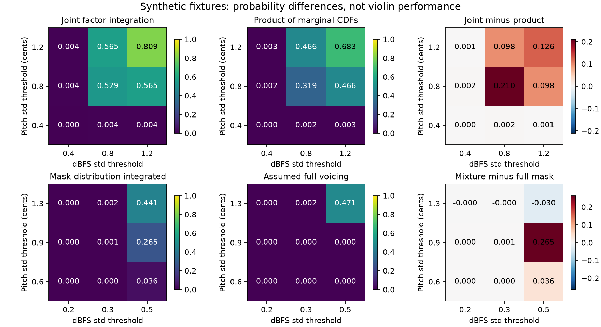

# 공동 변동량 decoder: 첫 수치 관문 통과

2026-11-02. **고정한 합성 수치 감사의10개 기준을 모두 통과했다.** 이는 제한된 모형의 계산·1차 미분이 동작한다는 결과다. 새 바이올린 예측 성능이나 높은 방법론 신규성을 입증한 결과가 아니다. 실제자료·source정답·olddev/test정답·기존예측/가중치를사용하지않았고새모델학습은0건이다.

## 실행과 결과

단위시험8개와별도AI소스/수학검토후코드5개·계약·환경·선행문서해시를동결하고감사를한번실행했다. 실행전공유ledger에1개수치감사시도를등록했고,10개기준통과상태와1.325초를기록했다. 같은감사를재실행하거나기준을완화하지않았다.

| 검증 | 최대 차이/결과 |
|---|---:|
| 알려진 독립 Gaussian 특수사례의 이론값 대조 | 5.56×10⁻¹⁶ |
| 적분 order256 대512 | 7.52×10⁻⁸ |
| 독립 경로표본(QMC)16개 고정 대조의 최대 확률 차이 | 0.001983 |
| CDF 입력/비중심성 gradient64개 | 사전 abs/relative기준 모두통과 |
| 경로 amplitude/lognoise/masklogit gradient9개 | 사전기준 모두통과 |
| 10패턴 확률 정합성 | 모든cell mass 비음수 |
| 프레임상수 mean/loading 변경의 분산분포 불변성 | 1.12×10⁻¹⁶ |
| voiced22개 invalid 대23개 valid | 기대대로동작 |

QMC는4fixture×2표본크기×2scramble의16개를모두보고했다. 유리한seed를선택하지않았다. 표본크기증가에따라오차가단조감소한것은아니며,위0.001983은엄밀한QMC오차상한이아니다. 정규tail질량 \(2\Phi(-8)\)은omitted forward확률만제한하며quadrature오차나gradient tail을증명하지않는다. Gradient는잘린수치구현의유한차분과일치했고전체분포gradient를인증한것이아니다.

한예시의CPUfloat64 forward+backward중앙값은약 **4.15ms**였다. 작은고정fixture의5반복측정이며실제모델학습·큰batch·고rank·GPU속도주장은아니다.

별도결과검토에서불일치0건이었다. 10기준중8개는저장한수치행렬/gradient값으로재계산했고,constant-shift불변성과guard경계2개는요약값·소스검토근거만남아있다. 개별5회timing도저장하지않아4.15ms는기록된중앙값이다. 이증거한계를보존하고중간값을채우기위해감사를다시돌리지않았다.

## 독립 가정과 누락 처리가 중요한 합성 반례

- sharedfactor가있는경우, **두무조건부주변CDF를곱하면** 공동확률과최대 **0.210398** 차이가났다.
- 미래voicing mask혼합을무시하고항상fullmask로두면공동확률이최대 **0.264838** 달라졌다.

이는알고리즘의실제성능을21%/26%올렸다는수치가아니다. 잘못된계산과선언한합성모형의올바른joint계산사이에생기는 **절대확률오차**다. 두채널과mask를함께다룰필요성을보여준다.

## 무엇이 성립했고 무엇이 남았는가

조건부iid·채널별등분산Gaussian혁신,1차원sharedfactor,혁신과조건부독립인finitefuturemask라는범위에서 **공동분산질의를미분가능한연산으로계산하는구현**을얻었다. [수식과가정](METHOD.md), [원점수](RESULTS.json), [결과봉인](RESULTS_SEAL.json)을보존한다. 이것은고전분포/적분/미분성질을결합한프로토타입이며신규성은아직확보하지않았다.

실제관측기의voicing이경로값/신뢰도에의존하는선택,시간상관혁신,더높은factor rank,생소한futuremask패턴은검증하지않았다. 실제바이올린에이제약이적절한지확인한것도아니다. 다음은별도source-only경로자료감사다. 실제futuremask를입력으로주는편법이나invalid제외없이학습할수있는모형을만들어야하며,추가path감독을받는MDN대조와새학습계약을먼저설계한다.
