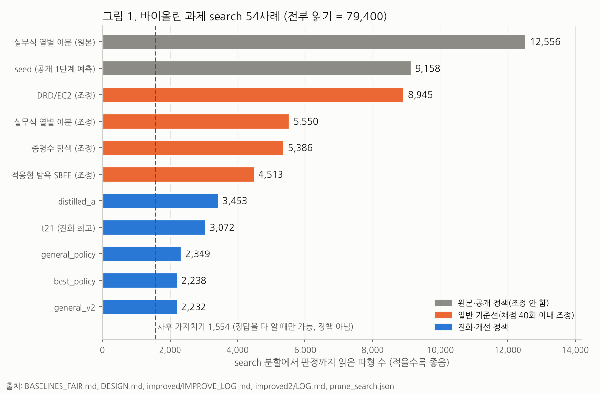
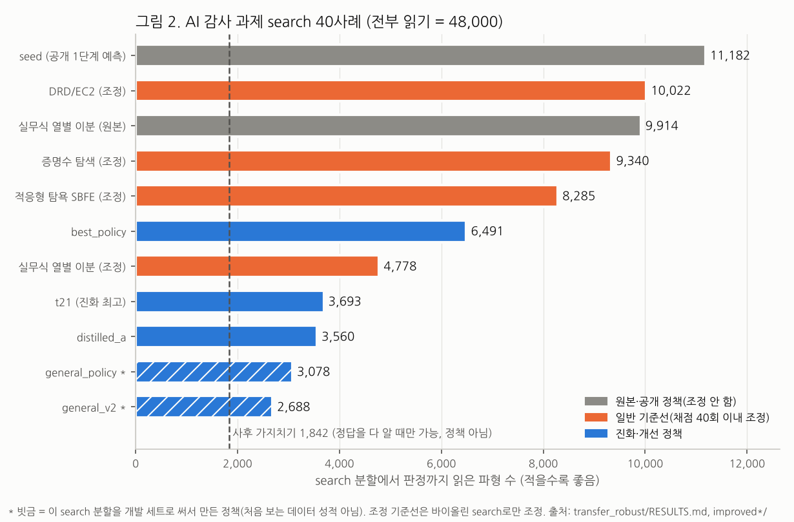

# evolve_v4 결과 보고 v2 (2026-11-05)

이 문서는 2026-11-04 `REPORT_KO.md`를 대신한다. 옛 보고서는 그대로 둔다.
프로젝트의 두 질문에 답한다.

1. "여기에 정보기술을 왜 꼭 써야 하는가?"
2. "그래서 이거 어따 써먹는데? 쓸모없는 거 아냐?"

숫자는 저장소 파일에 적힌 것만 쓴다. 숫자마다 대괄호로 출처를 붙였다. 출처 약어는 맨 끝 표에 있다.
봉인 holdout(바이올린 C/D, AI 감사 그룹 2–3)은 이 보고서를 쓰면서 열지 않았다.

---

## 한 줄 요약

**같은 정확한 판정을 내리면서, 진화·개선한 질의 정책은 search 분할에서 파형을 2,232회만 읽는다. 공정하게 조정한 실무식 방법(5,550회)보다 59.8%, 가장 좋은 조정 일반 기준선(4,513회)보다 50.5% 적다** [L2, BF, V]. 다른 분야(AI 모델 감사)에서도 덜 읽었다. 다만 그 숫자 중 가장 좋은 것은 개발에 쓴 데이터의 성적이다. 처음 보는 데이터(봉인 holdout)는 아직 열지 않았다. 지금 저장소처럼 이미 녹음된 자료만 다시 볼 때는 절약이 몇 분 수준이라 작다. 쓸모는 읽기 한 번이 비쌀 때(새 측정, 비싼 모델 평가) 생긴다. 그런 상황에서 실제로 보인 적은 아직 없다.

---

## 0. 먼저 알아 둘 것: "바이올린" 데이터의 정체

- 이 문서의 "바이올린 과제"는 프로젝트 이름을 따른 것이다.
- 실제 측정 자료는 **공개 로봇 운궁 첼로 현 자료**(A. Lampis, Zenodo)다. 바이올린 녹음은 쓰지 않았다 [JR].
- 판정 문제의 구조(9개 규칙, 기울기 −2 법칙)는 바이올린 연구 질문에서 왔다. 데이터는 첼로 현이다.

---

## 1. 무슨 문제인가

### 1.1 표 한 장으로 보기

- 한 사례는 표 한 장이다.
  - **열** 하나 = 활 위치(β) 하나. 사례마다 열이 13~40개다(중앙값 30) [SS].
  - 열마다 **파형 50개**가 있다. 같은 위치에서 힘을 바꿔 가며 그은 녹음이다. 힘 순서로 줄 세웠다 [SS, PA].
- **읽기 1회** = 파형 하나를 열어 자동 판정을 돌리는 것이다.
  - 한 번 읽으면 그 파형에 대해 **9개 판정 규칙의 라벨(0 또는 1)이 한꺼번에** 나온다 [OP, PA].
- 열마다 "경계"가 있다. 힘 순서로 보아 **처음으로 1이 두 번 연속 나오는 곳**이다 [PA].

### 1.2 인증서가 정하는 것 (예/아니오)

- 질문: "9개 규칙 중 **하나라도**, 모든 열의 경계가 기울기 −2 법칙(Schelleng)의 직선과 허용 폭 ε 안에서 맞는가?" [PA, D].
- ε는 0.2와 0.4 두 가지다. 한 폴더를 ε마다 따로 판정하므로 search 분할은 27폴더 × 2 = **54사례**다. 그중 "맞다(양립)"가 4사례다 [SS, D].
- 전부 읽으면 답이 나온다. search 54사례를 전부 읽으면 **79,400회**다 [SS].
- 대부분은 일부만 읽어도 답이 정해진다. 정해졌는지는 **고정된 정확 검증기(인증서)**가 판단한다.
- **정책**이 하는 일은 "다음에 어느 파형을 읽을지" 고르는 것뿐이다. 점수는 답이 정해질 때까지 읽은 수다. 적을수록 좋다.

### 1.3 왜 "틀려서 줄이기"가 안 되나

- 채점기는 정책이 멈춘 지점의 판정을 전체 판정과 비교한다. 다르면 오류로 멈춘다(AssertionError) [D §7 1세대 결과].
- 그래서 점수를 줄이는 방법은 "필요한 파형만 읽기" 하나뿐이다.
- 정책이 볼 수 있는 것은 공개 좌표(힘 순위, β 등)와 **이미 읽은 라벨**뿐이다(labels-only). 가드가 이를 검사한다 [D, L2 §채점·규칙].

---

## 2. 질문 1: 왜 꼭 정보기술을 써야 하나

### 2.1 사람이 쓰는 방법과 비교 (search 분할만)

그림 1: `figs/fig1_violin_search.png`



| 정책 | 어떻게 만들었나 | 조정에 쓴 채점 수 | search 읽기 | ε0.2 / ε0.4 | 조정 실무식 대비 | 출처 |
|---|---|---|---:|---|---:|---|
| 전부 읽기 | — | — | 79,400 | — | — | [SS] |
| 실무식 열별 이분 `bisect_each` (원본) | 사람이 흔히 쓰는 방법: 열마다 경계를 이분 탐색 | 0 | 12,556 | 5,049 / 7,507 | +126% | [BF] |
| seed (공개 1단계 예측) | 11/03 공개 정책 | — | 9,158 | 3,858 / 5,300 | +65% | [D, BF, V] |
| DRD/EC2 (조정) | 일반 기준선 | 26 | 8,945 | 3,630 / 5,315 | +61% | [BF] |
| **실무식 열별 이분 (조정)** | 위 원본을 공정 조정 | 31 | **5,550** | 1,789 / 3,761 | 0 | [BF, V] |
| 증명수 탐색 (조정) | 일반 기준선 | 29 | 5,386 | 1,724 / 3,662 | −3.0% | [BF] |
| **적응형 탐욕 SBFE (조정)** | 일반 기준선 중 최고 | 30 | **4,513** | 1,782 / 2,731 | −18.7% | [BF, V] |
| t21 | LLM 작업자 진화 + 제거 실험 | 수백 회 선택 | 3,072 | 972 / 2,100 | −44.6% | [D, V] |
| general_policy | t21에서 개선(시도 34개) | — | 2,349 | 749 / 1,600 | −57.7% | [IL, V] |
| best_policy | t21에서 개선(바이올린 전용) | — | 2,238 | 751 / 1,487 | −59.7% | [IL, V] |
| **general_v2** | general_policy에서 개선(시도 20개) | — | **2,232** | 747 / 1,485 | **−59.8%** | [L2, V] |
| (참고) 사후 가지치기 | seed가 읽은 칸 중, 정답을 다 아는 사람이 빼도 되는 칸을 뺀 수 | — | 1,554 | 524 / 1,030 | 정책 아님 | [PS, D §7] |

- "조정 실무식 대비" 열은 이 보고서에서 계산했다(1 − 정책/5,550).
- 가장 좋은 조정 기준선(4,513)과 비교하면 general_v2 −50.5%(이 보고서 계산), best_policy −50.4%, general_policy −47.9%, t21 −31.9%다 [D, BF].
- 코랩 자동 진화의 search 최고 숫자는 acct3 2,230, acct2 원래 엔진 2,234다. ShinkaEvolve 2차 실행은 제안 3개째에 2,217이었다 [D 11-05 "코랩 대표"]. 이 셋은 이 보고서에서 다시 채점하지 않았다. 그래서 "진화·개선 정책 2,217~2,349"라는 범위에서 2,217~2,234는 원장 숫자 그대로다.
- 참고로, 예전 정책 t2는 11/03에 봉인 C/D를 한 번 열어 seed 3,635회 → 1,452회(−60.1%)를 기록했다 [D §7 봉인 holdout 1회]. 이번 정책들(2,232 등)은 아직 holdout 성적이 없다.

### 2.2 왜 손으로는 안 되나

**(가) 정책의 경우의 수가 너무 많다.**

- 정책은 "지금까지 읽은 칸과 그 값"을 보고 다음 칸을 고른다. 그 상태의 수는 대략 (K+2)^(C·R)이다 [OP 1절]. K = 규칙 수, C = 열 수, R = 열당 파형 수다.
- 작은 합성 문제에서 **정확한 최적 정책**을 계산해 봤다 [OP 크기 확장 결과].
  - 풀린 가장 큰 크기: 열 2개 · 파형 8개 · 규칙 2개(정확 최적)와 열 2개 · 파형 7개 · 규칙 3개.
  - 열 2개 · 파형 12개 · 규칙 3개는 메모리 15GB를 넘어 시도하지 못했다.
- 실제 search 사례의 중앙값은 열 30개 · 파형 50개 · 규칙 9개다 [SS]. 위 식에 넣으면 11^1500 ≈ 10^1562개 상태다(이 보고서에서 [OP]의 식으로 계산). 정확히 푼 크기(4^16 ≈ 4.3×10^9)와 비교가 되지 않는다.
- 그래서 최적을 직접 계산할 수 없다. 남는 길은 **좋은 정책 프로그램을 찾아 자동 채점기로 거르는 것**이다. 이것이 진화형 탐색 루프가 하는 일이다.

**(나) 사람의 손 조정은 빨리 평평해진다.**

- 실무식 이분 탐색은 채점 31회로 12,556 → 5,550까지 좋아졌다 [BF].
- 일반 기준선 4종은 방법마다 26~31회 조정 뒤 개선이 평평해졌다. 마지막 5회 중 최고 기록을 바꾼 것은 적응형 탐욕의 4,524 → 4,513 하나뿐이었다 [BF 공정성 한계].
- 그 조정에는 진화 정책에서 읽은 원리(아래부터 0 쓸기, 분리 쌍 하나)까지 일부 들어갔다. 그래도 4,513에서 멈췄다 [BF 결론 먼저].
- 진화·개선 쪽은 수백 회 선택(맥 작업자), 시도 34개(improved), 시도 20개(improved2)를 거쳤다 [D, IL, L2]. 차이를 만든 장치는 사람이 처음부터 떠올리기 어려운 것들이다. 예: "고립 양성 하나로 열을 버리지 않는 덮개 판정"(t21 위에서 −621회) [IL].

**(다) 사례마다 다르게 움직여야 한다.**

- 두 데이터의 라벨 성질이 정반대다 [IL 3.1].

  | | 바이올린 search | AI 감사 search |
  |---|---|---|
  | 양성 위쪽에 0이 있는 행(단조성 위반) | 87% | 0.1% |
  | 첫 쌍 아래에 고립 양성이 있는 행 | 64% | 0% |

- 바이올린에 맞춘 best_policy는 바이올린 2,238이지만 AI 감사에서는 6,491로 t21(3,693)의 1.76배다 [IL 3.1].
- 고정된 규칙 하나로는 두 데이터를 다 잘할 수 없다. general_policy와 general_v2는 **사례 안에서** "양성 위에서 0을 봤는가"라는 한 비트를 보고 방식을 바꾼다 [IL 3.2, L2]. 바이올린에서는 이 신호가 대부분 2~18번째 읽기에 나오고, 늦은 세션은 38~58번째다 [IL 시도 33].
- 장치끼리도 얽혀 있다. 예: general_v2에서 단조 장벽을 끄면 바이올린 +52, AI 감사 −24다. 확률 탐침을 끄면 +99, −43이다 [L2 §3]. 한 장치의 효과가 데이터와 다른 장치에 따라 바뀐다. 이런 조합을 손으로 맞추기는 어렵다.

### 2.3 그래도 최적은 아니다 (최적성 연구)

작은 합성 문제(열 C=2)에서 정확한 최적 정책과 비교했다 [OP]. 값은 "최적 대비 기대 읽기 비율"이다. 1이면 최적이다.

| 크기 C×R×K | 최적 평균 읽기 | seed | distilled | t21 (+k0) | t9 (+k0) | 1단계 탐욕(LB) |
|---|---:|---:|---:|---:|---:|---:|
| 2×5×2 | 3.528 | 1.215 | 1.303 | 1.333 | 1.373 | 1.039 |
| 2×8×2 | 4.434 | 1.332 | 1.492 | 1.499 | 1.426 | 1.086 |
| 2×10×2 | 6.037~6.041 | 1.418~1.420 | 1.519~1.522 | 1.519~1.521 | 1.461~1.463 | 1.198~1.199 |
| 2×12×2 (3/4사례) | 5.645~5.735 | 1.438~1.463 | 1.394~1.419 | 1.382~1.407 | 1.381~1.406 | — |
| 2×10×3 | 6.370~6.504 | 1.509~1.549 | 1.478~1.519 | 1.476~1.517 | 1.450~1.490 | — |

출처: [OP 결과 표]. "+k0"는 처음 8번을 seed에 맡기는 장치를 끈 것이다.

- **진화 정책은 최적의 1.30~1.52배에 머문다.** R이 커져도 1로 다가가지 않는다 [OP 한 줄 답].
- 좁혀지는 것은 진화 정책과 seed의 차이다. seed가 더 빨리 나빠지기 때문이다 [OP].
- 따라서 **아직 줄일 여지가 남아 있다.**
- 주의 [OP 해석·실패와 한계]:
  - 열이 2개뿐이다. 실제 사례(열 13~40개)에서 진화 정책이 이득을 본 조건과 다르다.
  - 최적 정책과 LB는 생성기의 사전분포를 안다. seed와 진화 정책은 모른다.
  - 이 연구에 쓴 정책은 t21·t9·distilled다. best_policy·general_v2는 합성 문제에서 재지 않았다.
  - 실데이터의 사후 가지치기 1,554를 이 비율로 환산해 "실데이터 최적은 얼마"라고 말하면 안 된다 [OP 해석 5].

### 2.4 질문 1에 대한 답

- 최적을 계산으로 구할 수 없을 만큼 경우의 수가 크다.
- 사람이 쓰는 방법은 공정하게 조정해도 5,550(실무식)·4,513(일반 기준선 최고)에서 멈췄다.
- 프로그램을 자동으로 만들고 정확한 채점기로 거르는 방식은 2,232까지 내려갔다.
- 같은 판정을 유지하는 정확 검증기가 있기 때문에, 이 방식으로 얻은 개선은 "틀려서 줄인 것"이 아니다.
- 다만 이것은 search 분할의 숫자이고, 최적까지는 아직 거리가 있다.

---

## 3. 질문 2: 어디에 쓰나

### 3.1 두 번째 분야로 옮겨 보기: AI 모델 감사

같은 인증서를 그대로 AI 문제에 붙였다 [TR].

- 모델: 공개 MNIST로 학습한 작은 CNN(시험 정확도 98.36%).
- 사례: 같은 숫자의 이미지 24장 묶음 × ε.
- 질문: "경사 한 번으로 구한 싼 강건성 점수가, 이 묶음의 가우스 잡음 파괴점을 e^ε배 안에서 맞히는가?"

| 바이올린 | AI 감사 |
|---|---|
| 열 | 이미지 |
| 힘 순위 50개 | 잡음 세기 σ 50단계(0.03~3) |
| 읽기 1회 | 그 σ에서 잡음 이미지 64장 추론 |
| 규칙 9개 | 실패율 하한 3개 × 정답 확률 상한 3개 |

출처: [TR 문제].

그림 2: `figs/fig2_ai_audit_search.png`



| 정책 (AI 감사 search 40사례, 전부 읽기 48,000) | 읽기 | 이 데이터를 개발에 썼나 | 출처 |
|---|---:|---|---|
| seed | 11,182 | 아니오 | [TR] |
| 실무식 열별 이분 (원본) | 9,914 | 아니오 | [TR] |
| DRD/EC2 / 증명수 / 적응형 탐욕 (조정) | 10,022 / 9,340 / 8,285 | 아니오(바이올린으로만 조정) | [TR 추가, D, V(8,285)] |
| **실무식 열별 이분 (조정)** | **4,778** | 아니오(바이올린으로만 조정) | [TR 추가, D, V] |
| best_policy | 6,491 | 아니오 | [IL, TR] |
| t21 | 3,693 | 아니오 | [TR] |
| distilled_a | 3,560 | 아니오 | [TR] |
| general_policy | 3,078 | **예**(시도 27번부터) | [IL] |
| **general_v2** | **2,688** | **예**(시도 1~19 전부) | [L2, V] |
| (참고) 사후 가지치기 | 1,842 | 정답을 다 알 때만 가능 | [TR] |

- **깨끗한 비교**(AI 감사 데이터를 한 번도 안 본 정책끼리): t21 3,693, distilled_a 3,560은 가장 좋은 조정 기준선 4,778보다 22.7%, 25.5% 적다(이 보고서 계산; [TR]은 "23~25%").
- **개발 세트 숫자**: general_v2 2,688은 4,778보다 43.7% 적다(이 보고서 계산). 하지만 이 search 분할을 보면서 만들었으므로 처음 보는 데이터의 성적이 아니다 [L2 §5].
- 옮겨 간 것은 원리(규칙마다 분리 증인을 정하고 확인, 사례 안에서 라벨 성질을 보고 방식 바꾸기)다. 바이올린 전용 개선(best_policy)은 옮겨 가지 않았다 [TR 추가, IL].

### 3.2 읽기 1회는 얼마인가

| 분야 | 읽기 1회 | 저장소에 기록된 비용 | 출처 |
|---|---|---|---|
| 바이올린 과제(로봇 첼로 현 자료) | 녹음된 시행 하나 + 자동 판정 | Part 1 첫 시행 길이 2.16 / 3.16 / 5.16초(50 kHz라고 가정할 때). 판정 창 약 0.4초. 속도 폴더 하나에 시행 2,000개 | [DC] |
| 〃 | 〃 | 속도 폴더 하나를 풀면 17~24 GiB, 캐시는 시행당 약 320 KB | [CO] |
| 〃 | 〃 | 합성 시행 하나(14.9 MB)의 파싱 + 시행 분석 74 ms(pyarrow) / 269 ms(numpy), Mac M2 | [VA] |
| 〃 | 〃 | **이 과제의 실제 파형 처리 비용은 따로 재지 않았다.** 비용 단위는 저장된 파형의 조회 횟수다 | [FR] |
| AI 감사 | 한 이미지, 한 σ에서 잡음 이미지 64장 추론 | 이 데모에서는 싸다. 실제 감사에서는 공격 한 번(PGD·AutoAttack, 수백 번 순전파·역전파), 유료 API 호출, 물리 시험이 읽기 1회가 된다. 시간·금액은 재지 않았다 | [TR 주의] |

### 3.3 절약을 식으로 쓰기 (가정을 밝힘)

**식:** 절약 = (기준 정책의 읽기 수 − 새 정책의 읽기 수) × (읽기 1회 비용 c)

바이올린 search(54사례)에서 읽기 수 차이(이 보고서 계산, 숫자 출처는 2.1절 표):

| 비교 | 읽기 차이 | 사례당 평균 |
|---|---:|---:|
| 조정 실무식 5,550 − general_v2 2,232 | 3,318 | 61.4 |
| 조정 기준선 최고 4,513 − general_v2 2,232 | 2,281 | 42.2 |
| 전부 읽기 79,400 − general_v2 2,232 | 77,168 | 1,429.0 |

예시 계산(조정 실무식 대비 3,318회):

| 가정 | c | 절약 |
|---|---|---|
| 가정 A: 이미 녹음된 파형을 다시 처리만 함. c = [VA]의 합성 시행 처리 시간 | 0.074~0.269초 | 약 4~15분 |
| 가정 B: 읽을 때마다 로봇이 새로 한 번 긋는다. c = [DC]의 시행 길이, 준비·이동 시간 0 | 2.16~5.16초 | 약 2.0~4.8시간(활 긋는 시간만 센 하한) |

- 가정 A에서는 절약이 작다. **지금 저장소처럼 이미 모든 녹음을 가진 상황에서는 이 연구의 실익이 거의 없다.**
- 가정 B는 측정 계획에 쓸 때의 그림이다. 다만 54사례는 27폴더 × ε 2개다. 채점기는 ε마다 따로 세지만 [D §7 평가기 보강], 실제 측정에서는 두 ε가 같은 파형을 나눠 쓸 수 있다. 그러면 실제 절약은 더 작을 수 있다.
- 준비·이동·현 교체 시간은 저장소에 기록이 없어 넣지 않았다.

AI 감사 search(40사례, 읽기 1회 = 추론 64장 [TR]):

| 비교 | 읽기 차이 | 추론 장수 차이 (×64) |
|---|---:|---:|
| 조정 실무식 4,778 − distilled_a 3,560 (깨끗한 비교) | 1,218 | 77,952 |
| 조정 실무식 4,778 − general_v2 2,688 (개발 세트) | 2,090 | 133,760 |

- 읽기 1회가 공격 한 번이라면 절약 = 1,218 × (공격 1회 비용)이다. 공격 1회 비용은 기록이 없어 숫자로 쓰지 않는다.

### 3.4 누가 쓸 수 있나 (과장 없이)

- **측정 계획.** 측정 하나가 비싸고, "이 법칙이 맞나?"를 예/아니오로 **정확히** 확정해야 할 때. 다음에 무엇을 잴지 고르는 데 쓴다. 조건이 있다. 판정이 이 인증서 구조(열마다 첫 경계, 기울기를 정한 직선, 허용 폭)로 쓰여야 한다.
- **AI 모델 감사.** "싼 강건성 점수가 실제 강건성을 맞히는가"를 비싼 평가를 덜 하고 확인할 때. 지금까지는 MNIST CNN 1개, 가우스 잡음 1종에서만 확인했다 [TR 주의].
- **쓸 수 없는 경우.**
  - 데이터를 이미 다 가진 경우(절약이 분 단위).
  - 인증서 구조가 다른 판정. 정책을 다시 만들어야 한다.
  - 통계적 결론. 이 인증은 정해진 라벨에 대한 정확 판정이지, 잡음 모형을 세운 추론이 아니다.
- 대응 관계는 구성상 같은 꼴이다. 어떤 법칙 log t* = s·x + c든 같은 틀에 넣을 수 있다. 주장 범위는 "같은 인증서 구조를 가진 다른 분야로 옮겨 간다"까지다 [TR 주의].
- 새로운 일반 알고리즘이라고 주장하지 않는다. 이 문제는 확률적 불리언 함수 평가(SBFE)·순차 검사의 한 사례다 [PA].

### 3.5 질문 2에 대한 답

- "쓸모없는 거 아냐?" → **지금 저장소 안에서는 절약이 작다.** 이미 녹음된 파형을 다시 볼 뿐이기 때문이다.
- 쓸모는 읽기 한 번이 비쌀 때 생긴다. 새 측정을 계획할 때, 비싼 모델 평가로 감사할 때다. 그때도 판정은 전부 읽은 것과 같다.
- 두 번째 분야(AI 감사)에서도, AI 감사 데이터를 한 번도 보지 않은 정책(t21, distilled_a)이 가장 좋은 조정 기준선보다 23~25% 덜 읽었다 [TR]. 다만 이것도 holdout이 아니라 search 분할의 숫자다.
- 실제로 비싼 측정이나 비싼 감사에서 시간·돈을 줄인 것을 보인 적은 아직 없다.

---

## 4. 어떤 탐색 루프를 썼나, 최신 수준인가

### 4.1 단계별로

| 단계 | 무엇을 했나 | search 결과 | 출처 |
|---|---|---|---|
| 0층 관문 | 개선 여지를 먼저 잼. 정답을 알고 사후 가지치기하면 seed 읽기의 75~94%가 불필요 → 진행. 첼로 미래 예측(과제 B)은 여지 약 12%라 보류 | — | [D §7] |
| 맥 작업자 라운드(11/03~11/05) | 상용 LLM 작업자가 정책 코드를 쓰고 search로 몇 번 자기 채점. 엔진이 다시 채점해 원장(SQLite)에 기록 | 9,158 → t2 3,321 → t9 3,157 → t16 3,142 | [D §7] |
| t16 해부(제거 실험) | 장치를 하나씩 끔. 덮개 경로를 끄면 오히려 좋아짐 | 3,072(t21) | [D 11-05 00시] |
| 분석 도구를 쓴 개선 세션 | 정답 라벨을 쓰는 **분석 전용** 도구로 낭비를 찾고, 정책 파일은 라벨만 씀. 실패 포함 모두 기록 | 2,238 / 2,349(시도 34개) → 2,232(시도 20개) | [IL, L2] |
| 코랩 자동 진화(11/04~) | 코랩 Pro+ 계정 3개. 공개 모델(vLLM, Qwen3.8-27B-FP8 등)이 코드 변이, 섬 4개·이주·진단·중복 제거·원장. search 54사례만 담은 번들 | acct2 2,234, acct3(ε 안 봄) 2,230 | [D 11/04 코랩, 11-05] |
| ShinkaEvolve 비교 | 공개 최신 진화 루프와 같은 모델·채점기로 비교 | 진행 중 | [D 11-05 Shinka] |

- 코랩 마감 규칙: 런타임이 끝날 때까지 어느 계정도 2,193 이하가 없으면 코랩을 멈춘다 [D 11-05 봉인 순서].
- acct2의 제안 개수는 저장소 문서에 기록이 없어 적지 않는다.

### 4.2 ShinkaEvolve 비교 (판정 없음)

- **같게 맞춘 것**: 모델(Qwen/Qwen3.8-27B-FP8, temperature 1.0), 채점기(번들 search 54사례, labels-only 가드), 과제 설명, 사례별 힌트, 동시 제안 8개 [D].
- **비대칭**: Shinka는 시작 프로그램을 하나만 받아 c1(2,238)로 시작한다. 우리 엔진은 c1·c2와 예전 개체군을 같이 받는다. 우리 쪽에 유리하다 [D].
- **판정 기준(사전 등록)**: 처음 100/200/300개 제안 안의 최고 search 읽기. 300개 시점 차이가 22회(1%) 안이면 "같음". Shinka가 22회 넘게 나으면 "우리 루프는 최신 수준이 아님"으로 적고 남은 코랩을 Shinka로 바꾼다 [D].
- **1차 실행은 무효**(11-05 02:31~04:45 UTC, 2번 계정) [D]. 이유 셋:
  1. 칸을 여러 번 실행해 Shinka 3개가 같은 DB에 동시에 썼다.
  2. 작업 시간 제한을 제안 작성 시작부터 쟀다. 그래서 10분 제한에 걸려 9/14개 제안이 채점되지 않고 0점이 됐다.
  3. 임베딩 모델(MiniLM)이 앞 256토큰만 읽어 c1 자손을 모두 유사도 1.0으로 봤다.
  - 1차는 채점 통과 5개, 최고 3,157이었지만 비교에 쓰지 않는다.
- **처리량**: 세대 하나에 평균 약 28분. 이 속도면 300제안에 15~20시간 [D].
- **2차 실행은 진행 중이다.** 등록 시점에 제안 3개째 2,217이었다 [D]. **아직 판정하지 않는다.**

### 4.3 최신 수준인가

- **모른다.** 비교가 끝나지 않았다. 판정 규칙은 결과를 보기 전에 적어 두었다 [D].
- 지금까지 가장 좋은 숫자(2,232 등)는 완전 자동 루프가 아니라, 분석 도구를 쓴 개선 세션에서 나왔다 [IL, L2]. 코랩 자동 루프는 2,238짜리 시작점에서 출발해 2,230~2,234에 있다(acct2 원래 엔진과 Shinka의 시작점은 [D]에 적힌 대로이고, acct3의 시작 개체군은 이 보고서에서 확인하지 않았다).
- 문헌 조사에서 "인증 문제의 적응 질의 정책을 진화시킨 연구"는 찾지 못했다. 하지만 검색이 얕았으므로 "없다"가 아니라 "못 찾음"이다 [PA 2차 조사]. 새로움을 주장하지 않는다.

---

## 5. 정직한 한계

| 한계 | 내용 | 출처 |
|---|---|---|
| 개발 세트 재사용 | AI 감사 search를 general_policy(시도 27번부터)와 general_v2(전부)의 개발에 썼다. 3,078·2,688은 처음 보는 데이터 성적이 아니다 | [IL 3.2, L2 §5] |
| 같은 데이터로 조정·선택·보고 | 기준선과 정책 모두 search 54사례로 고르고 보고했다. 둘 다 낙관적이다 | [BF 공정성 한계] |
| 단일 실행 | 코랩·Shinka 실행은 각 1회. general_v2의 작은 이득(시도 13 −13, 시도 19 −30)은 잡음일 수 있다. DRD/EC2는 시드만 바꿔도 8,945 → 10,344 / 11,516 | [D, L2 §5, BF] |
| holdout 미개봉 | 바이올린 C/D와 AI 감사 그룹 2–3 모두 이번 정책으로 열지 않았다. C/D는 11/03에 이미 한 번 열린 폴더다. 다시 열면 "두 번째 열람"이고 독립 확증이 아니다 | [D §7, 11-05] |
| 기준선 조정 비대칭 | 기준선은 방법당 26~31회, 진화는 수백 회. 조정 스위치에 진화 정책의 원리가 일부 들어가 기준선은 낙관적인 쪽이다 | [BF] |
| 기계 차이 | 증명수 원본이 맥 6,526, 클라우드 x86 6,800. 사례당 시간도 기계마다 다르다(general_v2 최대 0.68초 [L2] vs 이번 재채점 1.08초 [V]) | [BF, L2, V] |
| 최적성 연구의 범위 | 열 2개 합성 문제뿐. 쓴 정책도 t21·t9·distilled뿐. 최적 정책은 사전분포를 안다 | [OP] |
| 읽기 비용 미측정 | 실제 파형 처리 비용, 로봇 준비 시간, 공격 1회 비용 모두 재지 않았다 | [FR, TR] |
| 데이터 이름 | "바이올린" 과제의 측정 자료는 로봇 첼로 현 자료다 | [JR] |
| 문서 사이 불일치 | [TR]은 holdout을 열 때 seed·distilled_a·t21·general_policy·best_policy·코랩 3번 계정 최고를 함께 연다고 적었다. 더 나중의 [D 11-05]는 후보 4개를 등록했다. 이 보고서는 [D 11-05]를 따른다. 어느 쪽을 쓸지는 연구 책임자가 확인해야 한다 | [TR 추가·재현, D 11-05] |

---

## 6. 봉인 평가 (아직 열지 않음)

### 6.1 사전 등록된 후보 4개 [D 11-05]

| 순위 | 후보 | search 바이올린 / AI 감사 |
|---|---|---|
| 1 | `improved2/general_v2.py` (대표 주장) | 2,232 / 2,688 |
| 2 | `improved/general_policy.py` | 2,349 / 3,078 |
| 3 | `improved/best_policy.py` | 2,238 / 6,491 |
| 4 | 코랩 대표 (아직 정해지지 않음) | — |

**코랩 대표를 뽑는 규칙** [D 11-05 "코랩 대표"]:
- 코랩을 멈추는 시점(런타임 종료 또는 마감 규칙)에 뽑는다.
- 유효한 원장 전체(acct1, acct2 원래 엔진, acct2_shinka 2차, acct3_noeps)에서 search 최고 하나. Shinka 1차(`acct2_shinka_dup*`)는 무효라 뺀다.
- 동점이면 먼저 채점된 것.
- 맥에서 labels-only 가드와 번들 채점기로 다시 채점한다. 원장과 다르면 맥 숫자를 쓰고 차이를 적는다. 가드에 걸리면 다음 순위.

### 6.2 판정 규칙 [D 11-05]

- 네 후보를 **한 번에** 연다. 네 숫자를 모두 보고한다. 연 뒤에 순위를 바꾸거나 고르지 않는다.
- 답할 질문: 공개 27B 모델로 자동 진화시킨 정책이, 분석 도구로 만든 general_v2보다 처음 보는 데이터에서 나은가? (= "코랩이 낭비였나")
  - **바이올린 C/D**: 코랩 대표가 general_v2보다 1% 넘게 적게 읽으면 "코랩 쪽이 낫다". 1% 넘게 많이 읽으면 "general_v2가 낫다". 그 사이면 "같음".
  - **AI 감사 holdout(그룹 2–3)**: 두 번째 검사로 같은 1% 기준. general_v2는 AI 감사 search를 개발에 썼고 코랩은 쓰지 않았다. 그래서 이 비교는 코랩 쪽에 불리한 조건이다.
  - 코랩 대표가 AI 감사 채점기에서 돌지 않으면 실패로 적는다.
- 바이올린 C/D는 11/03에 한 번 열렸다. 이번은 "두 번째 열람"으로 적는다 [D §7]. 그때 seed는 C/D에서 3,635회(910 / 2,725)였다 [D §7].

### 6.3 결과 표 (열면 채움)

| 후보 | 바이올린 C/D ε0.2 | ε0.4 | 합계 | AI 감사 holdout ε0.2 | ε0.4 | 합계 | 비고 |
|---|---:|---:|---:|---:|---:|---:|---|
| general_v2 | | | | | | | |
| general_policy | | | | | | | |
| best_policy | | | | | | | |
| 코랩 대표 (    ) | | | | | | | |
| 판정: 코랩 대표 vs general_v2 | | | | | | | |

---

## 7. 재현

### 7.1 핵심 search 숫자 다시 채점

채점기에 `threadpoolctl`이 필요하다(코드 변경 없음).

```bash
pip install threadpoolctl
```

바이올린 search(54사례):

```bash
cd agentic_research/evolve_v4/colab/bundle && python -m agentic_research.evolve_v4.colab_eval ../../improved2/general_v2.py
```

AI 감사 search(40사례):

```bash
cd agentic_research/evolve_v4/colab/bundle_robust && python -m agentic_research.evolve_v4.colab_eval ../../improved2/general_v2.py
```

같은 명령에서 파일만 바꾸면 된다: `../../improved/best_policy.py`, `../../improved/general_policy.py`, `../../seed_a.py`, `population/p25_t21.py`(bundle 안), `../../baselines/tuned/bisect_each_tuned.py`, `../../baselines/tuned/adaptive_greedy_tuned.py`. [L2]는 바이올린을 `colab/bundle_noeps`로 채점했다(ε를 읽는 정책을 거부하는 가드). general_v2는 두 번들에서 같은 2,232다 [L2, V].

### 7.2 분할 크기와 그림

```bash
python agentic_research/evolve_v4/figs/split_size.py
```

```bash
pip install matplotlib koreanize-matplotlib
```

```bash
python agentic_research/evolve_v4/figs/make_figs.py
```

- `split_size.py`는 두 번들의 search 사례 파일만 읽고 sha256을 확인한다. holdout 파일은 읽지 않는다.
- `make_figs.py`의 숫자는 모두 저장소 문서에서 옮겼다. 줄마다 출처를 주석으로 달았다.

### 7.3 이번에 다시 채점한 결과 (2026-11-05, 클라우드 x86 4코어)

| 파일 | 번들 | 기대값 | 이번 결과 (ε0.2 / ε0.4) | 일치 |
|---|---|---:|---|---|
| `improved2/general_v2.py` | 바이올린 | 2,232 | 2,232 (747 / 1,485) | ✅ |
| `improved/best_policy.py` | 바이올린 | 2,238 | 2,238 (751 / 1,487) | ✅ |
| `improved/general_policy.py` | 바이올린 | 2,349 | 2,349 (749 / 1,600) | ✅ |
| `baselines/tuned/bisect_each_tuned.py` | 바이올린 | 5,550 | 5,550 (1,789 / 3,761) | ✅ |
| `baselines/tuned/adaptive_greedy_tuned.py` | 바이올린 | 4,513 | 4,513 (1,782 / 2,731) | ✅ |
| `seed_a.py` | 바이올린 | 9,158 | 9,158 (3,858 / 5,300) | ✅ |
| `colab/bundle/population/p25_t21.py` | 바이올린 | 3,072 | 3,072 (972 / 2,100) | ✅ |
| `improved2/general_v2.py` | AI 감사 | 2,688 | 2,688 (479 / 2,209) | ✅ |
| `baselines/tuned/bisect_each_tuned.py` | AI 감사 | 4,778 | 4,778 (1,196 / 3,582) | ✅ |
| `baselines/tuned/adaptive_greedy_tuned.py` | AI 감사 | 8,285 | 8,285 (2,939 / 5,346) | ✅ |

- 10개 모두 일치했다. 불일치는 없었다.
- 사례당 최대 시간은 모두 3초 이내였다(가장 긴 것: 조정 적응형 탐욕, AI 감사 2.73초).
- 조정 적응형 탐욕은 채점 중 numpy 경고(`invalid value encountered in subtract`)를 냈다. 점수는 기대값과 같았다.
- 코랩 숫자(2,217, 2,230, 2,234)와 DRD/EC2·증명수 조정본은 이번에 다시 채점하지 않았다.

---

## 출처 약어

경로는 `agentic_research/evolve_v4/` 기준이다(따로 적은 것 제외).

| 약어 | 파일 |
|---|---|
| [D] | `DESIGN.md` (§7 진행 기록, "2026-11-05" 절들) |
| [BF] | `BASELINES_FAIR.md` |
| [IL] | `improved/IMPROVE_LOG.md` |
| [L2] | `improved2/LOG.md` |
| [OP] | `OPTIMALITY_PLAN.md` ("크기 확장 결과"의 "한 줄 답", "결과", "해석", "실패와 한계") |
| [TR] | `transfer_robust/RESULTS.md` |
| [PA] | `PRIOR_ART.md` |
| [PS] | `prune_search.json` (seed 읽기의 사후 가지치기: ε0.2 3,858 → 524, ε0.4 5,300 → 1,030) |
| [SS] | `figs/split_size.py` 출력 (search 분할만) |
| [V] | 이 보고서를 쓰며 다시 채점한 결과(7.3절) |
| [DC] | `docs/data_contract.md` (저장소 루트 기준) |
| [CO] | `docs/collection.md` (저장소 루트 기준) |
| [VA] | `docs/validation.md` (저장소 루트 기준, Local checks 표) |
| [FR] | `docs/final_ai_research/report.tex` (저장소 루트 기준, 연속 실험 결과 문단) |
| [JR] | `research/2026-10-19_protocol_audit/novelty/joint_rule/DATA.md` (저장소 루트 기준) |
