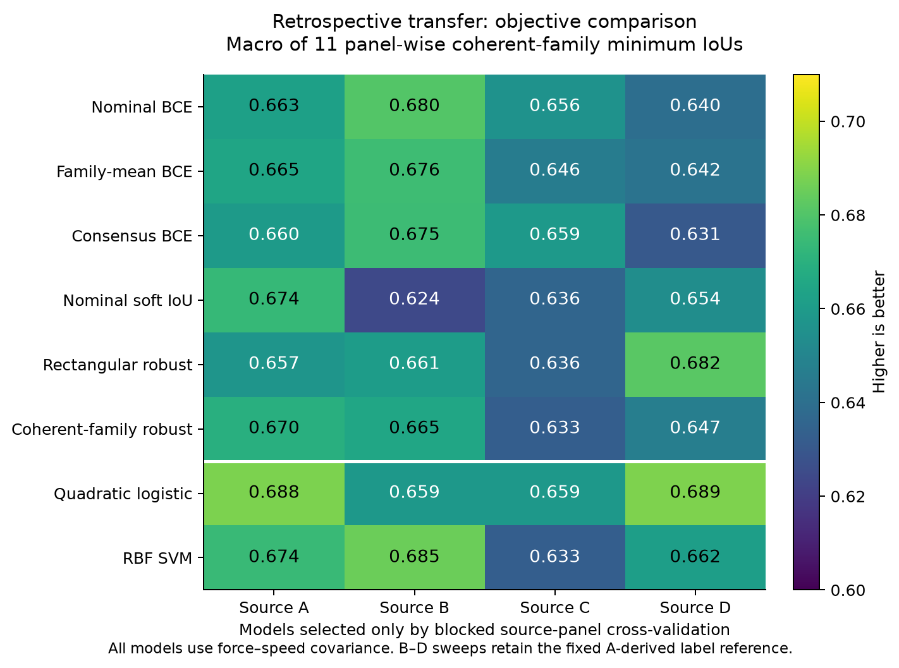
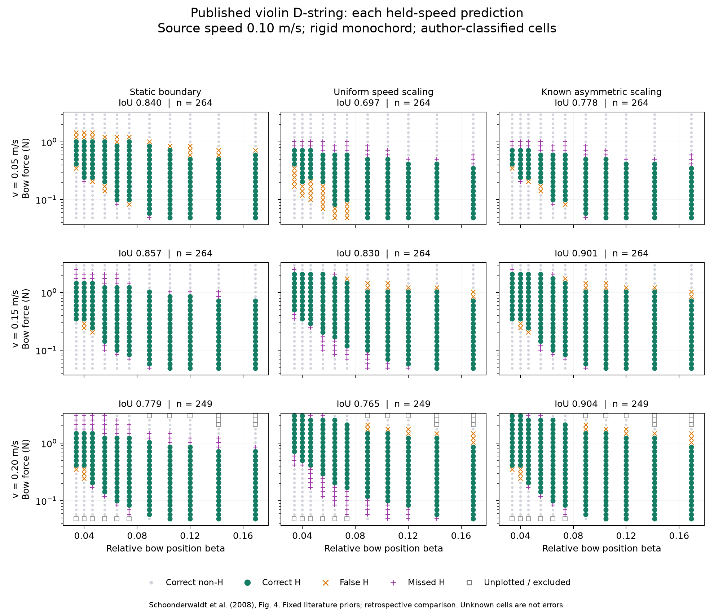
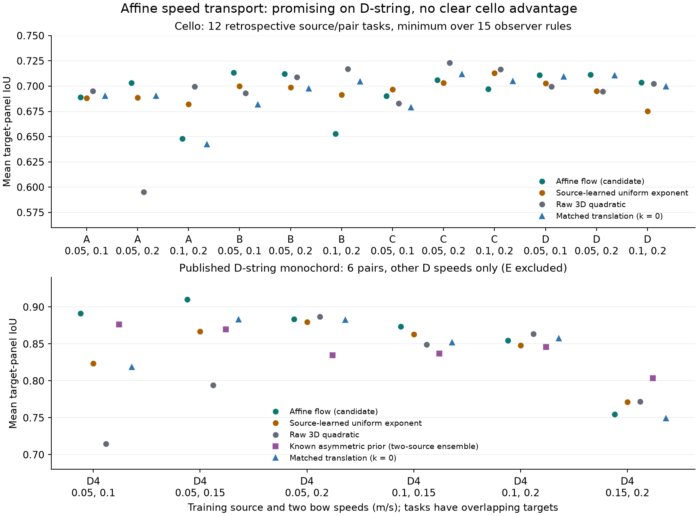

# 공개 자료로 수행하는 활–현 연주 가능 영역 예측 연구

2026-10-13. **이 문서는 실제 실행한 개발 연구와 아직 검증하지 못한 주장을 구분한다.** 이전 서버 결과를 그대로 이어 최적화하는 대신, 자료·관측 정의·물리 구현을 감사하고 Mac에서 재현 가능한 비교를 만들었다. 자체 바이올린 녹음, 센서 제작, 추가 구매는 사용하지 않았다.

현재 핵심 질문은 다음과 같다.

> 활의 접촉 위치, 수직 힘, 속도를 알 때, 속도나 현이 달라져도 안정적인 진동으로 판정되는 조건의 전체 영역을 예측할 수 있는가? 예측 오차 중 물리 가정, 수치 계산, 관측 판정의 영향을 어떻게 구분할 것인가?

음악 생성이나 마이크 음색 분류가 아니다. 입력은 물리적인 운궁 조건이고, 출력은 그 조건에서 특정 관측 절차가 판정하는 진동 영역이다. 현재 자동 판정을 실제 접촉점의 stick–slip 진실과 동일시할 수 없으므로 이 차이가 연구 설계에 포함된다.

## 지금까지 얻은 결론

1. **과거 물리 보정 결과를 좋은 물리 모델의 증거로 사용할 수 없다.** 반사 필터 구현이 설계식과 달랐고, 과거 최적 파라미터는 수동성 조건을 위반했다. 오류를 고쳤으며, 과거 점수와 자료는 감사용으로 보존했다.
2. **간단한 물리 좌표 변환이 첼로 자료에서 강하다.** 반면 새로 시도한 관측 불확실성 목적함수는 가장 강한 단순 기준 모델을 이기지 못했다. 복잡성 자체가 개선의 근거가 되지 않았다.
3. **그 좌표 변환이 바이올린 현 자료에서도 좋다는 주장은 성립하지 않는다.** 공개된 실제 바이올린 D현 실험에서는 기존 문헌의 비대칭 경계 이동 가정이 더 좋았다. 한 종류의 자료에서 잘 맞는 가정을 일반 법칙으로 확대할 수 없다.
4. **수치 정확도와 물리적 타당성, 관측 규칙의 일치는 서로 다른 문제다.** 표본화율을 크게 높여도 일부 분류가 바뀌며, 같은 관측 규칙은 정현파를 Helmholtz로 잘못 판정할 수 있다.
5. **아직 새 방법의 확실한 우월성이나 학술지 게재 가능성을 입증하지 않았다.** 지금 확보한 것은 실행 가능한 자료·강한 비교 기준·검증 도구와 구체적인 부정적 결과다. 새 후보는 이 기준을 넘어야 한다.

## 어떤 자료인가

| 자료 | 실제 사용량 | 역할과 제한 |
|---|---:|---|
| Lampis 공개 첼로 G현 로봇 실험 | 보존된 24,000행 중 양의 힘·속도 평탄구간 23,301행 | A–D는 서로 다른 현 설계/표본이다. 프로젝트가 만든 약한 라벨이며 모두 과거에 열어 본 자료다. |
| Schoonderwaldt 등(2008) 바이올린 현 그림 | 1,584 격자 슬롯, 엄격 판정 1,171개 | D현 1,041개로 속도 전이 비교. E현 130개는 선택적으로 관측된 경계 근처 자료라 전체 영역 성능 평가에서 제외한다. |
| 일반적인 가상 현 | 네 바이올린 개방현 주파수, 여러 힘·위치·속도·해상도 | 수치 검증용이다. 실제 바이올린 현 파라미터를 측정해 재현한 디지털 트윈이 아니다. |
| 새 첼로 A2 공개 표본 | 13.76 GiB 압축 아카이브 다운로드 진행 | 모델·관측 정의·평가 코드를 고정했다. 완료·전체 MD5 검증·전처리 전에는 결과가 없다. |

바이올린 그림 자료는 실제 바이올린 **현을 모노코드에 설치한 실험**이다. 같은 논문의 조립된 바이올린 실험에 관한 계수표도 따로 복원했지만, 이를 완성 악기의 격자 검증으로 계산하지 않았다. 회색으로 채운 미분석 영역이나 그려지지 않은 셀을 음성 라벨로 채우지 않았다. 24개 표식의 두 차례 표본 시각 확인과 표 VI/VII의 모든 계수 확인을 수행했다. 이는 전문가의 전체 독립 재라벨링을 대체하지 않는다.

공개 원문: [첼로 자료 Part 1](https://doi.org/10.5281/zenodo.17749111), [Part 2](https://doi.org/10.5281/zenodo.17782542), [바이올린 현 실험 논문](https://doi.org/10.3813/AAA.918070). [파생 입력의 출처·라이선스](../inputs/README.md), [그림 복원 명세](schoonderwaldt2008/README.md).

## 실제 비교 결과

### 첼로: 관측 불확실성보다 좌표 가정의 영향이 컸다

주 실험은 A 표본의 0.10 m/s 조건으로 학습하고 나머지 11개 표본/속도 패널을 평가했다. 정규화·기저·하이퍼파라미터 선택은 학습 자료만 사용한다. 아래 점수는 **각 패널에서 15개 전역 관측 규칙 중 가장 낮은 IoU를 구한 뒤 패널 평균**한 값이다. IoU는 예측 영역과 판정 영역의 교집합을 합집합으로 나눈 값이다. 모든 패널에 같은 규칙을 적용한 전역 최소값이나 개별 셀을 마음대로 바꿀 수 있는 하한과 구별한다.

| 방법 | 패널별 최소 IoU의 평균 |
|---|---:|
| 원 좌표 이차 로지스틱 | 0.5048 |
| 힘/속도 좌표 이차 로지스틱 | **0.6884** |
| 힘/속도 좌표 RBF SVM | 0.6745 |
| 같은 RBF 기저, 명목 IoU 목적함수 | 0.6738 |
| 같은 기저, 셀별 불확실성 하한 목적함수 | 0.6574 |
| 같은 기저, 전역 관측 규칙에 대한 강건 목적함수 | 0.6696 |

강건 후보는 A/B/C/D 네 학습원 모두에서 그 비교의 가장 강한 단순 기준 모델에 졌다. 전체 1,645회 적합에서 최적화 실패는 0회였고, 1,155개 패널별 지표 묶음을 별도 계산으로 대조했다. 이는 1,645개의 독립적인 물리 실험을 뜻하지 않는다.

단일 속도에서 학습하면 속도 지수는 자료로 식별할 수 없다. 같은 차원의 정적 좌표 모델과 비교한 후속 진단에서도 힘/속도 가정의 이점은 남았다. 두 속도를 사용하는 12개 후속 개발 비교에서는 속도 지수 학습이 고정 지수보다 좋아졌지만, 강한 원 좌표 3차원 이차 모델과의 평균 차이는 약 **0.0006**에 그쳤다. 이를 유의미한 새 방법의 성과로 주장하지 않는다.



자세한 값: [네 학습원 요약](benchmark_cross_source_summary.json), [동일 차원 좌표 비교](speed_prior_audit/results.json), [두 속도 지수 학습](multispeed_scaling_assessment.md), [목적함수와 정확한 집합 경계](method_formalization.md).

### 공개 바이올린 D현: 단순한 속도 가정도 자료에 따라 뒤집힌다

0.10 m/s를 학습원으로 두고 다른 세 속도를 평가한 평균 IoU다. 저자 판정을 그대로 사용하므로 위 첼로의 관측 규칙 최소 IoU와 수치 크기를 직접 비교하지 않는다.

| 방법 | 평균 IoU |
|---|---:|
| 정적 이차 로지스틱 | 0.8311 |
| 힘/속도 이차 로지스틱 | 0.7747 |
| 정적 경계 모델 | 0.8252 |
| 상·하 경계를 모두 속도에 비례시킨 모델 | 0.7638 |
| 문헌의 비대칭 경계 이동: 하한 고정, 상한 비례 | **0.8607** |

비대칭 가정이 네 학습 속도 각각의 평균 비교에서 가장 좋았지만, 0.10→0.05 m/s 한 방향에서는 정적 경계 모델에 졌다. 이 가정은 **동일한 2008년 논문에 근거한 기존 방법**이다. 데이터도 그 논문에서 복원했으므로 독립적인 발견이라고 부르지 않는다. 첼로/바이올린 현뿐 아니라 장치, 범위, 판정 방식도 동시에 달라져 결과 역전의 원인을 한 가지로 특정할 수 없다. [전체 결과와 셀 선택 한계](schoonderwaldt2008/RESULTS.md).



초록은 올바른 H 예측, 주황은 잘못된 H 예측, 보라는 놓친 H 조건이다. 빈 사각형은 원문에 표식이 없어 평가에서 제외한 조건이다. 어떤 경계에서 점수를 잃었는지 평균값과 함께 확인할 수 있다.

## 기술적으로 새로 구현하고 검증한 것

**연속 관측 규칙의 최악·최선 점수 계산.** 관측 기준을 15개 조합에서 고르는 대신 지정된 연속 구간의 모든 서로 다른 라벨 지도를 고려한다. Jaccard 비율 최적화를 반복적인 가중 사분면 문제로 바꾸고, 스위프와 구간 갱신 트리로 계산한다. 유한 상태 전수 계산과 대조했다. 기반인 분수 최적화와 사분면 알고리즘은 기존 기술이며, 구현의 조합만으로 방법론의 최초성을 주장하지 않는다. 실제 데이터에서 15개 기준 사용으로 생긴 최대 점수 낙관 편향은 **0.000357**로 작았다. 일반적인 물리적 진실이나 신뢰구간을 보장하는 도구가 아니다. [분석](continuous_observer_analysis.md), [실행 결과](continuous_observer_summary.json).

**물리 구현과 역문제 감사.** 수동성을 검사하는 도파관과 Numba 실행기, 반사 지연 방식 비교, 이상적 끝점 신호에서 접촉점 운동을 복원하는 실험을 만들었다. 잘 알려진 역문제 관계를 재현했으며 새 원리라고 주장하지 않는다. 양쪽 끝점이 완벽하게 일치해도 공통 임피던스 오차 때문에 접촉 상태를 잘못 판정하는 반례를 확인했다. 일관성만으로 절대적 정확도를 입증할 수 없다. [물리 감사](physics_audit.md), [끝점 복원](endpoint_observer_analysis.md), [기존 역문제 연구](endpoint_observability_prior_audit.md).

**속도에 따른 경계 폭 변화 후보.** 단순 평행 이동 대신 로그 힘의 위치와 폭이 함께 변하도록 하는 9개 파라미터의 흐름 모델을 구현했다. 두 속도로 학습하는 첼로 12개·공개 D현 6개 학습 조건을 전부 실행했다. 첼로의 평균 최소 IoU는 0.6948로 원 좌표 모델 0.6940과 수치상 차이가 작았다. D현 평균 IoU는 0.8613으로 학습한 단일 지수 0.8421과 기존 비대칭 경계를 앙상블한 모델 0.8445보다 높았지만, 높은 두 속도로 학습해 낮은 속도를 예측하는 조건에서는 크게 졌다. 이 흐름 공식은 기존 선형 미분방정식이며 그 자체가 새 수학은 아니다. 개발 자료의 후속 후보이고 기존 14개 모델의 A2 고정 평가에는 추가하지 않았다. [모든 조건의 결과와 실패](affine_transport_assessment.md).

같은 모델에서 폭 변화 계수만 0으로 고정한 마지막 비교에서는 D현 점수가 0.8405로 내려갔다. 따라서 이 자료에서의 이점 일부를 폭 변화로 설명할 근거는 있다. 첼로에서는 0.6935로 차이가 작았고, 같은 현의 미관측 속도만 보면 오히려 폭을 고정한 모델이 좋았다. 모든 18개 학습 조건을 보존했으며 작은 차이를 통계적 동등성으로 해석하지 않는다. [동일 조건 절제 실험](affine_width_ablation_summary.json).



## 수치 감사가 바꾼 해석

과거 구현은 설계된 반사 필터의 극점을 잘못 적용했다. 과거 최적값은 기본 주파수에서 반사 이득이 1보다 커서 에너지를 공급했다. 따라서 과거의 높은 IoU가 정당한 물리 보정이라는 해석은 철회한다. 수정 후에도 파라미터의 수동성을 별도로 확인해야 한다.

고정된 96개 조건의 1.2초 실험에서 400→800 kHz로 계산률을 높일 때, 선형 지연 방식의 이진 Helmholtz 판정이 7개 바뀌었다. Thiran 지연 방식에서는 5개였으나 앞선 해상도 단계에서는 오히려 더 많이 바뀌었다. 유한 해상도 간 일치는 연속체 해의 보증이 아니다. 17개의 다중 분류 변화와 7개의 이진 변화를 혼동하지 않았다. [수렴 분석](convergence_analysis.md), [지연 방식 비교](delay_method_analysis.md).

순수 정현파·대칭 삼각파도 기존 파형 규칙에서 Helmholtz로 판정됐다. 이는 모든 실측 라벨이 틀렸다는 뜻이 아니라, 현재 규칙만으로 해당 물리 상태를 확정할 수 없다는 반례다. 기존 라벨을 연구자에게 유리하게 바꾸는 대신 한계를 공개하고, 규칙 변화에 대한 민감도와 저자의 별도 판정 자료를 구분했다.

## 남아 있는 연구와 통과 기준

현재 결과만으로 ICML 수준의 새 방법을 주장할 수 없다. 최근 연구에는 물리 신경망, 유한 폭·비틀림·열 마찰, 학습 기반 바이올린 제어, 차원 없는 표현 학습이 이미 있다. 이름만 바꾸거나 기술을 붙이는 접근은 피한다. [확인한 선행연구와 겹치는 부분](literature_audit.md).

[영문 연구 초고](manuscript.md)와 [주장별 근거·논문 준비도](paper_readiness.md)를 별도로 작성했다. 초고는 실제 개발 결과만 포함하며, 아직 없는 새 표본 결과나 일반적 우월성을 써 넣지 않았다.

다음 단계의 주장은 검증 결과에 따라 결정한다.

- **예측 방법의 기여:** 경계의 위치·폭 변화 후보가 두 공개 실험 체계에서 강한 기준 모델을 넘어서는지 전체 조건으로 판단한다. 일부 조건에서만 이긴 결과나 목표 자료를 보고 선택한 가정은 일반 개선으로 발표하지 않는다.
- **새 표본 확인:** 원래 고정한 14개 모델과 관측 정의를 A2에 적용한다. 후속 후보 12개는 별도 추가 계획으로 고정했다. 모델 파일이 없는 새 복제본에서도 원래 14개 모델을 바이트 단위로 복원하고, 추가 후보는 명세에 포함된 계수만으로 검증할 수 있다. A2는 새로운 A 표본 검증이며 새로운 악기 종류 검증은 아니다.
- **수치 방법의 기여:** 적응적 계산을 주장하려면 고정 해상도, 단순 인접 해상도 일치, 일반적 비용 기반 방법과 비교해야 한다. 아직 구현한 감사 결과가 그 우월성을 입증하지 않는다.
- **중단 기준:** 복잡한 방법이 단순 기준을 지속적으로 이기지 못하면 그 실패를 유지한다. 검증 가능한 벤치마크와 재현성·관측 오차 연구로 논문의 주장을 좁히며, 실패한 후보를 새 이름으로 포장하지 않는다.

## 재현과 실행 중 작업

[Mac 실행 안내](../../docs/mac_research.md)의 환경에서 실행한다. 핵심 비교는 저장소에 포함된 약 4.1 MB 파생 자료로 재현할 수 있다. 원본 논문 PDF, 대형 원시 데이터, 체크포인트와 개인 파일은 Git에 넣지 않는다.

```bash
bash scripts/bootstrap_mac.sh
bash scripts/run_mac.sh test
bash scripts/run_mac.sh benchmark --source A --out reports/reproduction_A
bash scripts/run_mac.sh python scripts/restore_frozen_models.py
```

A2 진행 상태는 로컬 `reports/research_20261013/lockbox_A2_pipeline_state.json`에 기록한다. 현재 작업은 다운로드 완료를 기다렸다가 전체 체크섬 검증 → A2만 폴더별 전처리 → 원래 고정 모델 평가 → 별도 후보 평가를 수행하도록 실행했다. 아직 완료하지 않은 단계를 성공으로 간주하지 않는다. 다운로드와 분석은 노트북이 깨어 있고 프로세스가 유지되어야 진행된다. 재시작 방법과 디스크 사용량은 Mac 실행 안내에 있다.

별도 후보 계획은 **2026-10-13 09:02:25 UTC(한국 시각 18:02:25)**에 고정했다. 이때 A2는 부분 다운로드와 대기 상태만 존재하고 전처리·파형·평가 출력은 없음을 확인했다. A의 세 학습 속도 쌍마다 전체 흐름·폭 고정·학습 지수·원 좌표 모델을 보존하며, 주 비교는 0.05/0.10 m/s 학습이다. 원래 14개 비교를 바꾸거나 같은 학습 예산으로 섞어 순위를 매기지 않는다. [추가 명세](transport_lockbox_spec.json), [시점과 평가 범위](protocol.md). 이는 온라인 사전등록이나 모든 외부 미노출 이력의 증명은 아니다.

이 문서의 개발 결과와 이후 A2 결과는 구분해 보존한다. A2를 본 뒤 변경한 방법은 해당 표본에 대한 새로운 확증 실험이 아니다.

[새 작업 공간 재현 검사](reproduction_audit.md)에서 기존 보고서·원시 파일·체크포인트 없이 실행한 결과, 주요 수치 390개가 `1e-12` 이내에서 일치했다. 기존 Python 환경을 재사용한 검사이며 패키지를 처음부터 다시 설치한 검증이나 아직 내려받는 A2의 성공을 뜻하지 않는다.

최종 전체 검사에서 **269개 테스트와 102개 하위 검사가 통과**했다. [검증 기록](../../docs/validation.md)은 계산·소프트웨어 검사와 과학적 성능 증거를 구분한다.
