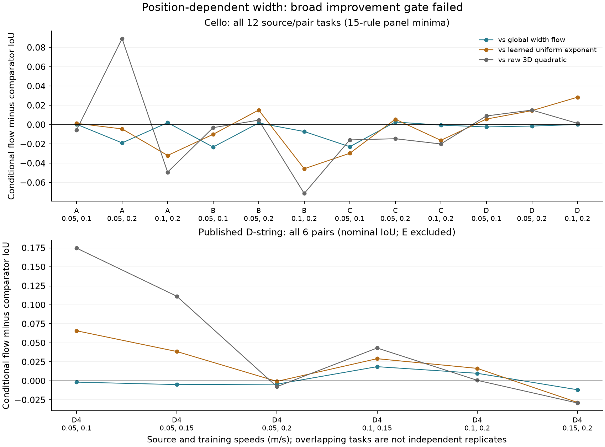

# Conditional width transport: independent review and rejection

Review date: 2026-10-14. Experiment recorded: 2026-10-13. Status: **retrospective
method development; the declared broad-improvement gate failed**. This review
neither opens A2 outcomes nor adds a candidate to its frozen evaluation.

The position-dependent width extension reduces mean cello IoU from **.694794
to .688991**. Its published D-string mean rises from .861265 to .862281, but it
wins only two of six D tasks against the original flow. The extension is not a
supported general improvement and should not become the paper's claimed method.
The complete results, including every failure, are preserved below and in the
public artifact bundle.

## Hypothesis and mathematical audit

The preceding global-width model assumes that the log-force band's width has
the same speed growth rate at every bow position. The extension replaces that
rate with `k(b)=k0+k1*b`, where `b=log(beta/.1)`, `u=log(F/1 N)`, and
`t=log(v/.1 m/s)`. For each fixed bow position, it solves the linear ODE

    du/dt = a0 + a1*b + (k0+k1*b)*u.

The reference-speed coordinate is

    z = exp(-k(b)*t)*u - (a0+a1*b)*(1-exp(-k(b)*t))/k(b).

At k(b)=0, its continuous extension is `z=u-(a0+a1*b)*t`. A second-order
quadratic logit in standardized b,z has its z-squared coefficient constrained
below zero. The extension has ten fitted coefficients versus the original
nine. It nests the original exactly at k1=0. All speed transformations compose
by adding t at fixed b; their inverse is obtained by negating t. These are
ordinary properties of a conditional linear differential equation, **not a new
flow theory or a new mathematical methodology**.

The extra coefficient changes local width scaling from exp(k*t) to
exp((k0+k1*b)*t). It does **not** change the one-interval topology: at a fixed
position and speed, z is a strictly increasing affine function of log force,
and the logit is a concave quadratic in z. The predicted Helmholtz force set
therefore remains one interval or empty. Position dependence cannot by itself
represent disconnected force-label components. Whether those components reflect
physical regimes or imperfect observation rules is a separate empirical issue.

The analytic gradient correctly includes
`dz/dk1 = b * dz/dk(b)`. The implementation uses a small-k*t series for the
potentially unstable derivative, and expm1/exprel elsewhere. Additional numerical
checks covered 48 parameter settings, including zero and near-zero rates: the
maximum absolute objective-gradient discrepancy was **3.89e-10**. Existing tests
also check composition, inversion, exact nesting, connected force bands,
serialization, source-only selection and the zero likelihood gradient in all
four transport parameters at the reference speed. Parameters describe a
predictive deformation; they are not established physical constants.

## Source isolation and fair scope

The experiment retained the preceding model's nominal BCE objective, concave
base classifier, source-only normalization in `(b,u-t)`, five contiguous bow-
position folds shared across both source speeds, two regularization grids
`{.001,.01,.1}`, and three k0 starts `(-.5,0,.5)`. Every k1 start is zero.
k1 has bounds [-2,2] and the same quadratic shrinkage toward zero as the other
non-default transport coefficients. Successful optimizer starts are chosen by
training objective; hyperparameters are chosen by pooled source out-of-fold
minimum-family IoU. There is no optimization-globality guarantee.

All 18 selections and source fits are serialized before target scoring. An
independent replay checked every training/target ID set, fold membership,
normalization, training objective, selected start, pooled source score and
chosen candidate. Target-label poisoning in the unit test leaves the selected
source model unchanged. This establishes source isolation in the executed
pipeline. It **does not erase prior inspection** of these corpora or make the
post-hoc candidate confirmatory.

The cello benchmark comprises all four sample1 specimens and all three pairs
of speeds .05, .1 and .2 m/s: twelve tasks. Its headline averages panel-wise
minimum IoUs over 15 fixed observation rules. Those rules share A-derived
pitch/noise calibration, and their labels are provisional rather than independent
physical ground truth. The other-specimen comparison therefore concerns the
same specified labeling pipeline, not independently labeled instruments.

The published benchmark uses all six pairs of D-string speeds .05, .1, .15 and
.2 m/s, with the other two D speeds as targets. It consists of systematically
analyzed classifications from the 2008 violin-string **monochord** experiment,
not an intact violin. Its singleton label family gives ordinary nominal IoU.
The published E-string cells are selectively concentrated near boundaries and
are excluded from the D headline; their conditional diagnostic is retained in
the complete results. See the [published-data audit](schoonderwaldt2008/README.md)
and [original affine assessment](affine_transport_assessment.md) for the data
scope and established physical motivation.

The pre-run decision recorded in the protocol required improvement over full
flow, learned uniform scaling and raw 3D on **both** corpora's declared combined
macro score. It was a development decision, not a public preregistration or a
significance test. It failed.

## Complete aggregate outcomes

| Target and score | Conditional width | Global width | Learned uniform alpha | Raw 3D quadratic |
|---|---:|---:|---:|---:|
| Cello combined: panel minimum-family IoU | .688991 | .694794 | .694609 | .694037 |
| Cello source's third speed: minimum-family IoU | .695059 | .713565 | .720903 | .689714 |
| Cello other specimens: panel minimum-family IoU | .688317 | .692709 | .691687 | .694518 |
| Cello combined: nominal IoU | .742688 | .747885 | .749343 | .747928 |
| Cello combined: pooled same-rule minimum IoU | .717520 | .721195 | .717082 | .723313 |
| Published D other speeds: nominal panel IoU | .862281 | .861265 | .842085 | .813398 |
| Published D other speeds: pooled nominal IoU | .865646 | .865816 | .843143 | .814540 |
| Published E observed cells: conditional diagnostic | .431519 | .430083 | .430964 | .426401 |

The .001016 D macro gain reverses to a small loss under pooled D IoU. Cello
loses to the original flow under every listed scope and nominal/minimum-family
aggregation. That does not prove every conditional-flow variant will fail; it
rejects this tested extension as the sought broad improvement.

| Comparison: conditional width minus comparator | Cello mean difference; wins/losses | Published D mean difference; wins/losses |
|---|---:|---:|
| Global width | -.005803; 5/7 | +.001016; 2/4 |
| Learned uniform alpha | -.005617; 6/6 | +.020196; 4/2 |
| Raw 3D quadratic | -.005046; 5/7 | +.048883; 4/2 |

The 18 tasks overlap in source and target panels. Neither task counts, grid
cells, the 828 fitted models nor 2,484 optimization starts are independent
physical replications. No p-value or general statistical superiority is claimed.

## All eighteen tasks

Each row is its declared combined mean target-panel score. Cello takes the
minimum over the 15 rules separately within each panel; D uses published labels.

| Corpus/source; two training speeds | Conditional width | Global width | Learned alpha | Raw 3D |
|---|---:|---:|---:|---:|
| Cello A; .05,.10 | .689397 | .689022 | .688060 | .694985 |
| Cello A; .05,.20 | .684297 | .703219 | .688732 | .595123 |
| Cello A; .10,.20 | .650178 | .648144 | .682134 | .699434 |
| Cello B; .05,.10 | .690104 | .713324 | .700138 | .693214 |
| Cello B; .05,.20 | .713696 | .712010 | .698591 | .709060 |
| Cello B; .10,.20 | .645887 | .653029 | .691600 | .717223 |
| Cello C; .05,.10 | .667182 | .690094 | .696865 | .683020 |
| Cello C; .05,.20 | .708716 | .706008 | .703110 | .723312 |
| Cello C; .10,.20 | .696576 | .697081 | .712868 | .716608 |
| Cello D; .05,.10 | .708511 | .710878 | .702760 | .699542 |
| Cello D; .05,.20 | .709720 | .711204 | .695225 | .694634 |
| Cello D; .10,.20 | .703635 | .703516 | .675227 | .702289 |
| Published D; .05,.10 | .889496 | .891149 | .823587 | .714826 |
| Published D; .05,.15 | .905357 | .910249 | .866701 | .793963 |
| Published D; .05,.20 | .879004 | .883351 | .879682 | .886652 |
| Published D; .10,.15 | .892319 | .873634 | .863132 | .849077 |
| Published D; .10,.20 | .864427 | .854459 | .847981 | .863691 |
| Published D; .15,.20 | .743081 | .754746 | .771424 | .772178 |



## Independent validation and public replay

The reviewer wrote a separate flow-score evaluator, polynomial-baseline
evaluator, IoU/box-bound calculation and aggregation, then recomputed the
complete saved results. It also reconstructed all 810 source-CV fits' predictions
and all 18 source-only hyperparameter decisions from frozen coefficients.
The 2,484 starts (2,430 CV plus 54 final) all reported success. Across **5,577,870
numeric comparisons**, including per-row predictions, the largest discrepancy
was **3.00e-15**. This count measures software replay coverage, not statistical
sample size. Every source/target and CV identity check passed. No P1/P2
implementation error was identified in the candidate or its ten original tests.

The public [gzip bundle](conditional_transport_artifacts.json.gz), about 750 KiB,
is a `utf8-file-map-v1` JSON object containing all 41 output files: protocol,
input manifests, every CV log, all frozen models, the pre-scoring model manifest,
full panel results and summary. Forty files preserve their exact original text
bytes. In `input_manifests.json`, one published-source path is made repository-relative
and JSON indentation is normalized; the original file hash and this transformation
are recorded in the bundle. No scientific values or model bytes change. The independent
[audit JSON](conditional_transport_independent_audit.json) includes their SHA-256
hashes. Baseline coefficients are embedded, so scoring does not require ignored
prior-run directories or pickles. The smaller [summary](conditional_transport_summary.json)
and [protocol](conditional_transport_protocol.json) are directly readable.

From the repository root:

```bash
bash scripts/run_mac.sh python research/2026-10-13/conditional_transport_assessment.py
bash scripts/run_mac.sh python -m pytest tests/test_conditional_transport.py tests/test_conditional_transport_report.py -q
```

The first command audits the public bundle without fitting. It checks input and
source-code hashes, regenerates the independent audit and figure, and fails on
mismatched results. The second additionally tests every four-cell rectangular
label-envelope case by exhaustive enumeration and replays the full audit in a
new filesystem tree containing only public scripts, compact input tables,
published cells and the gzip bundle. That tree contains **no reports directory,
raw archive, A2 data or local checkpoint**. It reuses the installed interpreter
and dependencies; this is not a fresh dependency-install test.

Retaining this rejected, reproducible extension is useful: it prevents the
small D-only improvement from being promoted into a broad method claim and
shows that merely adding position-dependent width is insufficient. Further
method development needs a clearer empirical target and a mechanism that
addresses the demonstrated failure, rather than another unmotivated parameter.
