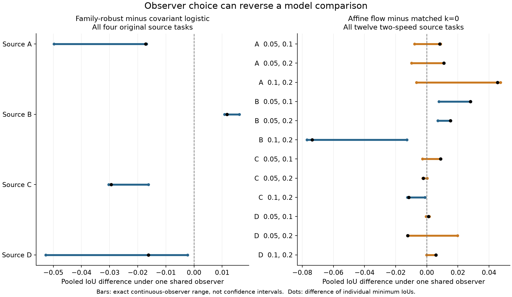

# Shared-observer comparison audit

2026-10-13. Retrospective development only. **No A2 outcomes or waveforms were
read. No frozen model, observation rule, prospective endpoint or evaluation
specification was changed.**

**Decision:** uncertainty about one shared observation rule can materially
change model rankings. This supports reporting comparison intervals and making
the aggregation semantics explicit. It does **not** support inventing a faster
algorithm for the present dataset: exhaustive exact calculation of every
declared comparison took 5.58 seconds on the Mac. Most reversals were already
visible in the existing fifteen-rule family.

## What was computed

For two frozen binary predictions P and Q, compute

    D(eta) = IoU(P, S_eta) - IoU(Q, S_eta)
    [L, U] = [min_eta D(eta), max_eta D(eta)].

The SAME eta labels both models' evaluation rows. The existing family uses
ratio < f and periodicity >= q, with f in [.3,.7], q in [.75,.85], and the same
fixed A-derived eligibility/reference as the main benchmark. All distinct
threshold states in that rectangle are enumerated with a two-dimensional
histogram and cumulative sums. Strict ratio boundaries, inclusive periodicity
boundaries, tied features and empty-union IoU=1 are preserved. There is no
interpolation between labels. The implementation does not call the individual
IoU-extreme solver to optimize the difference of two ratios.

L<0<U means the ranking reverses under admissible shared observers. L>0 means P
wins for every observer in this declared family. These are deterministic,
conditional sensitivity statements, **not confidence intervals or guarantees
about physical contact-state truth**. The threshold rectangle has not been
calibrated as a truth-coverage set.

The audit includes all unordered pairs among the fourteen original family-CV
winners for each of four source specimens: 91 pairs per source. Historical
physics diagnostics, target-ranked winners, alternative nominal-CV choices and
fixed-exponent side analyses are excluded by their original declared roles.
It additionally includes all six pairs among affine flow, matched k=0,
source-learned alpha and raw 3D for all twelve two-speed cello tasks. No task or
pair was discarded after its result was observed.

Every task is examined as pooled IoU, a macro average under ONE shared operator,
and each individual target panel. This yields **5,596 pair/scope comparisons**.
There are 292,436–319,300 candidate threshold pairs in the four original pooled
tasks, with many duplicate label maps. The reported count is threshold states,
not independent labels or experimental repetitions.

## Complete counts

| Models and aggregation | Pairs | Reversals in 15-rule grid | Reversals in exact continuous family | Newly found | Reversal exceeds .005 in both directions |
|---|---:|---:|---:|---:|---:|
| Original 14, pooled | 364 | 51 | 52 | 1 | 25 |
| Original 14, shared-rule macro | 364 | 51 | 52 | 1 | 31 |
| Original 14, individual panels | 4,004 | 789 | 840 | 51 | 484 |
| Four transport models, pooled | 72 | 36 | 40 | 4 | 23 |
| Four transport models, shared-rule macro | 72 | 30 | 34 | 4 | 18 |
| Four transport models, individual panels | 720 | 250 | 258 | 8 | 157 |

Counts include ties/non-reversals in the denominator. They describe these model
and data choices, not the probability of a future ranking reversal. Source
tasks reuse specimens, rows and target panels and are not independent trials.

The continuous family matters less than the table's new-reversal count alone
suggests. All five newly discovered pooled reversals have a weaker-side margin
below .001 IoU: the largest is .000533, and the original-model benchmark's sole
new pooled reversal is only .0000268. Among newly found panel reversals, 22/51
original-model and 4/8 transport cases exceed .001 on both sides; none exceeds
.005 on both sides. The exact method removes a discretization assumption but
does not establish a large practical improvement over the fifteen-rule grid.

For a concrete nontrivial comparison, A/.05,.1 affine flow minus learned alpha
has pooled difference range **[-.024497, +.018020]**. Its difference of
individually minimized pooled IoUs is +.016846. The latter is a valid maximin
preference for the flow; it cannot be interpreted as winning under every
shared observer. Flow minus matched k=0 in the same task is
**[-.007832, +.008786]**.

This audit does not rescue the robust training objective. Against the fixed
covariant logistic comparator, family-robust predictions lose under every
pooled observer for A, C and D, and win under every pooled observer for B.
The exact ranges for robust minus logistic are respectively
[-.049771,-.016879], [.010865,.016092], [-.030305,-.016209] and
[-.052638,-.002265].

The machine-readable declared contrasts also retain the strongest simple model
chosen by SOURCE CV. For source D that choice is raw SVC, whose previously
documented single-speed extrapolation failure makes its target performance
poor. Beating it is not evidence that the robust objective generally beats a
strong transfer baseline. All fourteen-model comparisons remain available;
no target winner is substituted for the source-selected choice.

## Three different aggregation questions

Let I_j(P,eta) be model P's IoU in panel j, for K panels. The original declared
conservative metric is

    R_separate(P) = (1/K) sum_j min_eta I_j(P,eta).

It permits the least favorable observer to be different in each panel.
Equivalently, it minimizes the average over a Cartesian product of K observer
choices. The same-global-observer robust macro is

    R_shared(P) = min_eta (1/K) sum_j I_j(P,eta).

Since every panel's minimum is at most its value under any fixed eta,

    R_separate(P) <= R_shared(P).

This is a bound for EACH MODEL, not a preservation of rankings between models.
Moreover, the shared-observer comparative range is

    L_macro = min_eta (1/K) sum_j [I_j(P,eta)-I_j(Q,eta)],
    U_macro = max_eta (1/K) sum_j [I_j(P,eta)-I_j(Q,eta)].

It obeys

    L_macro <= R_shared(P)-R_shared(Q) <= U_macro.

To see this, apply L_macro <= M_P(eta)-M_Q(eta) <= U_macro for every eta, where
M is the panel mean, and take minima. In contrast,
R_separate(P)-R_separate(Q) need not lie in this interval: its two models can
use different adverse observers in different panels. Pooled IoU is a further
different aggregation because intersection and union counts are combined
before their ratio is computed.

The old metric is not mathematically erroneous. It measures a more conservative,
panel-specific uncertainty scenario. Replacing it with a shared-operator metric
changes the scientific question. The original and additive A2 protocols retain
their already frozen endpoints; these development results do not authorize
changing them after the freeze.

Two empirical pairs expose this distinction particularly clearly:

| Source; P minus Q | Original mean panel-min difference | Macro difference under EVERY shared observer |
|---|---:|---:|
| A; raw HGB minus raw family-robust | -.003194 | [.002358, .016723] |
| B; raw extra-trees minus raw HGB | -.000573 | [.000404, .006146] |

Here the original conservative preference selects Q, although P's shared-rule
macro is larger at every admissible global observer. This is an aggregation /
uncertainty-set change, not a contradiction in arithmetic.

A twelve-row constructed regression test reproduces the effect without the
research dataset. Each of two panels has six rows and only two possible target
sets, {1} and {1,2,3,4}. P predicts {1} in the first panel and {1,2,3,4} in the
second. Q predicts {1,2,5} and {1,5}. Then

    R_separate(P)=1/4; R_separate(Q)=4/15, so the old metric prefers Q.
    M_P(eta)=5/8 for either observer.
    M_Q(eta)=5/12 or 3/10.
    Thus P's shared macro advantage is always between 5/24 and 13/40.

Feature ties ensure no impossible intermediate target sets enter the test.

## What this contributes, and what it does not

The useful finding is an empirical need to distinguish maximin preference,
uniform shared-observer dominance, pooled IoU and panel aggregation. Exact
comparison intervals produce witness rules and can prevent an unjustified
"better under all label definitions" interpretation. The dense implementation
is adequate for the existing scientific problem: all comparisons ran in 5.58
seconds, including validation and file processing. This is one runtime, not a
repeated hardware benchmark or a general complexity claim.

Neither min-versus-sum inequalities nor two-dimensional cumulative sums are new
methodological primitives. These results do not by themselves establish a
top-tier novel algorithm. An algorithmic claim would need larger scientifically
motivated observer classes where exact enumeration is demonstrably inadequate,
plus a substantial justified method improvement. A scientific decision claim
would need defensible uncertainty sets and independent evidence, not merely an
arbitrary wider threshold rectangle.

The published 2008 D-string experiment currently supplies a singleton label
family. With only one observer, the distinctions above collapse; this audit
cannot claim a corresponding benefit on that violin-string dataset. The cello
results remain mechanical-string development evidence, not an intact-violin
validation.



Bars are deterministic observer-sensitivity ranges, not confidence intervals.
The black dot is the difference of independently minimized pooled IoUs.
The figure includes all four source cases for the fixed covariant-logistic
comparison and all twelve source/speed cases for the matched k=0 comparison.

## Artifacts and reproduction

- [Complete 5,596-row pair table](observer_dominance_all_pairs.csv.gz), including
  both extremal observer settings, each model's IoU at those settings, grid
  comparison, independent-min preferences and the old macro preference.
- [All-task summary and provenance hashes](observer_dominance_summary.json).
- [Figure PDF](observer_dominance.pdf).
- Implementation: `scripts/observer_dominance_audit.py`.
- Tests: `tests/test_observer_dominance_audit.py`; six tests pass, including 50
  randomized direct-enumeration cases, ties/empty sets, a grid-missed reversal,
  identical-model dependence, macro semantics and the twelve-row contradiction.

The archived run is `reports/observer_dominance/2026-10-13/`. Those ignored input
reports can be regenerated from the released derived inputs and source-only
fitting programs; a new checkout does not need new raw recordings. Follow the
main [Mac instructions](../../docs/mac_research.md) to create the four benchmark
runs, the multispeed baseline run, affine run and matched-width run, then use:

```sh
bash scripts/run_mac.sh python scripts/observer_dominance_audit.py \
  --benchmark-base reports/research_20261013 \
  --full-run reports/affine_transport/2026-10-13-v2 \
  --k0-run reports/affine_width_ablation/2026-10-13 \
  --out reports/observer_dominance/new-run
bash scripts/run_mac.sh python -m pytest tests/test_observer_dominance_audit.py -q
bash scripts/run_mac.sh python research/2026-10-13/observer_dominance_report.py \
  --audit reports/observer_dominance/new-run --out research/2026-10-13
```

Use the actual newly created paths when reproducing rather than implying a fresh
run was the archived historical run. The report builder reproduces tables and
figures from completed development outputs; it never accesses A2.
