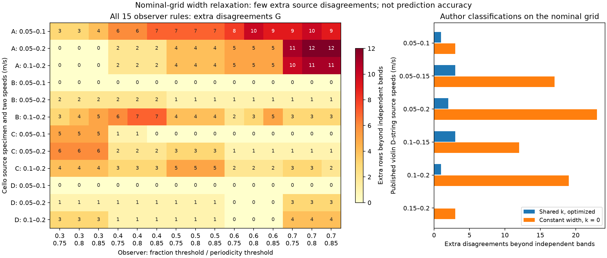

# A nominal-control certificate for shared band-width scaling

Completed and independently checked on 2026-10-15 KST. This is a retrospective diagnostic on the existing sample-1 cello data and published violin D-string classifications. It does not use A2, fit a new predictor, or change any label.

**Result:** a shared width exponent creates a small additional incompatibility with the labels. The nominal cello rule gives a positive gap in 9/12 source pairs, but the largest gap is only 7 rows, or 0.189% of that pair. Across all 15 fixed observer rules, the largest gap is 12 rows, or 0.336%. Published violin D-string data give gaps of 0–3 rows. These results do not establish that the width restriction explains the model's broader prediction failures, nor do they justify a more flexible model by themselves.

**Scope matters:** the certificate assumes constant controls within a nominal beta/speed column. The actual cello predictor uses slightly varying measured controls. Therefore the cello result is **not a certified lower bound on that implemented predictor's training loss**. For the published violin D-string grid, the nominal coordinates are also the available predictor coordinates. Even there, the result is conditional on the extracted author classifications and nominal force levels, not a proof about true physical motion.

## Diagnostic and its meaning

Let `u = log F`, `t = log v`, and let a positive band at fixed bow position have endpoints `l(t), h(t)` and width `W(t) = h(t) − l(t) > 0`. For the existing affine transport `du/dt = a0 + a1 b + k u`, subtraction of the endpoint equations gives

\[
\frac{dW}{dt}=kW,\qquad
W_2=\exp\{k\log(v_2/v_1)\}W_1.
\]

We deliberately relax the rest of the model: every nominal beta column has free band centers and free initial width, and `k` can be any real number. In particular, the diagnostic does not impose the trained model's quadratic boundary shape, affine dependence of center motion on `b`, or `k ∈ [−2,2]` search bounds.

`L_ind` is the minimum number of disagreements when each column at each speed has an independent interval. `L_width` is the minimum when the two widths must obey one exponent `k` shared across all columns. We report

\[
G=L_{\rm width}-L_{\rm ind}\geq0.
\]

`G > 0` rules out realizing the *minimum independent-band disagreement count* under this nominal shared-width relation. It does not mean every label is reliable, or that exactly `G` identifiable labels are erroneous. Alternative minimizers can disagree with different rows. `G = 0` only means this relaxation can attain the independent-band count: it does not validate the full flow. A single paired column necessarily has `G = 0`, because free `k` can match any two positive widths. The saved witness exponent is one feasible optimizer, not a physical estimate or confidence interval.

`G` is a source disagreement count, not an IoU improvement, a test-set score, or a statistical significance measure. All observer rules and speed pairs reuse observations.

## Why the finite calculation is sufficient

For force-ordered observations `u_1 ≤ … ≤ u_n`, each nonempty observed interval `i…j` has a disagreement cost and admissible widths

\[
W\in[u_j-u_i,\;u_{j+1}-u_{i-1}),\qquad W>0.
\]

The upper endpoint is infinite if the band touches a sampled edge; adjacent excluded observations must remain outside the closed positive band. Equal force values are indivisible. An off-grid positive-width band predicts no sampled positives and can have arbitrary positive width, so alternatives with no lower cost than that off-grid prediction can safely be discarded.

Taking the lower cost envelope over these width intervals preserves every attainable minimum. Two positive-width envelope cells `(a,b)` and `(c,d)` admit the shared exponent on

\[
\frac{\log(c/b)}{\Delta t}<k<\frac{\log(d/a)}{\Delta t},
\]

with the appropriate infinite limits. The endpoints are strict. Summing the per-column lower envelopes and sweeping their finite endpoints gives the global integer minimum in real arithmetic. At a breakpoint, open intervals can remove feasible alternatives but cannot create a cost smaller than both neighboring open-cell costs. Consequently the global minimum occurs in a represented open cell. Fixed `k = 0` is evaluated with strict membership in the original pair intervals, rather than assuming a neighboring cell's cost is valid at the breakpoint.

This is an application of finite interval enumeration and a standard sweep, **not a claimed new optimization theorem**. The implementation uses floating log coordinates, not interval arithmetic. It explicitly reconstructs finite band endpoints and reclassifies observations for each selected optimum; representational ambiguity raises an error. These witnesses prove attainment of the reported upper bound. The lower-bound/global-optimality claim additionally relies on the enumeration argument and the exhaustive small-instance tests; a constructive witness alone would not prove it.

## Complete results

The nominal observer is fraction threshold `0.5`, periodicity threshold `0.8` (rule 7). All 15 rules were retained separately, without selecting a favorable observer. `G0` is the additional count when width is constrained to remain constant (`k = 0`).

| Cello source | Speeds (m/s) | Rows | Nominal `L_ind` | Nominal `G` | Nominal `G0` | `G` range across 15 rules | Positive rules |
|---|---|---:|---:|---:|---:|---:|---:|
| A | 0.05, 0.10 | 3,699 | 147 | 7 | 9 | 3–10 | 15/15 |
| A | 0.05, 0.20 | 3,575 | 105 | 4 | 4 | 0–12 | 12/15 |
| A | 0.10, 0.20 | 3,376 | 138 | 4 | 4 | 0–11 | 12/15 |
| B | 0.05, 0.10 | 3,976 | 210 | 0 | 12 | 0 | 0/15 |
| B | 0.05, 0.20 | 3,986 | 188 | 1 | 9 | 1–2 | 15/15 |
| B | 0.10, 0.20 | 3,990 | 236 | 4 | 10 | 2–7 | 15/15 |
| C | 0.05, 0.10 | 4,000 | 228 | 0 | 1 | 0–5 | 5/15 |
| C | 0.05, 0.20 | 4,000 | 233 | 3 | 3 | 1–6 | 15/15 |
| C | 0.10, 0.20 | 4,000 | 229 | 5 | 6 | 2–5 | 15/15 |
| D | 0.05, 0.10 | 4,000 | 171 | 0 | 0 | 0 | 0/15 |
| D | 0.05, 0.20 | 4,000 | 161 | 1 | 2 | 0–3 | 12/15 |
| D | 0.10, 0.20 | 4,000 | 216 | 1 | 8 | 0–4 | 12/15 |

Across cello rules, `G > 0` in 128/180 cases. The independent single-band disagreement is already 2.94–5.91% under the nominal rule and 2.35–9.88% across all rules. The additional width restriction contributes at most 0.189% nominally and 0.336% across rules. The relaxed nominal-grid source fit needs few additional disagreements. This does not determine whether the shared-width restriction causes the fitted model's transfer losses; center dynamics, quadratic shape, estimation, extrapolation and control variation are not evaluated by `G`.

Conversely, a small source gap does **not** causally rule out the width restriction as a contributor to held-out IoU loss. This diagnostic optimizes Hamming loss over free column centers and unrestricted `k`; the predictor uses a coupled quadratic generator, regularization, source model selection, bounded parameters, and an IoU-based evaluation. These different feasible sets, objectives, and evaluation distributions prevent converting `G` into a bound on predictive improvement or degradation.

| Published violin D-string speeds (m/s) | Rows | `L_ind` | `G` | `G0` |
|---|---:|---:|---:|---:|
| 0.05, 0.10 | 528 | 1 | 1 | 3 |
| 0.05, 0.15 | 528 | 0 | 3 | 17 |
| 0.05, 0.20 | 513 | 0 | 2 | 23 |
| 0.10, 0.15 | 528 | 1 | 3 | 12 |
| 0.10, 0.20 | 513 | 1 | 1 | 19 |
| 0.15, 0.20 | 513 | 0 | 0 | 3 |

The published data distinguish a constant-width relation from a freely estimated shared exponent more strongly than they distinguish the latter from independent widths. This agrees descriptively with why allowing width change may be useful; it does not establish predictive superiority or novelty of that known model component. The maximum remaining `G` is 3/528 = 0.568%.



## Numerical checks and reproducibility

The complete 186-task rerun took 78.97 seconds on the M2 laptop. Its task results equal the preceding all-observer run exactly; the new run records the corrected scope and current script hash. Older ignored output directories were preserved.

An independent report checker reclassified every saved endpoint witness and computed `L_ind` with a separate maximum-subarray algorithm that preserves tied force groups. It verified all 186 tasks, 7,266 paired columns, and 702,153 row evaluations **with reuse**, not that many unique experiments. The checker imports neither the width optimizer nor its witness/band implementation. It also checks the complete task set, source IDs, input hashes, current experiment-source hashes, and summary/full-artifact agreement.

The 22 targeted tests include 120 random small instances against uncompressed exhaustive optimization, every pair of four-cell binary patterns for one column, conflicting tied forces, strict endpoint and fixed-`k` cases, planted opposing width constraints, multiplicative force invariance, invalid inputs, independent witness tamper rejection, and path portability. The figure was visually inspected.

The control audit found 480 cello nominal columns. Relative within-column beta range was 0.0671% at the median and 0.2833% at the maximum; the maximum speed range was 0.0214% of nominal speed. These are small variations, but the certificate's exact fixed-control premise is still absent. No bound on the resulting label changes has been proved. Force calibration, extraction uncertainty, observer error, and dependence between trials are also not statistically modeled here.

Public artifacts:

- `width_law_artifacts.json.gz`: all 186 complete witnesses, cost envelopes, diagnostics, protocol, and input manifests.
- `width_law_summary.json`: all pair summaries and the original run protocol.
- `width_law_witness_audit.json`: independent reclassification and source checks.
- `width_law_report.py`: public-bundle replay, audit, aggregation, and figure generation.
- `../../scripts/width_law_certificate.py` and `../../tests/test_width_law_certificate.py`: diagnostic and tests.

The public bundle replaces one repository-local absolute source path with its repo-relative form, records that transformation and the exact SHA-256 of the original input-manifest file, and preserves all numerical results. The original ignored run remains unchanged. This path-only publication step is not a new experiment.

From the repository root:

```bash
bash scripts/run_mac.sh python -m pytest tests/test_width_law_certificate.py -q
bash scripts/run_mac.sh python research/2026-10-14/width_law_report.py
# Optional complete recomputation; choose a new output directory.
bash scripts/run_mac.sh python scripts/width_law_certificate.py \
  --all-observers --output reports/width_law/my-new-run
bash scripts/run_mac.sh python research/2026-10-14/width_law_report.py \
  --run reports/width_law/my-new-run --out reports/width_law/my-public-replay
```

The scientific contribution here is a reproducible diagnostic that separates single-band incompatibility from an additional transport restriction. It is supporting evidence and an implementation contribution. Its current magnitude and scope do not support presenting it as a major new methodology or as validation of the full physical model.

## Matching the predictor's exponent bound

A subsequent [bounded sensitivity analysis](width_bound_sensitivity.md) restricts
the same relaxation to the fitted model's `k ∈ [−2,2]` range. All 186 cases were
retained. Although 23 original representative witnesses were outside that range,
only six minimum costs increase, by one or three rows; the other seventeen have
equally good in-range witnesses. Nominal cello and every published-D case are
unchanged. The complete new witnesses were directly reclassified. This removes
one relaxation difference, while free centers, nominal controls and source
Hamming loss still differ from the actual prediction problem.
