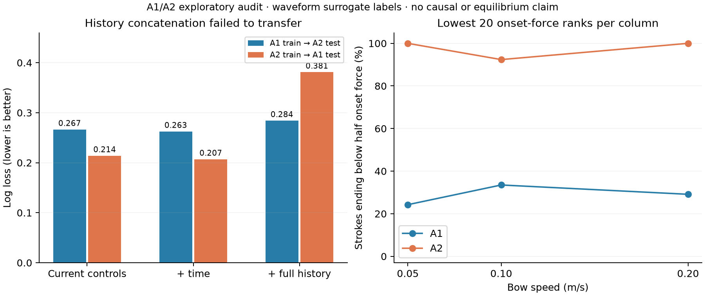

# 2026-10-18 공동 연구 검증 결과

현재 결론: **같은 관측 시간으로 맞추면 보편적인 최소 활 힘 법칙이 드러난다는 주장은 유지할 수 없다.** A2의 속도 지수 약 +1은 재현되지만, 같은 분석을 A1에 적용하면 +0.57~+0.67이다. 현재 힘뿐 아니라 시작 힘·가속도·이동 경로와 표본/세션 차이가 중요하다. 이를 단순히 변수로 추가하는 접근도 표본 간 예측 개선에 실패했다.

이 결과는 연구 실패를 감추는 이유가 아니라, 실제 방법론이 해결해야 할 문제를 구체화한다. 현재 **높은 novelty의 새 방법 또는 일반적인 성능 개선을 입증하지 못했다.** 정상상태 법칙, 물리적 hysteresis, critical slowing, 특정 bifurcation 유형을 확정하지 않는다.

## 1. 데이터와 측정 경로 검증

- A1·A2 각각 6,000개 시행에서 특징·시작 구간 메타데이터·50 ms 블록을 독립적으로 연결했다. 키 중복/누락 0, beta 불일치 0.
- 비교에는 각 시행의 0.2 s 창 네 개(평탄 구간 시작 기준 0, 0.1, 0.2, 0.3 s)를 사용했다. 표본당 24,000개 창이며, 세 속도와 모든 시행이 네 시점을 제공한다. 시행을 나누어 학습/평가하지 않았다.
- 현재 힘이 0 이하인 창도 예측 평가에 포함했다. 힘은 asinh 변환하여 접촉 손실처럼 어려운 사례를 제거하지 않았다.
- 고정 98.08 Hz 기준과 표본 전체에서 추정한 기준의 Helmholtz 이진 라벨 차이는 두 표본 모두 0이었다. 라벨은 파형 분류기의 대리 라벨이며 물리 상태를 독립적으로 측정한 정답은 아니다.
- 시작 힘으로 각 beta 열 내부를 정렬한 하위 20개 시행에서, 마지막 창의 힘이 시작 힘의 절반 미만인 비율은 A2에서 92.4~100%, A1에서 24.3~33.5%였다. 이는 명목 trial 순위와 다른, **측정 시작 힘 순위**의 요약이다.
- 현재 힘·beta 열·속도·시점을 근사적으로 맞출 수 있는 창은 약 85~86%였다. 그중 44~47%는 가속도가 두 배 이상, 55~60%는 시작 힘이 0.05 N 이상 달랐다. 재사용된 최근접 이웃을 이용한 공통 지지 범위 진단이며 인과 효과 추정이 아니다.

읽힌 힘의 이동거리 의존성은 시간만에 따른 단순 드리프트 설명보다 강한 근거를 갖는다. 다만 별도 교정 없이 위치 의존 센서 오차까지 모두 배제했다고 표현하지 않는다. [Lampis et al. 2024 §2.1](https://pub.mdw.ac.at/media/content_files/aacus240063_EwplPL3.pdf)은 힘을 직접 제어하지 않고 활 높이로 설정하며, 힘을 일정하게 유지하기 위해 활 중앙 6 cm를 썼음을 확인해 준다.

## 2. 시간 정렬 후에도 표본 간 법칙이 다르다

40개 beta 열 × 세 속도의 완전한 시행 범위에서, **각 창에서 실제 측정한 힘**으로 K=2 연속 양성 force-grid 경계를 추정했다. 원래 beta 격자를 복구하고 안정적인 interval likelihood와 세 초기값의 수렴을 확인했다.

| 창 시작 시각 | A1 속도 지수 | A2 속도 지수 |
|---|---:|---:|
| 0.0 s | +0.574 | +1.041 |
| 0.1 s | +0.639 | +0.945 |
| 0.2 s | +0.666 | +0.940 |
| 0.3 s | +0.655 | +0.968 |

A1의 각 시점에서 beta 열 단위 bootstrap 구간은 +1을 포함하지 않았다. 하지만 이는 해당 표본·고정 분류기·격자에 조건부인 안정성 구간이다. 여러 독립 표본의 모집단 불확실성이 아니다. A1/A2 구간의 일부 겹침도 있으므로 위 표를 곧바로 표본 차이의 유의성 검정으로 해석하지 않는다.

양성 구간이 전혀 없는 열을 오른쪽 censoring으로 취급하는 관례에는 단일 물리 경계 가정이 필요하다. 관측 시점의 force-grid 경계는 그 가정 아래의 기술적 요약이다. 힘 이력과 가속도가 함께 바뀌므로 무한 시간 경계나 독립적인 속도 효과로 해석할 수 없다.

## 3. 이력 변수의 단순 추가는 개선에 실패

실험 전에 `ANALYSIS_PLAN.md`에 변환·모델·평가 지표를 고정했다. 현재 힘/beta/속도 기준, 시간 추가 기준, 시작 힘/가속도/이동거리 추가 모델 및 각각의 제거 실험을 두 학습기로 양방향 평가했다. 총 24개 고정 모델 비교다. A1과 A2는 이미 관찰한 개발 자료이므로 새 독립 확인 실험이라고 부르지 않는다.

Histogram gradient boosting의 log loss — 낮을수록 좋음:

| 학습 → 평가 | 현재 조건 | 시간 추가 | 이력 전체 추가 |
|---|---:|---:|---:|
| A1 → A2 | 0.2665 | **0.2627** | 0.2842 |
| A2 → A1 | 0.2140 | **0.2070** | 0.3812 |

시간 기준 대비 이력 모델의 오차 증가는 +0.0216, +0.1742였다. 위치 열 단위 paired bootstrap 95% 범위도 각각 [0.0063, 0.0374], [0.1036, 0.2456]으로 악화 방향이었다. Logistic polynomial 모델에서도 양방향의 주 지표 개선은 없었다. 일부 IoU 개선만 골라 성공으로 보고하지 않는다.

가속도를 제거하면 특히 A2→A1 tree 모델의 오차가 0.2101까지 낮아졌다. 이는 표본마다 다른 공격 설계 관계를 학습한 것이 전이에 취약하다는 가설과 부합한다. **실패 원인이 입증됐다는 뜻은 아니다.** 가속도는 beta·속도·시작 힘으로 설명되는 설계 변수이며, 양쪽 표본의 설계 관계가 다르다.

이 실험은 현재 창의 실제 힘으로 현재 창의 상태를 설명하는 **동시점 분류**다. 미래 힘을 모르는 온라인 예측이라고 주장하지 않는다.



## 4. 기존 survival 사건 정의의 문제를 수치로 확인

기존 정의는 “그 이후 관측의 80% 이상이 양성인 첫 창”이므로 미래에 의존한다. 관측을 절반으로 줄이면 0.2 s 창 기준 사건 판정이 A1 86/6,000, A2 94/6,000에서 바뀌었다.

새 정의는 **연속 K개 양성 창의 판정이 완료되는 최초 시각**이다. 판정 시각은 창 끝이며, 누락된 시간 간격에서 연속 횟수를 초기화한다. K=1/2/3, 세 창 길이, 여러 절단 길이/시각에서 미래 관측 제거에 따른 판정 변경은 0이었다. 이 검증은 고정 분류기를 전제로 한다.

K=2로 검출한 뒤 다시 음성 창이 나타난 비율은 A1/A2에서 느린 속도 약 15~16%, 중간 속도 약 7%, 빠른 속도 약 5%였다. 따라서 최초 검출을 영구적인 물리적 lock으로 취급하지 않는다. 관측 종료까지 검출되지 않은 경우도 영원히 형성되지 않는다는 뜻이 아니다.

현재 힘이 계속 변하므로 이 사건 시각에서 상수 힘에서의 relaxation이나 bifurcation 유형을 추론하는 기존 survival 분석은 보류한다. 검출 규칙 수정만으로 censoring의 독립성이나 정상상태 식별이 해결되지는 않는다.

## 5. 선행연구와 다음 방법론의 기준

[Beigi & Conneely v3 §II-F–H](https://arxiv.org/html/2609.14990v3)는 이미 관측 길이에 따른 경계 변화와, 고정 조건의 playable map 밖에서 경로를 따라 유지되는 운동을 보고한다. 따라서 ‘시간/경로 의존성 최초 발견’을 novelty로 삼을 수 없다. [상세 검토](literature_identifiability.md)에 원문 위치와 한계를 기록했다.

다음 방법의 평가 대상은 **주어진 관측 이력에서 유한 시간 내 진입·이탈을 예측하는 문제**가 적합하다. 실제 방법론 기여를 주장하려면 관측 창에 따른 오차 또는 경로 지지 범위 문제를 다루는 구체적 결과와, 강한 같은-정보 기준 모델 대비 표본 간 개선이 필요하다. 단순 survival/RNN/HMM 추가나 새 이름은 기여로 계산하지 않는다.

다음 확인 실험에서는 예측 시점 이후의 실제 힘을 입력하지 않고, 과거 파형과 목표 창의 원시 샘플이 겹치지 않게 해야 한다. Persistence, 제어값만 쓰는 모델, 이력 GAM/tree, 작은 recurrent 모델을 모두 비교해야 한다. B1 이후 자료는 아직 이 문서의 예측 성능 평가에 사용하지 않았다. 새 방법이 정해지기 전에 무분별하게 평가하여 확인 자료를 소진하지 않는다.

현재 실측 자료는 cello G이다. violin D의 공개 그림 재분석 및 모의실험은 별도 근거이며, 이 결과를 실제 바이올린 전체에 검증된 방법이라고 부르지 않는다.

## 6. 돌아가는 작업과 남은 일

- 기존 `replicate.py` 한 개만 실행 중이다. 기본 B1 처리는 끝났고 C1 다운로드로 넘어갔다.
- `archive_companion.py`를 별도로 실행했다. 새 아카이브를 같은 파일시스템의 hardlink로 확보하고, 원래 `ramp_meta.py`와 `stroke_blocks.py` 실행 및 완전한 검증이 끝나야 보존 링크를 해제한다. 추출 중에도 다음 아카이브 발견/보존을 계속한다. 원래 아카이브나 기존 파이프라인을 삭제/재시작하지 않는다.
- A1 기존 추가 출력은 6,000개 coverage와 완전한 블록 길이를 확인해 등록했다. 삭제된 A1 원본의 MD5나 과거 추출 종료 코드를 이번 검증에서 확인했다고 주장하지 않는다. A2는 보존 원본 MD5까지 다시 확인하고 기존 출력을 검증했다.
- **B1 누락:** 보조 작업 활성화 전 06:16에 원본이 삭제됐고 추가 출력도 없다. `recover_B1.py`를 대기 작업으로 실행했다. 기존 대량 다운로드/추출 종료 후 디스크 60 GB와 다운로드/출력 여유를 확인하고 B1을 재다운로드한다. 현재 B1 추가 추출이 완료됐다는 뜻은 아니다. 기존 추출과 큰 아카이브 두 개의 디스크 사용이 겹치지 않도록 후순위로 배치했다.
- 보조 추출 실패 시 아카이브와 오류 로그를 보존한다. 폴더 basename 충돌, 8 s보다 긴 자료의 블록 절단 등은 완료로 처리하지 않는다. 기존 `replicate.py`의 비원자적 gzip 저장 결함은 여전히 별개다. 보조 추출이 성공해도 기존 특징 파일은 분석 전 별도 검증해야 한다.
- 이번 검증: 새 작업 35개 테스트, 이전 audit 5개 테스트 통과. 실제 7-Zip 고체 압축 fixture로 두 추출기의 stream 순서 가정도 검사했다.
- GitHub push 없음. 기존 동결된 연구 구현/결과 수정 없음.

## 재실행

```sh
cd "$HOME/violin-rne/astra_20261018"
PY="$HOME/violin-bowing-boundaries/.venv-mac/bin/python"
OPENBLAS_NUM_THREADS=1 OMP_NUM_THREADS=1 "$PY" -m pytest -q tests test_history_prediction.py
OPENBLAS_NUM_THREADS=1 OMP_NUM_THREADS=1 "$PY" history_prediction_audit.py
OPENBLAS_NUM_THREADS=1 OMP_NUM_THREADS=1 "$PY" support_audit.py
OPENBLAS_NUM_THREADS=1 OMP_NUM_THREADS=1 "$PY" compare_descriptive_boundaries.py
"$PY" plot_audit.py
```

실행 중인 companion/recovery/replicate를 다시 시작하는 명령은 위 목록에 넣지 않았다. 상태는 해당 `.log`, `archive_companion/receipts/`, `timeres/replicate_state.json`에서 확인한다.
