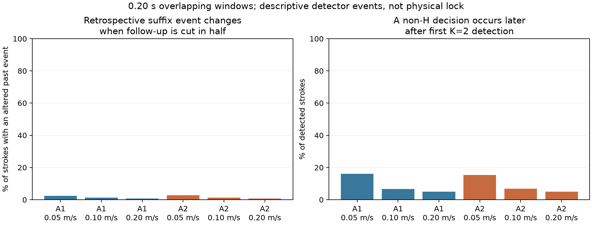

# Time-resolved event-definition audit — 2026-10-18

**Scope:** A1 and A2 public robot-bowing recordings, all available strokes and every cached 0.10/0.20/0.40 s window. This audit measures observed detector events. It does not estimate a steady-state boundary, physical locking time, critical-slowing exponent, or bifurcation type.

The former suffix rule chooses the first H-labelled window after which at least 80% of all remaining observed windows are H. This uses future observations, so truncating follow-up can change an event assigned to the past. A first-K run rule instead declares detection when K consecutive H decisions have become available. Each decision is stamped at the **window end**, not the start. K=1,2,3 and all three window lengths were retained, without target-driven selection.

## Main descriptive results (0.20 s windows)

| Sample | Speed (m/s) | Strokes | Suffix event changes after halving follow-up | First K=2 detected | Later non-H among detected | No K=2 detection by final decision | Multiple observed H episodes |
|---|---:|---:|---:|---:|---:|---:|---:|
| A1 | 0.05 | 2000 | 47/2000 (2.4%) | 1050 | 169 (16.1%) | 950 | 179 |
| A1 | 0.10 | 2000 | 26/2000 (1.3%) | 958 | 63 (6.6%) | 1042 | 67 |
| A1 | 0.20 | 2000 | 13/2000 (0.7%) | 540 | 27 (5.0%) | 1460 | 17 |
| A2 | 0.05 | 2000 | 55/2000 (2.8%) | 1329 | 204 (15.3%) | 671 | 215 |
| A2 | 0.10 | 2000 | 25/2000 (1.2%) | 956 | 66 (6.9%) | 1044 | 72 |
| A2 | 0.20 | 2000 | 14/2000 (0.7%) | 536 | 27 (5.0%) | 1464 | 22 |

Across every retained window length, nuisance setting, K, and prefix horizon, the first-K rule had **0 changes in 1,134,756 prefix comparisons**. Those comparisons repeatedly reuse the same strokes and are not independent replications. The exhaustive binary-sequence tests establish the stopping-rule property separately from these descriptive counts.



## What the event means

- For 0.20 s windows spaced by 0.05 s, the earliest K=1,2,3 detections are 0.20, 0.25, and 0.30 s after plateau onset. The historical survival code assigns a first-window event to an upper bound of 0.025 s; this precedes availability of the analysed waveform. Its last-window start is likewise earlier than the last observable decision.
- A first-K event is exact on the observed decision grid. No detection by the last window end is an observed detector follow-up limit; it is not proof that the physical process will never become H. Prefix stability does not establish the independent-censoring assumptions needed by a survival model.
- A later non-H decision demonstrates that first detection is not an absorbing detector state. Overlap, detector error, changing controls and physical switching can all cause recurrence; the audit cannot identify which mechanism applies. H-episode endpoint spans are released as descriptive decision spans, not inferred physical dwell durations.
- A1 nuisance parameters are estimated once from its full feature archive and then held fixed. A2 is analysed both with original acquisition-window nuisance constants and with current pipeline constants. Prefix causality is conditional on these fixed classifiers, not an assertion that archive-wide calibration itself is online.

## Force filtering and force history

No rows are removed by force in the primary event sequences. This avoids silently concatenating windows separated by missing nonpositive-force samples. Time-grid gaps reset the first-K counter. The former positive-force filtering is reproduced only as a separate sensitivity diagnostic.

| Sample | Speed | Legacy eligible strokes | Suffix time/status changes from filtering | Filtered sequences with internal time gaps |
|---|---:|---:|---:|---:|
| A1 | 0.05 | 2000 | 3 | 96 |
| A1 | 0.10 | 1954 | 0 | 35 |
| A1 | 0.20 | 2000 | 1 | 15 |
| A2 | 0.05 | 2000 | 39 | 88 |
| A2 | 0.10 | 2000 | 3 | 30 |
| A2 | 0.20 | 1943 | 2 | 7 |

**Force changes during these strokes.** Neither causal detection nor a corrected time stamp converts this acquisition into a constant-force relaxation experiment. Inferring critical slowing down or an equilibrium minimum-force law from stroke-average force and these events remains unsupported. Acceleration, travel and force history also require a separate support/identifiability analysis.

## Verification and outputs

13 tests pass, including all binary histories of length 2–8 at every strict prefix for K=1,2,3, literal historical-suffix equivalence through length 9, counterexamples in both lookahead directions, missing-time resets, recurrence and invalid-input rejection. Every input archive is SHA-256 checked before and after the run. All source records are retained in the output; source hashes and calibration constants are saved.

Full per-setting results: `*_event_audit.json`. Per-stroke detection times and force-filter sensitivity: `*_stroke_events.csv.gz`. Every observed H run with observation/gap-edge flags: `*_H_episodes.csv.gz`.

```bash
/Users/jeongjihoon/violin-bowing-boundaries/.venv-mac/bin/python -m pytest astra_20261018/tests/test_event_definition_audit.py -q
/Users/jeongjihoon/violin-bowing-boundaries/.venv-mac/bin/python astra_20261018/event_definition_audit.py --output astra_20261018/event_audit_new_run
```

Run from `~/violin-rne`. Existing audit outputs are preserved; choose a new output directory for a repeat.
