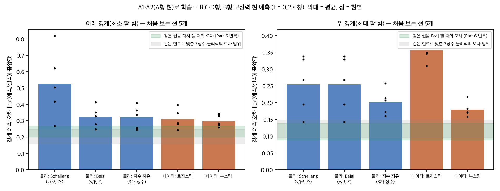
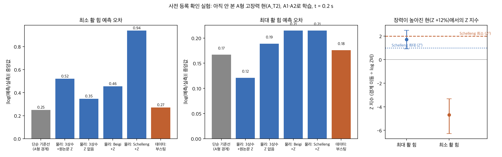
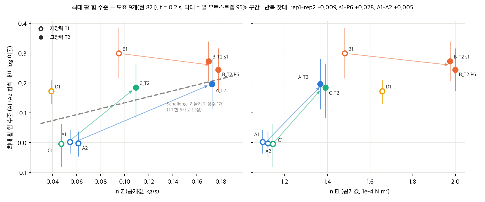
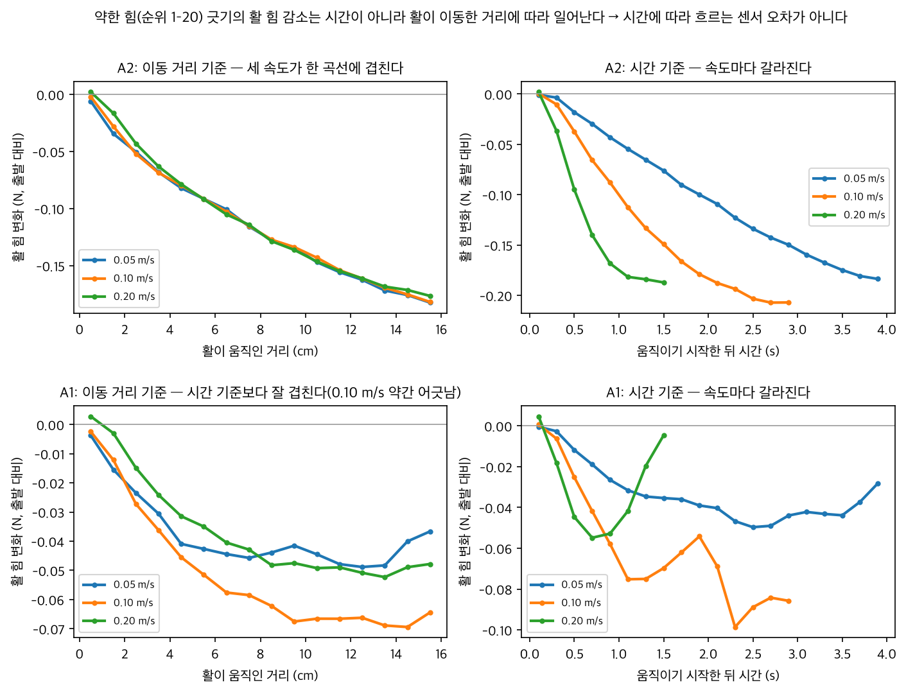

# 활–현 진동 경계의 측정 절차 의존성과 새 조건 예측

## 공개 첼로 자료 분석과 바이올린 문헌·시뮬레이션 비교

강원과학고 R&E · 김태건 · 정지윤 · 정지훈  
2026년 10월 19일 · 재현 및 반박 검증 반영 연구보고서 초안

**상태:** 기존 10개 도표에 대한 오프라인 검증을 정리했다. D_T2 확인 실험은 계획과 계수를 고정했으며 아직 채점하지 않았다. 제출 완료본이나 새로운 방법의 우월성이 입증된 논문으로 부르지 않는다. 이전 판은 [수정 전 보고서](/Users/jeongjihoon/violin-rne/astra_20261019/final_report_before_revision.md)에 보존했다.

## 초록

활–현 진동의 최소·최대 활 힘 경계는 악기 연주와 물리 모형의 검증에 중요하다. 그러나 유한한 시간창에서 측정한 경계를 정상상태의 물리 법칙으로 해석하려면, 출발 가속도·힘 변화·측정 시각·세션 차이를 구분해야 한다. 본 연구는 공개 로봇 운궁 첼로 G현 자료 10개 도표, 60,000번의 긋기를 재분석했다. 새로운 악기 측정은 수행하지 않았다. 바이올린과의 연결은 공개 문헌 그림의 재분석과 시뮬레이션에 한정된다.

같은 시각에 맞춘 아래 경계의 속도 지수는 A1에서 +0.57~+0.67, A2에서 +0.94~+1.04였고 독립 구현으로 재현되었다. 각 속도가 별도 기록 세션에 배치되어 있어 이 차이를 현 고유의 속도 효과로 분리할 수는 없다. 낮은 공칭 힘에서 읽힌 힘의 감소량과 도표별 아래 경계 수준의 상관은 r=0.880이었다. 하지만 측정 힘을 공칭 설정값으로 바꾸면 연관과 예측력이 약해졌다.

기준 경계 모양까지 학습 자료만으로 다시 추정한 도표 제외 검증에서, 힘 변화 기술자를 쓰면 수준 MAE가 0.213에서 0.101 log로 줄었다. 반면 유한 경계 구간의 열별 오차는 0.294에서 0.316으로 커졌다. 검열을 포함한 구간 거리는 0.315에서 0.303으로 소폭 줄었다. 따라서 도표 수준의 연관을 전체 경계 예측의 개선으로 확대할 수 없다.

기존 물리·기계학습 비교의 힘 범위, 비유한 경계, 적중률 처리를 수정한 결과에서도 보편적인 우위는 확립되지 않았다. 공개 임피던스를 쓰는 자유 지수 물리 모형과 단순 조회 기준선의 아래 경계 오차는 각각 0.268과 0.269였다. 위 경계의 모델 순위는 공통 평가 열을 사용하면 달라졌다. 본 연구의 현재 성과는 측정 절차와 평가 방식이 법칙 추정 및 모델 비교에 미치는 영향을 재현 가능한 형태로 정량화한 데 있다. 현 물성과 측정 절차의 인과 분해, 새로운 예측 방법의 우월성, 바이올린에 대한 실측 일반화는 남은 과제다.

## 1. 연구 질문과 증거의 범위

질문은 세 가지다. 첫째, 측정 시각과 힘 변화가 추정된 활 힘 경계를 얼마나 바꾸는가? 둘째, 새로운 현 종류·장력 조건에서 물리 모형과 데이터 모형은 단순한 기준선보다 정확한가? 셋째, 라벨을 쓰지 않고 얻는 힘 변화 정보가 경계 예측에 도움이 되는가?

경계는 브리지 힘 파형의 H 판정이 나타나는 범위로 정의한다. H는 헬름홀츠 운동을 추정하는 대리 라벨이다. 직접 측정한 현 운동의 정답도, 사람이 평가한 음질도 아니다. 본문에서 아래·위 경계는 이 관측 및 추출 규약에 따른 값이다. 물리적 분기점이나 정상상태의 최소·최대 힘과 자동으로 같아지지 않는다.

추가 구매, 센서 제작, 바이올린 실측은 연구 절차에 포함하지 않는다. 바이올린에 대한 직접적인 주장을 하려면 별도의 공개 바이올린 원자료 검증이 필요하다. 첼로 결과를 바이올린 실측 결과로 바꾸어 쓰지 않는다.

## 2. 자료, 분석 단위와 노출 이력

| 조건 | 분석 도표 | 긋기 수 |
|---|---|---:|
| 저장력 T1 | A1, A2, B1, C1, D1 | 30,000 |
| 고장력 T2 | A_T2, B_T2s1, B_T2r1, B_T2r2, C_T2 | 30,000 |
| 합계 | 10개 도표, 4개 현 종류, 7개 종류×장력 조합 | 60,000 |

도표 하나는 속도 3개(0.05/0.10/0.20 m/s), 접촉 위치 β 40개, 공칭 힘 순위 50개로 구성된다. 각 속도 폴더의 2,000개 trial ID와 40×50 격자, 시각별 누락·중복을 검사했다. 같은 긋기의 여러 시간창은 새로운 독립 실험이 아니다. B_T2 반복 도표들도 독립적인 현 종류가 아니다. 자료 수집 사이에 같은 물리적 현이 재사용되었는지는 확인되지 않았으므로 독립 현 개수를 임의로 제시하지 않는다.

T1 자료의 폴더 날짜는 2024년 3~4월, T2는 6월과 10월에 배치된다. 이는 경로에 적힌 날짜이며 원시 헤더의 실제 시각까지 독립 검증한 값은 아니다. 현 종류·장력·날짜가 충분히 교차하지 않는다. 속도마다 별도 기록 세션이므로 속도와 세션도 분리되지 않는다.

기존 10개 도표는 현재 모두 개발에 노출되었다. A_T2는 당시 로컬 계획을 고정한 뒤 한 번 채점한 확인 사례였으나, 지금은 추가 모델 선택의 독립 확인 자료가 아니다. B1·C1·D1·B_T2 두 반복의 비교도 이전 관찰 이력이 있어 엄격한 미공개 평가로 부르지 않는다. D_T2와 그 뒤 자료의 결과는 아직 보지 않았다.

## 3. 분석 방법과 검증 규약

### 3.1 시각과 경계 추출

평탄 구간 시작을 t=0으로 삼고 길이 0.2초의 창을 사용한다. 주 분석은 창 시작 t=0.2초다. 해당 라벨은 t=0.4초 이후에 계산할 수 있다. 속도별로 서로 다른 정착 시간이 들어가던 기존 분석창을 같은 시각으로 맞췄다.

고정 분류기의 진폭 기준은 과거 A2에서 유도되었다. 이는 독립적인 정답 센서나 매번 학습 표본에서만 추정한 관측 모형이 아니다. 동일한 공개 대리 판정 규약으로 비교한다는 범위로 해석한다.

같은 β·속도의 50개 **서로 다른 긋기**를 힘 순으로 정렬한다. K=2는 이 순서에서 이웃한 두 긋기가 H인 규칙이다. 한 긋기에서 시간상 두 창 연속 H라는 뜻이 아니다. 아래 경계는 첫 양성 묶음의 바로 앞 힘과 시작 힘 사이, 위 경계는 마지막 양성 묶음 끝과 그 다음 힘 사이로 잡는다. 여러 양성 묶음이 있으면 전체 범위를 감싸는 기존 단일 띠 규약을 유지한다.

범위 밖 경계를 임의의 점으로 대입하지 않고 검열로 기록한다. H 묶음이 전혀 없는 열은 기존 계산 규약에 따라 아래 경계의 오른쪽 검열로 처리하고, 위 경계는 관측 불가로 기록한다. 이는 단일 띠 모형의 가정이며 물리적으로 유일한 해석이 아니다. 미검출 수를 별도로 공개한다. 측정 힘의 0 이하 값 등에 적용한 0.001 N 하한 처리도 남아 있는 한계다.

### 3.2 수준과 열별 경계를 구분한다

기준 모양을 다음과 같이 둔다.

\[
\log F_d(v,\beta)=c+a\log v+b\log\beta+\Delta_d.
\]

여기서 Δ는 도표의 전체적인 로그 힘 이동이다. 검열 구간의 정규 우도를 최대화하여 추정한다. 이것은 모든 열의 오차가 작다는 뜻이 아니다. 본 연구는 다음 세 지표를 구분한다.

수치식에서 F는 N, v는 m/s 단위의 값이며 β는 무차원이다. Δ도 직접 측정된 물리적 참값이 아니라 정한 형상과 우도 아래의 추정량이다.

- **수준 오차:** 예측 Δ와 목표 도표에서 추정한 Δ의 절대 차이.
- **유한 열 오차:** 양끝이 유한한 관측 구간의 로그 중점과 점 예측의 절대 차이. 도표별 중앙값을 먼저 구하고 도표 간 평균한다.
- **구간 거리:** 점 예측이 관측 구간 안이면 0, 밖이면 가까운 끝까지의 로그 거리. 검열 구간도 포함하되 넓은 구간은 맞히기 쉬운 한계가 있다.

수준 추정은 검열을 포함한 우도를, 유한 열 오차는 선택된 열의 절대 오차를 사용한다. 두 지표의 순위는 다를 수 있다. 둘 중 유리한 지표만 골라 방법의 성공을 주장하지 않는다.

### 3.3 힘 변화 기술자와 검증 분할

`dec5_pl`은 낮은 공칭 힘 순위 1~20의 긋기에서 계산한다. 첫 [0, 0.1]초 평탄창의 평균힘과, 창 속도×창 시작시간이 0.05 m 이상인 최초 0.1초 창의 평균힘의 차이다. 속도별 800개 긋기의 중앙값을 구한 뒤 세 속도를 동일 가중 평균한다. 음수는 감소를 뜻한다.

이는 정확히 적분한 이동거리 5 cm의 순간힘도, 활 출발 전 힘과의 차이도 아니다. 0.05 m/s에서는 약 1초 뒤의 관측이 필요하다. H 라벨을 읽지 않지만 목표 도표의 후속 힘 측정을 사용하므로, 시작 전 제어 입력만으로 하는 예측이나 물성만으로 하는 예측과 정보량이 다르다. 제어 열만 읽는 독립 구현은 기존 10개 도표의 기술자를 모두 정확히 재현했다.

기존 결과를 재현한 뒤 힘 축 2가지(측정/공칭), K=2/3, t=0.1/0.2/0.3초의 12가지 민감도 분석을 모두 보고했다. 날짜·종류 제외 검증과 C형 잔차도 점검했다. 이들은 기존 탐색 결과에 대한 사후 반박 검증이며 새로운 사전 가설 검정은 아니다.

추가로 도표 하나 또는 현 종류 전체를 학습에서 제외하고, **기준 모양·학습 도표 수준·기술자 회귀를 모두 학습 자료에서 다시 적합**했다. 예측 이동량을 고정한 뒤에 평가 대상의 수준을 적합해 채점했다. 현 종류 제외 결과도 최종 평균은 도표별 동일 가중이며, 현 종류별 동일 가중 결과를 별도로 확인했다.

## 4. 측정 절차와 경계 법칙 감사

### 4.1 시간·힘·세션의 교락

이 장비의 힘은 활 높이를 통해 설정된다. 낮은 힘에서는 활이 이동하면서 읽힌 힘이 줄어든다. A2의 세 속도는 시간보다 이동거리 기준에서 잘 겹친다. 그러나 이것만으로 실제 접촉력 변화와 위치·자세에 따른 센서 오차를 구분할 수 없다. 센서 잡음이 비슷하다는 사실도 편향이 같다는 증거가 아니다. 비접촉 상태의 영점 차이와 세션 내 변화가 보고되어, 낮은 힘의 정량 해석에는 추가 불확실성이 있다.

출발 가속도도 힘과 접촉 위치에 따라 설계상 달라진다. 같은 시각의 창이어도 이동거리와 출발 이력은 같지 않다. 따라서 시각 정렬은 중요한 교락 하나를 줄이지만, 현 고유의 정상상태 법칙을 식별하지는 않는다.

### 4.2 재현된 속도 지수

독립 구현은 A1의 +0.57~+0.67, A2의 +0.94~+1.04를 소수 셋째 자리까지 재현했다. A1·A2 차이는 주로 0.05 m/s 조건에 집중된다. 그 조건에서 A1은 낮은 순위의 실제 출발힘이 공칭 설정값보다 특히 작았다. 시작힘을 축으로 바꾸어도 두 도표 차이가 해소되지는 않았다.

과거의 +1.77은 속도마다 다른 시점의 창을 비교한 결과여서 대표 속도 법칙으로 사용하지 않는다. 새로운 지수도 세션과 운궁 절차에 조건부인 기술량이다. 이 자료의 차이만으로 이론적 보편 법칙 자체가 반증되었다고 단정하지 않는다.

B_T2의 같은 날 반복 두 장은 해당 설정의 반복성을 보여준다. 다른 날짜·현·설치의 세션 분산을 정하는 자료는 아니다. A1·A2 차이를 순수한 표본 물성 차이로 판정하는 데 사용하지 않는다.

## 5. 아래 경계와 힘 변화: 강한 연관, 제한된 예측 개선

### 5.1 독립 재현과 반박 검증

측정 힘, K=2, t=0.2초에서 r=0.8798을 재현했다. 독립 경계·우도 계산의 기존 수준과의 최대 차이는 0.000037 log였다. 고정된 기준 모양 위의 회귀 단계 도표 제외 MAE는 0.0816이었다. Z 단독은 0.2059, EI 단독은 0.2100이었다.

다만 고정 기준 모양은 A1+A2를 이미 사용한다. 따라서 이 0.0816은 기준 모양 추정까지 포함한 완전한 도표 제외 성능이 아니다. 현 종류 전체를 제외하면 같은 회귀 단계 오차는 0.1290으로 커진다. A1+A2를 모두 빼도 상관은 0.688로 남지만, 작은 관련 표본의 탐색 결과다.

K·시각을 바꾼 측정 힘 6조건의 상관은 0.815~0.880이었다. 공칭 힘 축에서는 0.675~0.707로 약해졌다. 주 조건의 회귀 단계 교차검증 R²는 측정 힘에서 도표 제외 0.707, 현 종류 제외 0.489였으나, 공칭 힘에서는 각각 0.255와 −0.242였다. 힘 축이 바뀌면 반응 척도도 바뀌므로 두 축의 절대 MAE만 직접 비교하지 않는다.

날짜 선형 추세나 종류 효과를 제거한 잔차 상관도 남는다. 하지만 도표가 10장뿐이고 날짜·현·장력이 충분히 교차하지 않아 인과 효과를 식별한 것은 아니다. 기술자와 경계가 같은 힘 채널을 공유하는 점도 남는다. 현의 접촉 특성이 힘 변화 자체를 바꿀 수 있으므로 이를 회귀로 제거했다고 현 물성의 효과가 없어지는 것은 아니다.

### 5.2 기준 모양까지 다시 적합한 검증

| 제외 단위 | 예측 변수 | 수준 MAE | 유한 열 오차 | 검열 포함 구간 거리 |
|---|---|---:|---:|---:|
| 도표 하나 | 평균 수준만 | 0.2134 | 0.2937 | 0.3153 |
| 도표 하나 | 힘 변화 기술자 | 0.1012 | 0.3162 | 0.3032 |
| 현 종류 전체 | 평균 수준만 | 0.2210 | 0.3186 | 0.3355 |
| 현 종류 전체 | 힘 변화 기술자 | 0.1312 | 0.3541 | 0.3301 |

모든 열을 비교한 것은 구간 거리이고, 유한 열 오차에 쓰인 열은 1,200개 중 843개다. 도표별 유한 열 수는 58~112개다. 두 모델은 각 지표에서 같은 열을 사용한다. 현 종류별 동일 가중으로 집계해도 수준 개선, 유한 열 악화의 방향은 같다.

**결과는 혼합적이다.** 힘 변화 정보는 전체 수준 이동을 예측하는 데 도움이 된다. 유한 열의 실제 경계 위치 예측은 나빠지고 검열 포함 거리는 조금 좋아진다. “최소 경계는 측정 절차로 결정된다” 또는 “새 방법이 경계 예측을 전반적으로 개선했다”는 결론은 성립하지 않는다.

그림 1. 기존 10개 도표의 사후 감사. 기준 모양 재적합 여부와 힘 축을 구분했다. 모집단 신뢰구간을 주장하지 않는다. 숫자는 [저장 결과표](/Users/jeongjihoon/violin-rne/astra_20261019/audit_tables.md)에서 자동 생성했다.

### 5.3 남은 대안 설명

기존 역인과 점검의 “차이 ≤0.012 N”은 첫 평탄창 힘이 0.15~0.35 N인 넓은 범위를 모은 비교였다. 동일 출발힘·β·속도·가속도를 맞춘 대응 비교가 아니며 역인과를 배제하지 못한다.

C형을 통째로 제외한 고정 형상 회귀에서는 잔차가 C1 −0.241, C_T2 −0.167 log였다. 두 조건에서 낮은 방향이 남지만 C형은 이미 결과를 보고 선택한 대비다. 독립 확인이나 물리 기전의 증거로 쓰지 않는다.

## 6. 위 경계와 임피던스: 모델과 집계 수준을 구분한다

T1→T2 대비의 통합 Z 지수는 +1.28, 보고된 조건부 구간은 [0.61, 1.85]였다. 쌍별 값은 A 약 +1.7, B 약 −0.5, C 약 +3.3으로 이질적이다. 구간에 1이 들어간다는 이유로 세 종류 모두 같은 Z¹ 법칙을 따른다고 결론내릴 수 없다. 장력 조건과 날짜도 분리되지 않는다.

**기존의 “엄격한 cZv/β가 4% 오차로 예측”은 정정한다.** 0.0386 log RMSE는 A1+A2에서 학습한 경험적 모양 `v^0.66068 β^-1.11072`를 고정하고 Z¹로 도표 수준을 옮긴 결과다. B의 두 자료를 먼저 평균한 뒤 A·B·C 세 종류의 수준 오차를 집계했다. 모든 도표나 개별 경계가 4% 이내라는 뜻이 아니다.

엄격한 `cZv/β`의 고장력 자료별 유한 열 중앙 절대 로그오차는 A_T2 0.1989, B_T2s1 0.2137, B_T2r1 0.1248, B_T2r2 0.1130, C_T2 0.2234였다. 경험적 모양의 수준 전이와 엄격한 물리식의 개별 열 예측을 별도 결과로 유지한다.

같은 날 B_T2 반복의 위쪽 도표 수준 차이는 약 −0.009 log로 작았다. 그러나 해당 차이의 조건부 부트스트랩 구간은 약 [−0.112, 0.106]이고 공통 유한 42열의 중앙 절대 차이는 0.0828이었다. 작은 수준 차이를 전체 세션 잡음의 크기로 삼거나 현 종류 차이가 잡음의 10배라고 주장하지 않는다.

한 현의 공개 마찰 재구성 자료에서 얻은 힘·속도 의존성과 위 경계 속도 지수가 비슷하다는 결과는 정황적 보조 결과로만 남긴다. 현 식별과 열 마찰 기전의 유일성, 다른 현에서의 재현은 확립되지 않았다.

## 7. 물리 모형과 데이터 모형의 사후 수정 비교

A1+A2로 학습하고 이미 노출된 B1·C1·D1·B_T2r1·B_T2r2를 t=0.2초에서 평가했다. 물리 모형의 Z는 원논문 공개값을 사용한다. 목표 도표의 H 파형으로 추정한 과거 Z 버전은 별도 진단 자료로 보존하며 순수한 새 조건 예측으로 부르지 않는다.

수정 내용은 다음과 같다. 확률모형의 경계 추출을 각 열의 측정 힘 범위로 제한했다. 범위 끝까지 양성이면 검열로 남겼다. 빈 띠와 비유한 예측을 구분했고, 임의의 큰 오차 대입과 자동 적중 처리를 없앴다. 기울기 교정에서 NaN을 숨기던 경로를 수정했다. 과거 few-shot 수치는 이 수정으로 자동 복구되지 않으며 재사용하지 않는다.

오차는 도표별 유한 열 중앙값의 평균이다. 괄호 N은 전체 다섯 도표에서 그 지표를 계산할 수 있는 열 수다.

| 모델 | 아래 오차 (N) | 위 오차 (N) | 아래 점 적중 | 위 점 적중 |
|---|---:|---:|---:|---:|
| Schelleng 형상 + 공개 Z | 0.6468 (376) | 0.1949 (259) | 173/600 (28.8%) | 329/554 (59.4%) |
| Beigi 형상 + 공개 Z | 0.3063 (376) | 0.1949 (259) | 146/600 (24.3%) | 329/554 (59.4%) |
| 자유 지수 물리 모형 + 공개 Z | 0.2679 (376) | 0.1552 (259) | 149/600 (24.8%) | 347/554 (62.6%) |
| 같은 속도·가까운 β 5열 조회 | 0.2687 (376) | 0.1882 (259) | 136/600 (22.7%) | 80/554 (14.4%) |
| 로지스틱 회귀 | 0.3067 (363) | 0.2580 (181) | 85/600 (14.2%) | 45/554 (8.1%) |
| 그래디언트 부스팅 | 0.2878 (364) | 0.1692 (241) | 86/600 (14.3%) | 93/554 (16.8%) |

점 적중은 점 예측이 관측 구간에 포함되는 횟수다. 분모는 검열 관측까지 포함한 가용 관측 전체다. 검열된 예측과 관측 구간이 겹치기만 하는 경우는 점 적중이 아니다. 물리식은 측정 범위 밖에도 점을 내므로 무한 구간에 쉽게 적중할 수 있다. 반대로 확률모형은 측정 범위 밖 경계를 점으로 내지 않는다. **이 적중률은 정밀한 경계 추정 성공률이나 모델 간 공정한 단일 순위가 아니다.** 오차·검열·실패 수를 함께 읽어야 한다.

600열 중 H 띠 미검출은 46열이다. 부스팅은 빈 띠 43열, 아래 예측 검열 50열, 위 예측 검열 279열이다. 로지스틱은 각각 68, 52, 333열이다. 모든 모델이 점 예측을 낸 공통 열로 제한하면 위쪽 오차는 자유 지수 물리 모형 0.1804, 부스팅 0.1762로 순서가 바뀐다(181열). 아래 공통 열에서는 각각 0.2680, 0.2870이다(356열). 이 공통 부분집합에도 선택 편향이 남는다.

현재 결과는 단순 조회 기준선이 강하다는 것을 보여주지만 특정 모형의 일반적인 우위를 입증하지 않는다. 수정된 규약에 맞는 새로운 확증 비교 없이 과거 다른 규약의 부트스트랩 유의성 수치를 가져오지 않는다. 회귀와 부스팅의 원래 확률 출력에 대한 IoU·log-loss는 이전 실행과 수치 정밀도 내에서 같다. 이번 변화는 새 모형의 성능 개선이 아니라 평가 오류의 수정이다.

23개 회귀 테스트, 500개 집계 항등식, 12개 물리 적합의 수렴을 확인했다. 부스팅의 기존 내부 무작위 행 검증과 같은 긋기의 여러 시간창 의존성은 유지된 한계다. 상세 결과는 [수정 비교 보고서](/Users/jeongjihoon/violin-rne/astra_20261019/compare_fixed_results/README.md)에 있다.

## 8. A_T2 확인 사례와 시간 이력 예측

### 8.1 A_T2의 당시 확인 결과

2026년 10월 18일 로컬 계획을 고정하고 A_T2를 한 번 채점했다. 당시 규약에서 위 경계 오차는 자유 지수+공개 Z 0.121, 조회 기준선 0.167, 부스팅 0.176이었다. 아래 경계에서는 각각 0.520, 0.250, 0.271이었다. 따라서 “두 경계 모두 조회 기준선보다 낫다”는 확인 목표는 충족하지 못했다. 이는 당시 평가 규약의 기록이며 7절의 수정 비교표와 동일한 재평가로 부르지 않는다.

아래 경계 수준이 A형 저장력 기준보다 약 42% 낮았다는 관측은 보존한다. 그러나 “장력을 높이면 최소 활 힘이 내려간다”는 인과 해석은 철회한다. 반대로 “세션 효과 때문에 42% 내려갔다고 입증했다”로 대체하지도 않는다. 현·날짜·절차의 변화가 섞여 있다. 다른 종류의 T1→T2 대비가 같은 방향으로 일관되게 재현되지 않은 점도 함께 고려한다.

### 8.2 과거 창과 미래 목표창을 겹치지 않은 예측

A1↔A2 양방향에서 9개 고정 모형, 2개 미래 목표창으로 총 36개 적합을 수행했다. 입력은 t=0.2초까지, 주 목표는 [0.25, 0.45]초의 H 라벨이다. 이는 0.2초 길이의 미래 창에 대한 예측이며, 미래 한 시점의 물리 상태나 온라인 정착 시간 판정을 뜻하지 않는다. 두 방향 모두 6,000개 긋기를 유지했다.

평탄 구간 시작점은 전체 속도 파형에서 사후 추출한 외부 기준점이다. 완전한 온라인 검출기는 검증하지 않았다. 입력·목표창의 분리는 이 기준점에 상대적인 것이며, 라벨의 진폭 기준도 과거 A2에서 정한 값을 고정하여 사용했다. 보조 목표 [0.30, 0.50]초는 주 목표와 겹치므로 독립 반복 실험이 아니다.

| 모형 | A1→A2 log-loss | A2→A1 log-loss |
|---|---:|---:|
| 직전 H와 속도 기반 Markov 기준선 | 0.2984 | 0.2158 |
| 현재 창 특징 부스팅 | 0.1458 | 0.1133 |
| 과거 이력 추가 부스팅 | 0.1426 | 0.1047 |
| 현재 창 특징 로지스틱 | 0.1425 | 0.1297 |
| 과거 이력 추가 로지스틱 | 0.1405 | 0.4722 |

부스팅의 이력 추가 효과는 A1→A2에서 −0.00319, 위치 묶음 부트스트랩 구간 [−0.01222, +0.00559]였다. 역방향에서는 −0.00869 [−0.01749, −0.00016]이었다. 이 구간은 해당 세션에 조건부이며 현 모집단의 일반화 구간이 아니다. 로지스틱 역방향의 큰 악화까지 고려하면 “이력이 항상 개선한다”는 주장은 지지되지 않는다. 풍부한 현재 파형 특징이 단일 H 라벨보다 유용한 것과 새로운 이력 방법의 우월성은 별개다.

예측과 적합 모형을 채점 전에 저장했다. 포화 확률의 log-loss clipping 기준이 본 점수와 쌍대 비교에서 달랐던 문제는 저장 예측만 재채점하여 수정했다. 모델을 재적합하거나 좋은 결과만 선택하지 않았다. 이 결과는 이미 노출된 A1/A2의 개발 결과다.

## 9. 시뮬레이션과 철회한 주장

수립과 유지를 분리한 점-활 도파관 시뮬레이션은 이력 의존을 보였다. 하지만 이 현상 자체는 선행연구가 있다. 가속도와 마찰식 선택에 따라 지수가 크게 달라지고, 원래 솔버의 정착 시간 1~4초는 실측 추정 0~0.4초와 맞지 않았다. 비틀림을 넣으면 정착이 빨라지지만 최소 힘이 약 3배 커져 절대 경계가 더 멀어졌다. 문헌 불일치를 정량적으로 해결한 것으로 쓰지 않는다.

| 과거 주장 | 현재 처리 |
|---|---|
| 중간발표의 큰 보정 성능 향상 | 구현 오류로 철회 |
| 속도 지수 +1.77이 대표 법칙 | 분석 시각 교락으로 철회 |
| 거리 의존 힘 감소이므로 실제 힘 변화임 | 원인 미해결로 정정 |
| A2에서 수립 경계 아래 유지되어 실측 이력 효과 입증 | 최소값 정의와 무이력 귀무 모형으로 재현되어 증거로 사용하지 않음 |
| 임계 감속 또는 정확한 상실 사건 문턱 | 미식별·비현실적 적합으로 사용하지 않음 |
| 물리 모형은 부스팅보다 실패에 강함 | 측정 범위 밖 격자 인공물로 철회 |
| A_T2 −42%는 장력의 인과 효과 | 관측은 보존, 인과 해석 철회 |
| 최대는 물리, 최소는 절차로 결정됨 | 연관·제한된 전이 결과로 정정 |
| 엄격한 물리식이 모든 위 경계를 4% 이내 예측 | 경험적 모양의 집계 수준 RMSE로 정정 |
| 새 방법의 전반적 성능 우위 | 아직 입증되지 않음 |

## 10. D_T2 확인 계획과 아직 필요한 작업

[확인 계획](/Users/jeongjihoon/violin-rne/final/CONFIRM_PLAN_D_T2.md)은 2026년 10월 19일 01:19 KST에 결과를 보기 전에 저장하고 해시를 기록했다. 외부 사전등록이 아닌 로컬 동결이다. D_T2는 Z=1.2021 kg/s, EI=5.766×10⁻⁴ N m²인 조건이다.

아래 경계의 기준은 `log F = −1.451783 + 0.806141 log v − 1.032484 log β`다. 힘 변화 모형은 `Δ = 0.368611 + 7.672158 dec5_pl`로 고정했다. 물성 주 대조군은 log Z+log EI 회귀이며 D_T2 예측 Δ는 −0.372015다. 평균만 쓰는 대조군과 단일 물성 회귀도 함께 고정했다. 위 경계 주 예측은 `log F = 0.966005 + log Z + log v − log β`이고 경험적 모양+Z는 보조 예측이다.

아래 0.23 log, 위 0.12 log를 실용 허용오차로 고정했다. 이 값은 모집단의 95% 잡음 한계나 동등성 검정 한계가 아니다. 아래 모형의 비교 차이가 0.23에 미치지 못하면 구별 불충분으로 판정한다. 위치 40개를 세 속도에 걸쳐 묶어 재표집하며, 구간은 동결 예측에 조건부다. 학습계수·힘 변화 기술자·새 세션의 전체 불확실성을 포함하지 않는다.

실행은 두 단계다. 제어 신호만으로 기술자와 목표 예측을 먼저 저장·동결하고, 이후 처음으로 목표 H 라벨과 경계를 채점한다. K=3, t=0.1/0.3초, 공칭 힘 축은 미리 지정한 보조 분석이며 주 결과를 뒤집는 용도로 쓰지 않는다. 미식별이나 계산 실패는 검증 불가로 보고한다.

현재 다운로드는 사용자 요청 상태에 따라 중지되어 있다. Wi-Fi 재개 승인이 있기 전에는 다운로드·D_T2 채점을 실행하지 않는다. 이 확인 도표 하나의 성공도 보편 법칙이나 인과 기전을 확립하지 않는다. 이후 공개 출발 과도 자료는 별도 계획을 고정한 뒤 분석해야 한다.

## 11. 연구 기여와 남은 한계

현재 재현된 기여 후보는 측정 시각·힘 변화·세션 구조를 드러낸 감사, 경계 추출과 검열 처리의 재현 절차, 그리고 수준 개선과 개별 경계 개선이 다를 수 있음을 보인 평가다. 이는 오류를 숨기지 않는 연구 기반이며, 곧바로 새로운 학습 원리나 높은 학술적 신규성을 뜻하지 않는다. 수립/유지 차이와 경로 의존 자체에는 선행연구가 있다. 문헌 전체에서 최초라고 단정하지 않는다.

독립적인 현·세션 수가 작고 속도·날짜·현 물성이 교락한다. 라벨은 파형 대리 판정이다. 기술자와 경계는 같은 힘 채널을 공유한다. 낮은 힘의 센서 편향이 남는다. 반복 두 장으로 모집단 세션 분산을 정할 수 없다. 검열 경계의 위치가 알려지지 않아 유한 열 오차에는 선택이 생긴다. 역인과도 배제되지 않았다.

해외 학술지 원고로 발전시키려면 D_T2의 사전 고정 확인 결과, 라벨·힘 축·검열 가정의 민감도, 원자료 출처와 코드의 완전한 재현 묶음이 필요하다. 현 단계에서 ICML 수준의 새 방법과 성능 개선이 확보되었다고 주장하지 않는다. 후속 확인이 실패하면 측정 및 평가 방법에 관한 감사 연구로 범위를 좁히는 것이 증거에 맞다.

## 12. 재현 자료와 검증 상태

- [전체 감사 표·출처 해시](/Users/jeongjihoon/violin-rne/astra_20261019/audit_summary.json), [그림 생성 코드](/Users/jeongjihoon/violin-rne/astra_20261019/build_audit_outputs.py).
- [12조건 반박 검증](/Users/jeongjihoon/violin-rne/astra_20261019/protocol_results/results.json), [기준 모양 재적합 결과](/Users/jeongjihoon/violin-rne/astra_20261019/nested_protocol_results.json), [독립 코드 감사](/Users/jeongjihoon/violin-rne/astra_20261019/nested_audit.md).
- [비교 코드 수정과 전체 검열·실패 수](/Users/jeongjihoon/violin-rne/astra_20261019/compare_fixed_results/README.md).
- [미래 창 예측의 수정 채점 결과](/Users/jeongjihoon/violin-rne/astra_20261018/forecast/results/results_paired_corrected.json). 이전 실행과 예측은 보존했다.
- [D_T2 동결 계수](/Users/jeongjihoon/violin-rne/astra_20261019/d_t2_freeze/frozen_parameters.json), [동결 영수증](/Users/jeongjihoon/violin-rne/astra_20261019/d_t2_freeze/freeze_receipt.json).
- [변경 이력](/Users/jeongjihoon/violin-rne/COLLAB_LOG.md). 기존 코드·실패 결과·수정 전 보고서를 보존했다. GitHub에는 아직 반영하지 않았다.

코드 테스트는 모형 가정의 물리적 정당성을 입증하지 않는다. 재적합 감사의 기준 형상 28개는 모두 세 시작점에서 수렴했으나, 각 source/target 수준 적합의 세부 진단 전부가 결과 파일에 보존된 것은 아니다. 이 기록 한계도 남긴다. 현재 결과의 모델 선택·변수 탐색은 사후 분석이고, 이후 동결 확인만 별도로 해석한다.

## 참고 자료

아래는 기존 문헌 감사에서 사용한 자료다. 이번 오프라인 정리에서는 웹을 새로 검색하지 않았다. 문헌 부재나 최신성에 대한 새로운 검증을 의미하지 않는다.

- Schelleng, J. C. (1973). J. Acoust. Soc. Am. 53, 26. 활–현 진동의 고전적 경계 이론.
- Schoonderwaldt, E., Guettler, K., & Askenfelt, A. (2008). Acta Acustica united with Acustica 94, 604. [원문 PDF](https://knutsacoustics.com/files/schoonderwaldt-et-al.-empirical-schelleng.pdf).
- Woodhouse, J. (2003). Acta Acustica united with Acustica 89, 355. Galluzzo, P., Cambridge 박사학위논문. 출발과 정상 운동, 이력 의존 관련 기존 감사 참조.
- Mansour, H., Woodhouse, J., & Scavone, G. (2017). On Minimum Bow Force for Bowed Strings. [저자 원문](https://www.repository.cam.ac.uk/handle/1810/263508).
- Lampis, A., Mayer, A., & Chatziioannou, V. (2024). Acta Acustica 8, 44. [DOI](https://doi.org/10.1051/aacus/2024034).
- Lampis, A., Chatziioannou, V., & Scavone, G. (2025). POMA 58, 035013. 데이터셋과 현 물성 표.
- Mayer, A., & Lampis, A. IWK Technical Report 1-2024. [DOI](https://doi.org/10.21939/iwk-tech-report-1-2024).
- Matusiak, E., & Chatziioannou, V. (2024). J. Acoust. Soc. Am. 156, 1135. [DOI](https://doi.org/10.1121/10.0028228).
- van Walstijn, M. 외 (2026). Acta Acustica 10, 47. [DOI](https://doi.org/10.1051/aacus/2026042).
- Beigi, N., & Conneely, B. (2026). [arXiv:2609.14990v3](https://arxiv.org/html/2609.14990v3). 기존 감사에서 확인한 시뮬레이션 선행연구.
- IWK 공개 첼로 자료: [Part 1](https://zenodo.org/records/17749111), [Part 2](https://zenodo.org/records/17782542), [Part 4](https://zenodo.org/records/17782565), [Part 6](https://zenodo.org/records/17795326). 정확한 파일과 버전은 개별 실행 manifest를 따른다.

## 부록 그림

