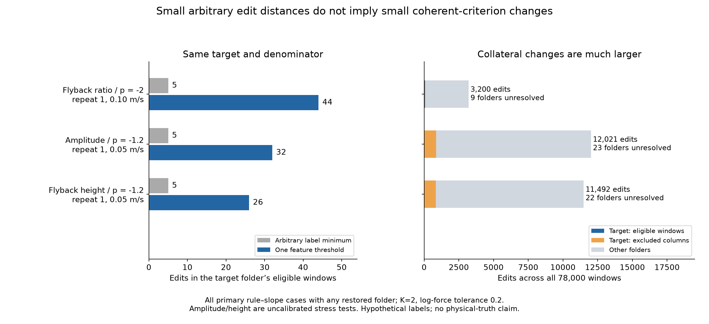
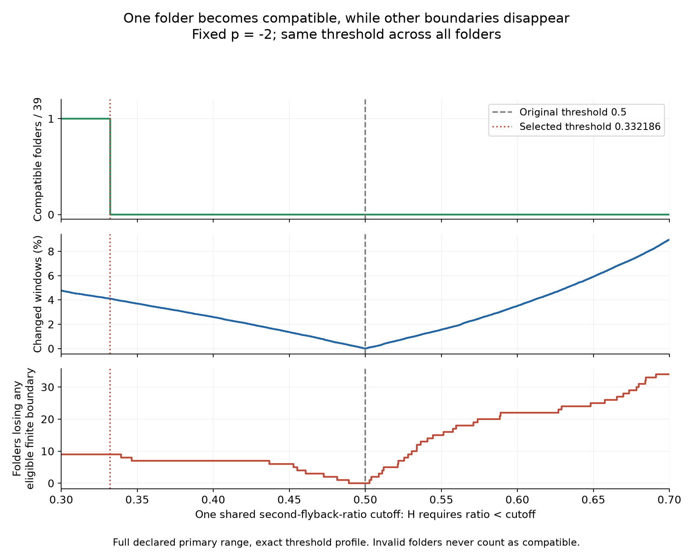

# 임의 라벨 변경과 일관된 파형 판정 규칙은 다른 결론을 준다

2026-10-21 · 구현·독립 전수 검증·실측 전체 적용·복사본 재현 완료. **이미 본 자료의 사후 방법 개발**이다. 원래 판정과 기존 통계 검정은 바꾸지 않았다. 실행 전 계획 `e94d8e4`, 도달 가능성 진단 추가 `61b5304`는 로컬 기록이며 공개 사전등록은 아니다.

## 이번에 답한 질문

앞선 연구는 창마다 독립적으로 H/비H를 바꿀 수 있다고 가정했다. 이번에는 **파형 특징 하나의 문턱 하나를 78,000개 창 전체에 똑같이 적용**했다. 폴더별 문턱·분위수 정규화·활 위치나 힘을 사용한 분류는 허용하지 않았다. 이 제약 안에서도 정해 둔 법칙 양립 결론이 바뀌는지, 최소 몇 개의 판정이 바뀌고 다른 조건에 어떤 영향이 생기는지 정확히 계산했다.

판정 대상은 이전과 같은 모든-열 구간 양립 규칙이다. 39개 속도 폴더, 원래 유한 양의 K=2 경계 1,132열·56,600창, 고정 지수 −2 또는 −1.2, 자유 절편, 주 허용 거리 ε=.2 자연로그 힘을 쓴다. 원래 제외된 열에도 공통 규칙을 적용하고 부수 변경을 센다. 변경 후 대상 열의 유한 경계가 없어지면 그 폴더를 성공으로 세지 않는다. **기존 MLE 신뢰구간 반전, 실제 오분류 개수, 물리적 참 법칙을 계산하는 문제는 아니다.**

## 결과: 가능하지만 드물고, 다른 조건에 미치는 영향이 크다

| 하나의 공통 규칙 | 탐색한 문턱 범위 | −2가 양립 가능한 폴더 | −1.2가 양립 가능한 폴더 |
|---|---|---:|---:|
| 주기성 하한 교체 | .7–.9 | 0/39 | 0/39 |
| 둘째 되돌이 비율 상한 교체 | .3–.7 | **1/39** | 0/39 |
| 원래 H에 진폭 하한 추가 | 0–∞, 교정되지 않은 스트레스 시험 | 0/39 | **1/39** |
| 원래 H에 되돌이 높이 하한 추가 | 0–∞, 교정되지 않은 스트레스 시험 | 0/39 | **같은 1/39** |

주기성과 비율 범위를 각각 [0,1]로 넓힌 별도 민감도에서도 ε=.2의 성공 폴더는 늘지 않았다. −2의 유일한 성공은 B_T2r1의 0.10 m/s, −1.2는 같은 반복 설치의 0.05 m/s다. 독립된 여러 현에서 반복 확인된 결과로 부르지 않는다. 앞선 임의 변경의 가능 수는 −2:14/39, −1.2:39/39였다. 따라서 **작은 임의 편집 비용을 실제 판정 기준 변경의 민감도로 바로 읽으면 크게 과장할 수 있다.**

| 성공 규칙·대상 | 임의 양방향 최소 | 임의 삭제만 최소 | 일관된 규칙의 대상 창 변경 | 해당 폴더 전체 변경 | 전체 78,000창 변경 | 다른 폴더의 경계 소실 |
|---|---:|---:|---:|---:|---:|---:|
| 비율 / −2 / 반복1·0.10 m/s | 5 | 6 | **44 / 1,200** | 88 | **3,200 (4.10%)** | 9폴더 |
| 진폭 / −1.2 / 반복1·0.05 m/s | 5 | 6 | **32 / 650** | 856 | **12,021 (15.41%)** | 23폴더 |
| 높이 / −1.2 / 반복1·0.05 m/s | 5 | 6 | **26 / 650** | 844 | **11,492 (14.73%)** | 22폴더 |

세 성공 규칙 모두 원래 H를 삭제한다. 따라서 **방향까지 맞춘 비교는 6→44, 6→32, 6→26**이다. 대상 창 기준의 규칙 제약과, 다른 창까지 바뀌는 부수 비용을 구분해야 한다. 3,200을 5로 나눈 값을 전부 '일관성의 비용'이라고 부르지 않는다.

비율 규칙은 원래 `ratio < .5`를 `ratio < .33218555281080747`로 바꾸면 성공한다. 주 범위 내 성공 구간은 [.3, .33218555281080747]로, 우연한 한 점에만 의존하지 않는다. 그러나 24개 대상 β 열 중 21개에서 적어도 하나의 라벨이 바뀌고, 전체 자료에서 다른 9폴더의 10개 대상 열이 더 이상 유한 경계를 갖지 않는다. 경계 소실은 분석상 미검출/검열을 뜻하며, 실제 오류나 물리적 손상을 뜻하지 않는다.

## 방법론적으로 추가한 것

**일관된 규칙으로 도달 가능한 첫 경계에는 구조적 제약이 있다.** `score >= t`일 때 힘 순서 K구간의 특징 최솟값을 q_s라 하면, 첫 run이 s에서 생길 조건은 `max(q_0,...,q_(s−1)) < t <= q_s`다. 즉 앞선 구간보다 엄격히 큰 새 최솟값 기록을 가진 위치만 첫 경계가 될 수 있다. `score < t`에서는 K구간 최댓값의 엄격한 누적 최저 기록이 대응한다. 고정 H/비H guard와 끝점도 포함했다. [증명·독립 구현](literature/ATTAINABILITY.md).

실제 주기성 .7–.9 범위에서는 1,132개 열 중 **1,112개(98.23%)가 가능한 유한 첫 경계 하나만** 가진다. 모든 가능한 힘 경계 후보 중 도달 가능한 비율의 열별 중앙값은 주기성 2.08%, 비율 6.25%, 진폭 20.83%, 높이 18.75%다. 이는 임의 라벨 최적화가 허용했던 많은 경계를 하나의 문턱으로는 만들 수 없음을 설명한다. 확률이나 분류 정확도는 아니다.

각 열에서 가능하더라도 필요한 문턱 구간이 서로 겹치지 않으면 동시에 실현할 수 없다. 모든 특징값 사건을 동률까지 함께 처리하는 sweep으로 실제 가능한 패턴을 빠짐없이 방문하고, 매 패턴의 K-run·절편 교집합·변경 수·무효 경계를 기록했다. 폴더별 최적 문턱은 참고용 oracle이고, 전체 결과에는 같은 숫자를 사용한다. [전체 알고리즘 증명](THEORY.md).

## 부수 영향을 보존하는 추가 진단과 허용 거리 민감도

**사후 추가 진단:** 원래 1,132개 대상 경계를 어느 폴더에서도 잃지 않아야 한다는 조건을 더하면, ε=.2에서는 조사한 여섯 범위 전부에서 복원 가능한 폴더가 0개다. 주 분석의 성공을 지우지 않고 별도 조건으로 보고한다. 선언한 규칙군 안의 정확한 불가능이며 모든 분류기의 불가능은 아니다.

이 결론을 모든 ε로 확대하면 틀린다. ε=0과 .1에서는 어떤 규칙도 양립을 복원하지 못했다. ε=.4에서는 원래 −2에 4폴더, −1.2에 1폴더가 이미 양립한다. 이때 비율 규칙은 **150개 전체 변경·경계 소실 없이** A4의 0.20 m/s를 추가해 −2에 총 5폴더를 양립시킨다. 폴더별로 다른 문턱을 고르면 6폴더가 각각 가능하지만, 하나의 공통 문턱으로 가능한 최대는 5다. 이것이 개별 최적 문턱을 합쳐 공통 기준의 성과처럼 표시하면 안 되는 실제 사례다. 성공 폴더가 교환되는 경우도 있어 개수와 ID를 모두 보존했다.

ε는 사전에 선택한 해상도이며 물리적 측정 오차의 신뢰구간이 아니다. ε=.2에서 두 지수 모두 처음부터 모든 폴더에 불양립이라는 점은 이 규칙의 엄격함을 보여준다. 이를 이전 MLE 결과와 동일시하지 않는다.

## 검증과 재현

- 독립 합성 코드: 828조건, 34,620개 프로파일 비교, 43,236개 최솟값 비교에서 일치.
- 첫 경계 닫힌형 구현: 14,560조건·94,024개 문턱 끝점/구간 비교 통과.
- 입력: 78,000개 창의 ID·힘·원래 라벨이 앞선 fixture와 일치. 네 규칙 모두 원래 문턱에서 판정을 그대로 재현.
- 실측: 독립 코드가 각 열의 모든 특징 문턱에서 라벨부터 다시 계산해 **182,057개 전역 문턱 패턴** 전부를 검증했다. 저장값 157,115,191개가 일치했다. 이는 코드 비교 수이지 실험 표본 수가 아니다.
- 공통 최적해 48개·예산별 288개·폴더별 1,872개를 검사하고, 공통 문턱 48개를 각각 전체 창에 직접 재적용했다. 비교에는 실패·무효·부수 변경·임의 비용 하한도 포함된다.
- 원자료 없는 복사본에서 전체 분석·독립 검증·그림을 재생했다. [실행 방법](REPRODUCE.md), [독립 검증 상세](verification/REVIEW.md), [해석 검토](literature/RESULT_REVIEW.md).

## novelty와 실제 연구 의미

문턱 sweep에는 [Fawcett(2006)](https://doi.org/10.1016/j.patrec.2005.10.010), 처리 선택에 따른 결론 차이에는 [Steegen 외(2016)](https://doi.org/10.1177/1745691616658637) 등의 선행이 있다. '문턱을 바꾸면 결과가 달라진다'나 정렬 알고리즘 자체를 최초라고 주장하지 않는다. [문헌 검토](literature/README.md).

기여 후보는 **임의 편집의 하한 → 파형 규칙으로 도달 가능한 경계 → 하나의 공통 문턱 → 다른 조건의 부수 변화**를 하나의 정확하고 재현 가능한 분석으로 연결한 것이다. 앞선 작은 변경 비용의 현실적 의미를 실제로 제한했고, 동시에 가능한 양립 변경의 구체적 기준도 찾았다. 이는 기존 결과를 무조건 지키거나 깨뜨리기보다 어떤 변화가 실제 규칙으로 구현되는지를 구분하는 연구 성과다.

독립 정답 라벨이 없으므로 더 정확한 분류기·오류 교정·물리 법칙 복원으로 부르지 않는다. 특징 추출은 고정했고 최종 문턱만 바꾸었다. β를 입력하지 않아도 특징의 β 의존성은 남는다. 특징 조합·다변수 규칙·새 파형 추출까지 인증하지 않는다. 전 자료가 이미 노출되었으며 새 독립 확인도 아니다. 모든 실측은 첼로이고 바이올린 측정 일반화는 없다.

## 저장 파일

`input_features.json.gz`는 파생 특징·guard·원래 판정을, `prior_input_columns.json.gz`는 이전 비교 입력을 담는다. [출처·변환·라이선스](DATA.md). `results.json`에는 최적 문턱·성공 구간·폴더 ID·예산별 결과, `profiles/*.npz`에는 모든 패턴, `diagnostics.json`에는 도달 가능성과 사후 무소실 조건이 있다. `PLAN.md`와 `ADDENDUM_ATTAINABILITY.md`를 포함해 실패도 보존했다. 논문 초안 v2.8 §3.13, 한국어 보고서 §10.13에 반영했다. 기존 PDF는 이 추가 결과를 포함하지 않는다.
