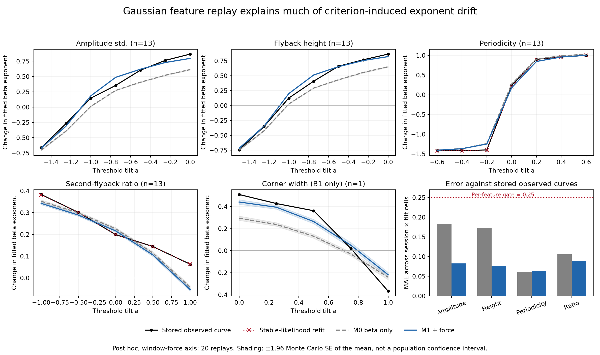

# 판정 기준이 활 힘 법칙을 바꾸는 경로 — 2026-10-21 결과

**이번 단계는 완료했다.** 최신 Claude 인계의 tilt 결과를 검토하고, 수학 반례·정량 모형·경계 위치 감사·선행연구 검토를 추가했다. 핵심은 **특징의 β 분포만으로는 판정 변경에 따른 경계 지수 변화를 알 수 없으며, 특징과 힘의 결합이 필요하다**는 점이다. 이 정보를 추가한 모형은 이미 본 자료의 판정 변경 반응 오차를 42.3% 줄였다. 외부 예측 성능이나 새 물리 법칙을 입증한 것은 아니다.

영문 원고 `../../paper/draft_v2.md` v2.6과 한국어 보고서 `../../final/최종보고서.md` 10.10–10.11절에 반영했다. 수정 전 문서는 `before_update/`에 보존했다. 기존 동결 확인 점수·원자료·다운로드 프로세스는 바꾸지 않았다. 이번 계산을 위해 새 장비나 데이터 다운로드는 필요하지 않았다.

## 1. 실제로 새로 얻은 결과

| 질문 | 결과 | 해석 범위 |
|---|---|---|
| 문턱 tilt가 증가하면 최소 힘 지수도 반드시 증가하는가? | 실제 K=2·구간 우도에서도 반례: 0 → −0.11905 | 기존 실측 방향성은 유지되지만 보편 정리는 아님 |
| 문턱 tilt를 전체 특징 기울기에 맞추면 중립적인가? | a=b=0인데 지수 0 → +1인 반례 | 중립화만으로 참 법칙을 복원할 수 없음 |
| β별 특징 분포가 같으면 반응도 같은가? | 힘 순서만 바꾸면 지수 변화 +1 → 0 | 특징–힘 결합을 버린 요약은 불충분 |
| 힘 의존성을 넣으면 정량 설명이 나아지는가? | 같은 마스크·안정 목표 MAE **.13365 → .07708 (42.32%↓)** | 같은 자료의 내부 설명력 개선 |
| 모든 특징을 설명했는가? | 둘째 되돌이 비율의 없는 중립점을 잘못 예측 | 보편 반응 모형은 아직 아님 |
| 최대 힘에 같은 규칙이 안 통하는 이유는? | 진폭 판정 변경 시 아래 끝점 43.6%, 위 끝점 5.9% 변화 | 경계 추출의 위치 효과, 지수 부호 증명 아님 |

정량 비교는 4특징·13도표·338개 도표×tilt 값이다. 이 값들은 독립 실험이 아니다. D_T2는 1 mN 클램프에서 생기는 폭0 구간 때문에 제외했고, B1 모서리 폭은 한 도표의 별도 보조 결과로만 썼다. 이전 '5특징 모두 14세션' 표현을 정정했다.

## 2. 방법과 성과의 정확한 뜻

M0는 기본 H 창에서 log 특징을 속도 폴더와 log β로 설명한다. M1은 log 측정 힘을 추가한다. 두 모형 모두 원래 H와 β·힘 격자는 알고 있다. 특징값만 가상 생성한 다음 같은 제거율·K=2·구간 우도로 판정 변경 반응을 재생한다. 지수 변화량 자체를 회귀 목표로 넣지 않았다.

실행 전 고정한 사후 설명력 기준은 전체 MAE≤.15, M0 대비 25% 이상 감소, 각 특징 MAE≤.25였다. 모두 통과했다. 비교의 공정성을 확인하기 위해 비양수 힘 H 창 4개에 대한 마스크를 일치시키고, 이전 적합의 수치 문제 네 건도 따로 감사했다. 각각의 결과를 보존했다.

| 평가 조건 | M0 MAE | M1 MAE | 감소율 |
|---|---:|---:|---:|
| 최초 계획·기존 저장 목표 | .13267 | .07720 | 41.81% |
| 같은 마스크·기존 저장 목표 | .13248 | .07720 | 41.73% |
| 같은 마스크·안정 재적합 목표 | .13365 | .07708 | 42.32% |

주 재생 13,720회와 동일 마스크 추가 적합 1,660회에서 미해결 수치 실패는 0회였다. 합성 계수 복원·gradient·기존 라벨/경계 재현도 점검했다. 이는 모형 가정이 참이거나 현 데이터의 정답 라벨을 확보했다는 뜻은 아니다.

진폭의 중립점은 관측 −1.0881, M1 −1.0933이었다. 그러나 되돌이 비율의 관측 곡선에는 [−1,1]에서 중립점이 없는데 M1은 +0.8325를 예측했다. 주기성은 기존 목표에서는 소폭 악화, 안정 목표에서는 소폭 개선했다. Gaussian 재생은 기본 H 판정 조건을 벗어날 수도 있다(주기성 0.054%, 비율 2.337%의 기대 비율). 따라서 실제 H 파형의 생성기나 모든 특징에 맞는 물리 모형으로 쓰지 않는다.

그림은 보존한 최초 계획의 결과다. 공통 마스크·안정 목표 집계는 위 표와 `response/matched_force_mask.json`에 있다. 음영은 고정 모형에서 20회 재생 평균의 ±1.96 Monte Carlo 표준오차이며 모집단 신뢰구간이 아니다.

## 3. novelty와 의미

가장 방어 가능한 기여는 **활–현 운동의 판정 기준이 물리 경계 법칙에 미치는 영향을, 특징–힘 관계와 K연속 경계 추출을 통해 분석하는 방법**이다. 지수의 차이를 새 물리 법칙으로 해석하기 전에 어느 부분이 판정 절차에서 생기는지 검사할 수 있게 한다.

넓은 발상 자체를 최초라고 주장하지 않는다. 공변량에 맞춘 문턱은 [Janes–Pepe (2009)](https://doi.org/10.1093/biomet/asp002), 문턱 오지정이 멱지수를 만드는 현상은 [Bryant 외 (2021)](https://arxiv.org/html/2010.02935v1), 검열 우도는 [Turnbull (1976)](https://doi.org/10.1111/j.2517-6161.1976.tb01597.x) 등의 선행이 있다. 활–현 분야에서도 [Beigi–Conneely v3](https://arxiv.org/html/2609.14990v3)는 분석 창과 판정 관례의 영향을 정량적으로 보고한다.

따라서 현재 수준은 **방법을 포함한 음향학 응용 연구의 기여 후보가 강화된 상태**다. 범용 ML 알고리즘의 신규성, 바이올린 실측 일반화, 외부 예측 우위는 아직 없다. 세계 최초나 특정 학술지의 채택 가능성을 수치로 단정하지 않는다.

## 4. 인계 요청별 처리

1. **정량 왜곡 모형:** 구현·채점·독립 코드 검토 완료. 설명력 개선과 실패 조건을 모두 기록했다.
2. **최대 힘 일반화 실패:** 추가 지수 탐색 대신 첫/마지막 K-run 변화 위치를 계산했다. 원래 실패를 성공으로 바꾸지 않았다.
3. **구간 검열 추정기를 새 방법으로 제안:** 고전 선행이 있어 그 자체의 novelty 주장은 제외했다. 안정 구현과 수치 감사의 역할로 유지했다.
4. **다른 자료/저자 라벨:** 공개 metadata에서 독립 저자 라벨의 존재를 확인하지 못했다. 압축 내부를 모두 보지 않았으므로 부재도 단정하지 않았다. 새 자료를 받지 않았다.
5. **선행연구:** 통계·분류·강건성 인증까지 범위를 넓혀 원문/초록을 확인했다. 확인 수준은 문헌 메모에 구분했다.

## 5. 남은 핵심 작업

**2026-10-21 후속 갱신:** 아래에서 설계로 남겨 둔 최소 변경 방법은 이제 [run_fragility](../run_fragility/README.md)에서 구현·독립 전수 검증·실측 적용을 완료했다. 정확한 대상은 새로운 모든 열의 구간 양립 판정이며 기존 MLE 검정은 아니다. 아래 단락은 그 작업 전의 상태 기록이다.

후속 방법론으로는 **특정 물리 법칙과 양립하려면 K-run 판정을 최소 몇 개 바꿔야 하는가**를 정확히 계산하는 문제가 남는다. 최소 변경이라는 발상 자체는 Fragility Index와 label-robustness 선행이 있으므로, 힘 격자와 K-run에 특화한 정확한 계산·검증이 필요하다. 이번에는 설계 검토만 했고 구현한 성과로 세지 않는다.

진행한다면 먼저 작은 합성 격자의 전수조사와 맞는 동적 계획을 만들고, 고정 법칙·허용 변경 방향·no-band 처리·힘 축을 명시해야 한다. 찾아낸 변경 사례는 최소 비용의 상한이며, 더 적은 변경으로 불가능함을 증명하기 전에는 인증이라고 부르지 않는다. 실제 데이터에서 낮은 변경 비용이 나와도 라벨이 그만큼 틀렸다는 뜻은 아니다.

원고 제출 준비는 별도다. 중심 기여 하나로 재구성, 전체 입력부터 재현하는 실행 묶음, 저자 검토와 출처·그림 정리가 남았다. 같은 데이터에서 조건을 계속 바꾸는 것을 새 독립 검증으로 세지 않는다.

## 6. 재현 파일

- [실행 전 계획과 감사 수정](PLAN.md): 로컬 계획 커밋 2d8b05c, 4172da3, e79e7fa. 모두 이미 결과를 본 자료의 사후 계획이다.
- [수학적 범위](theory/REPORT.md), [합성 검증](theory/counterexamples.py), [결과](theory/counterexamples.json).
- [정량 재생 보고서](response/RESULT.md), [주 코드](response/replay.py), [동일 마스크 감사](response/matched_force_mask.py), [수치 감사](response/audit_and_present.py), [조건 범위 진단](response/support_diagnostic.py).
- [경계 위치 분석](locality/RESULT.md), [코드](locality/analyze.py), [그림](locality/fig_endpoint_locality.png).
- [독립 코드·해석 검토](review/response_review.md), [선행연구와 미구현 후속 방법의 범위](literature/README.md).

실행은 `~/violin-rne`의 기존 파생 특징 캐시를 필요로 한다. 원자료·캐시를 포함한 완전한 독립 재현 패키지는 아직 아니다. 각 JSON에 입력·코드 해시를 기록했다. 새 GitHub 게시 없이 로컬 연구 snapshot으로 저장한다.
