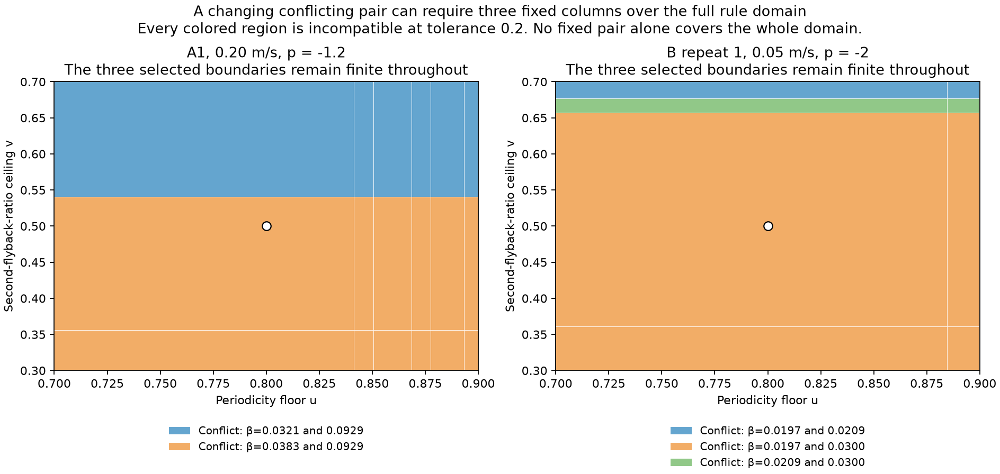
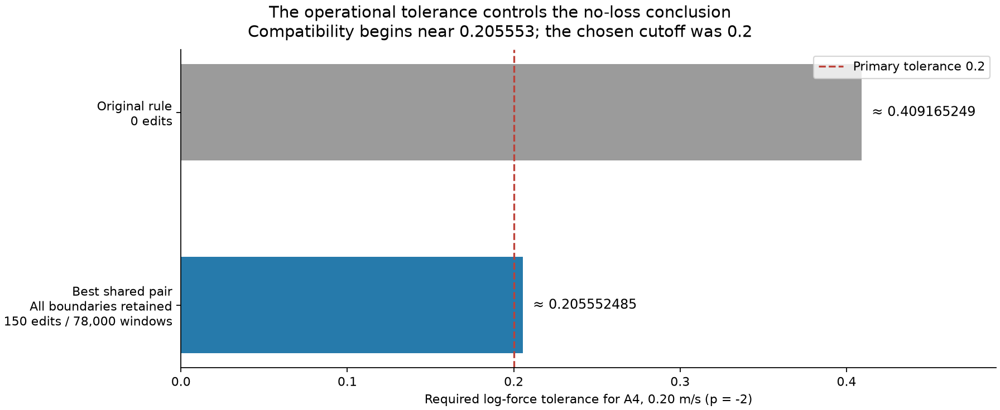
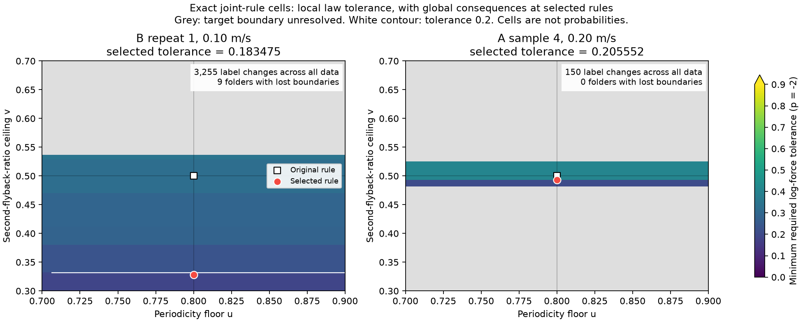

# 공통 판정 규칙의 가능 영역과 최소 모순 증명

2026-10-21. 이번 성과는 **공통 파형 기준으로 가능한 결론의 범위와, 불가능한 이유를 작고 검증 가능한 증거로 설명하는 방법**이다. 두 문턱의 전 영역 계산, 최소 고정 β 열 집합, 연속 허용 오차 진단까지 구현·독립 검증했다. 이미 본 첼로 자료의 사후 방법 개발이며, 새로운 물리 법칙이나 바이올린 실측 결과가 아니다.

## 가장 중요한 결과

주기성 하한 `u∈[.7,.9]`와 둘째 되돌이 비율 상한 `v∈[.3,.7]`을 **동시에 바꾸고, 같은 숫자 쌍을 전체 78,000개 창에 적용**했다. 기존 물리 조건은 고정했다. 기본값은 (.8,.5)이다. 두 단일 기준의 기존 결과를 합치는 방식은, 두 기준을 함께 완화할 때만 새로 허용되는 105개 창을 놓친다. 원래 특징 캐시에서 공통 조건을 다시 추출하고 기본값 판정 78,000개가 모두 일치하는지 확인했다.

판정 대상은 이전과 같은 모든 대상 열의 법칙 구간 양립 여부다. K=2, 원래 유한 양의 경계 1,132열, 고정 지수 p와 자유 절편, 주 허용 거리 ε=.2를 사용한다. **기존 MLE 검정이나 실제 정답 라벨의 반전이 아니다.** 조사 범위는 두 특징의 지정된 직사각형이며 모든 가능한 분류기를 뜻하지 않는다.

| 주 ε=.2 | 임의 변경으로 가능했던 폴더 | 두 문턱을 함께 바꿔 가능한 폴더 | 모든 기존 경계 보존 시 |
|---|---:|---:|---:|
| p=−2 | 14/39 | 1/39 | 0/39 |
| p=−1.2 | 39/39 | 0/39 | 0/39 |

−2의 한 성공은 이전과 같은 B_T2r1·0.10 m/s다. 가장 적은 전체 변경으로 성공하는 공통 규칙은 대상 44개, 전체 3,200개를 바꾸고 다른 9폴더의 경계를 일부 잃는다. 두 특징의 결합으로만 새롭게 가능해진 폴더는 없었다. 이는 두 특징의 결합을 놓친 탐색 실패가 아니다. **597,003개 폴더별 영역, 22,282,064개 공통 영역 전체**를 확인했고, 합성 자료에서는 두 문턱을 함께 바꿔야만 성공하는 사례를 정확히 검출했다. 영역 수는 독립 실험 수나 서로 다른 라벨 벡터 수가 아니다.

## 새 방법: 작은 고정 집합으로 전 영역의 불가능을 증명

어떤 문턱에서 법칙 절편의 교집합이 비면, 아래 끝점이 가장 높은 열과 위 끝점이 가장 낮은 열이 충돌을 설명한다. 그러나 문턱이 바뀌면 그 두 열도 달라질 수 있다. 그래서 **같은 β 열 집합이 문턱 전 영역에서 계속 불가능을 증명하는지**를 별도로 계산했다. 모든 쌍을 조사하고, 쌍으로 안 되는 경우에는 모든 세 열 조합을 조사했다. 이는 공동 결과를 본 뒤 추가한 사후 설명 분석이다.

이전 임의 변경 문제에서 힘 격자가 허용했던 경우만 보면 다음과 같다.

| 공동 규칙에서 불가능한 조건·지수 조합 | 실패 수 | 정확한 최소 고정 집합: 2열 | 정확한 최소 고정 집합: 3열 |
|---|---:|---:|---:|
| p=−2 | 13 | 12 | 1 |
| p=−1.2 | 39 | 38 | 1 |
| 합계 | **52** | **50** | **2** |

별도로, 이전부터 힘 격자 자체가 불가능했던 p=−2의 25조건도 두 열로 증명되지만 **새로운 분류 규칙 제약의 증거에 합산하지 않는다.** 전체 77개 실패의 최소 집합은 75개가 두 열, 두 개가 세 열이다. 한 열은 원래 문턱에서 유효하므로 전 영역의 불가능을 증명할 수 없다. 따라서 발견한 두 열 집합은 정확히 최소이고, 세 열 사례도 모든 쌍의 실패를 확인했으므로 정확히 최소다. 최소 단위는 β 열이지 라벨 수가 아니다.

세 열이 필요한 사례:

- A1·0.20 m/s, p=−1.2: β≈0.03207, 0.03828, 0.09288.
- B_T2r1·0.05 m/s, p=−2: β≈0.01969, 0.02094, 0.02996.

각 문턱에는 충돌하는 두 열이 있지만, 같은 두 열로 전 범위를 덮을 수는 없다. 세 열을 함께 보면 전 영역을 덮는다. 두 사례 모두 선택된 세 경계가 전 영역에서 유한하며, 경계 소실에 의존하지 않는 수치적 충돌이다. **세 열이면 항상 충분하다는 정리는 아니다.** 새로운 52실패 중 50개는 경계 소실에 의존하지 않는 고정 쌍 또는 세 열 인증이 존재한다. 나머지 두 경우는 일부 영역에서 무효 경계를 이유로 사용한다. [전체 표](theory/obstruction_table.md), [증명과 영역 기록](theory/obstruction_summary.md).

## ε=.2의 불가능을 강한 물리적 강건성으로 읽으면 안 되는 이유

고정된 문턱에서 필요한 최소 허용 거리를

`δ = max(0, (최대 아래 절편 끝점 − 최소 위 절편 끝점) / 2)`

로 계산하고, 두 문턱 전체에서 최소화했다. 모든 원래 대상 경계를 보존하는 경우, p=−2가 어느 한 폴더에서라도 양립하기 시작하는 최소값은 **0.2055524847973138**이다. 해당 사례는 A4·0.20 m/s, 공통 문턱 (.8, .49326392706532574)이며 **대상 1개·전체 150개 판정 변경**, 경계 소실 0이다. 원래 기준에서 이 폴더는 약 0.409165의 허용 거리를 필요로 했다.

독립 재판정에서 ε=.205552는 불양립, ε=.205553는 양립이었다. 저장된 float64 끝점에 대한 가장 작은 통과 수와 그 바로 이전 실패 수까지 확인했다. ε=.2와의 차이는 약 **0.005553 log-force**뿐이다. 따라서 ε=.2에서의 불가능은 선언한 판정 규칙에 관한 정확한 결과이고, 물리적으로 오차에 둔감하다는 증거가 아니다. ε는 교정된 측정 잡음이나 신뢰구간이 아니다.

폴더별 최소 δ는 각각 다른 문턱을 허용하는 oracle 값이며, 모든 폴더가 동시에 그 값을 달성하는 한 쌍이 아니다. `results.json`은 이 구분과 실제 공통 규칙의 예산별 결과를 모두 보존한다. p=−1.2의 폴더별 최소 δ 중 가장 작은 값은 무제한 0.227326, 모든 경계 보존 시 0.290378이다. 모든 폴더의 동시 양립을 위한 최소값은 아니다.

이 그림의 B 반복1 선택점은 **허용 거리 최소화** 목적이라 전체 3,255개가 바뀐다. ε=.2에서 변경 수를 최소화하는 앞의 3,200개와 목적이 다르다.

## 기술적 구성과 검증

K개 힘순 이웃 창의 run은 `u ≤ 그 구간의 최소 주기성`, `v > 그 구간의 최대 비율`이라는 사각형에서 활성화된다. 첫 run의 영역은 그 사각형에서 앞선 run들의 영역을 뺀 집합이다. 이를 각 열의 절편 구간과 결합해 성공 영역과 불가능 영역을 계산했다. 무효 경계 한 열 또는 충돌하는 두 열로 각 영역을 검증할 수 있고, 전체 영역을 덮는 고정 열 집합을 별도로 최소화했다. [수학적 구성](theory/THEORY.md).

- 합성 755조건, 90,140개 문턱 쌍: 판정·비용·경계 증명 일치.
- 입력 78,000개 ID·힘·라벨 일치; 기존 단일 문턱 판정 62,394패턴·3,119,700개 라벨 비교 일치.
- 모든 597,003개 국소 영역을 별도 열별 직접 재판정으로 확인; 16,184,036개 저장값 일치.
- 모든 22,282,064개 공통 영역을 독립적으로 훑어 예산별 96개·국소 1,248개·최소 허용 거리 156개 최적성과 불가능 판정 확인.
- 최소 모순 집합: 33,728개 쌍·5,246개 세 열 조합 전수 검증. 77개 선택 증명의 1,660개 사각형과 75,062개 영역·끝점 검사 통과.
- 별도 복사본의 12단계 전체 재현을 162.21초에 완료했다. 92개 결과 파일, 1,063개 배열의 16,248,845개 값, JSON 수치197,575개가 일치하고 그림3개를 재생성했다. 원본과 복사 입력은 변경되지 않았다.
- 모든 검증은 계산 정확성에 관한 것이며 독립적인 물리 실험 수가 아니다. [독립 검증](verification/REVIEW.md), [복사본 전체 재현](REPRODUCE.md), [출처·변환](DATA.md).

## novelty와 연구 의미의 범위

공동 문턱 최적화, 사각형 기반 검증, 최소 모순 부분집합에는 선행연구가 있다. [IJCAI 2021의 제약 설명 연구](https://www.ijcai.org/proceedings/2021/191), [NeurIPS 2019의 트리 검증 연구](https://proceedings.neurips.cc/paper_files/paper/2019/hash/cd9508fdaa5c1390e9cc329001cf1459-Abstract.html), [문헌 감사](theory/LITERATURE.md). 2차원 탐색만으로 큰 novelty가 생겼다고 주장하지 않는다.

이번 기여 후보는 **공통 파형 규칙 → 힘순 첫 경계 → 법칙 양립 → 다른 조건의 경계 소실**을 정확한 가능 영역으로 연결하고, 불가능한 이유를 최소 고정 측정 위치 집합으로 설명하며, 그 설명이 성립하는 허용 거리까지 계산한 것이다. 이를 통해 '몇 개 라벨을 바꾸면 된다', '공통 기준으로는 안 된다'라는 두 주장 모두에 필요한 조건을 구체적으로 제시한다. 어떤 측정 위치가 충돌을 만드는지 식별하므로, 향후 판정 검토 대상을 정하는 데도 유용하다. 다만 해당 위치가 잘못 측정됐거나 잘못 분류됐다는 뜻은 아니다.

독립 정답 라벨, 새 현에서의 성능 개선, 기존 MLE 추론의 반전은 검증하지 않았다. 더 많은 특징이나 다른 추출기를 포함하는 모든 분류기에 대한 보장도 아니다. 측정 자료는 첼로다. 기존 동결 결과·원자료·이전 논문 PDF는 그대로 보존했다.
