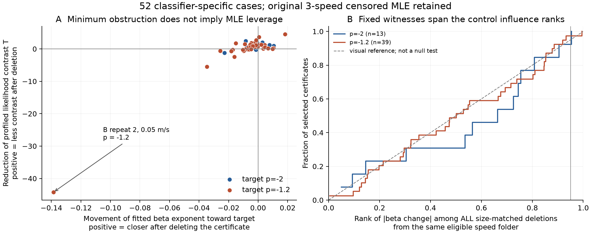
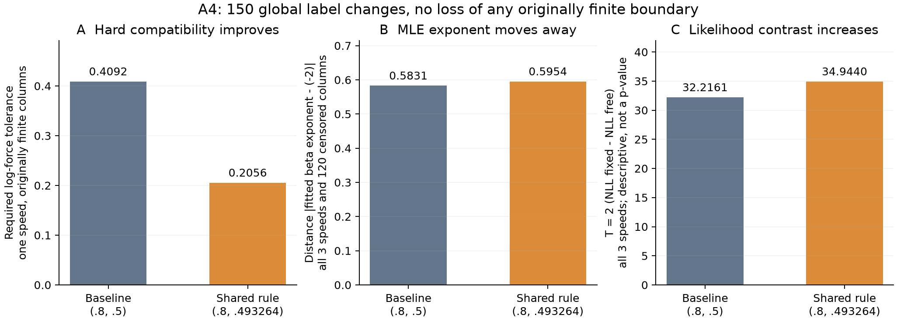

# 최소 모순 집합은 원래 MLE도 설명하는가?

2026-10-21. **작은 모순 집합만으로 기존 MLE의 결론을 설명하거나 반전시킨다고 볼 수는 없었다.** 대신 공통 파형 규칙의 기하학적 증명과 통계 추정의 영향을 구분하고, 두 정보를 함께 제시하는 분석을 구현했다. 기존 13개 전체 MLE를 재현하고 모든 비교 조합을 계산했으며, 독립적인 우도·최적화 구현으로 검증했다.

이번 자료는 이미 공개·분석한 첼로 현 측정이다. 바이올린 실측, 새로운 확인 시험, 새 물리 법칙 또는 예측 성능 개선을 주장하지 않는다. 원래 동결 채점과 신뢰구간은 변경하지 않았다.

## 1. 무엇을 비교했나

이전 방법은 **한 속도의 모든 대상 경계가 허용 오차 안에서 한 법칙과 양립하는지**를 물었다. 이 문제의 전 영역 불가능을 증명하는 최소 고정 집합이 2열 또는 3열이었다.

원래 MLE는 **속도 3개·120열 전체**에 다음 모형을 맞춘다.

`log F = c + a log v + b log β + 정규 잔차(표준편차 σ)`

실제 우도는 경계 구간에 들어갈 확률이다. 왼쪽 검열 315열과 run이 없는 오른쪽 검열 113열도 유지했다. 총 1,560열 중 유한 경계 1,132열만 쓰던 기하학적 문제와 분석 대상 관측 집합·판정 대상이 다르다. MLE는 일부 불일치를 잔차로 허용하며, ε는 σ나 신뢰수준이 아니다.

각 기존 증명 집합을 원래 120열에서 제외해 다시 적합하고, **같은 속도 폴더·같은 크기·같은 대상 열 집단의 선택 집합 자신을 포함한 모든 삭제 조합**과 비교했다. 서로 다른 삭제 조합 22,110개, 자유·고정 지수 모형 적합 60,234회다. 반복 계산 수가 독립 실험 수를 뜻하지는 않는다. 선택 집합을 같은 β 순번의 세 속도 블록으로 확장하는 별도 민감도 분석도 수행했다.

지수 p를 고정한 모형과 자유 모형의 차이는 `T=2(NLL고정−NLL자유)`로 기록했다. T는 여기서 기술적 우도 대비다. 선택 효과·측정 의존성에 맞춘 검정 분포를 만들지 않았으므로 **p값이나 기존 신뢰구간의 반전으로 해석하지 않는다.** 삭제 전후 각각 같은 남은 관측에 대해 두 모형을 비교한다.

## 2. 처음 선택했던 최소 집합은 MLE를 특별히 지배하지 않았다

힘 격자만으로 이미 불가능했던 25개는 분리하고, 분류 규칙 때문에 불가능했던 52개를 중심으로 요약했다.

| 기존 고정 집합을 삭제한 결과 | 52개 조건·지수 조합 |
|---|---:|
| 지수 변화 절댓값 중앙값 | 0.00613 |
| 목표 법칙 지수에 가까워짐 / 멀어짐 | 17 / 35 |
| 같은 크기 삭제 대비 절대 영향력 순위 중앙값 | 54.2백분위 |
| β 간격까지 ±20%로 맞춘 순위 중앙값 | 34.7백분위 |
| 절대 영향력 상위 5%에 해당 | 2개 |
| T 감소 / 증가 | 37 / 15 |

순위는 완전한 유한 대조 조합 내의 기술적 순위이며 유의확률이 아니다. 52개는 서로 독립적인 표본도 아니다.

예를 들어 B 설치 반복 2의 0.05 m/s, p=−1.2에서 선택 집합을 제외하면 b는 **−1.816→−1.955**, T는 **54.55→98.79**가 된다. 기하학적 충돌을 보여 주던 열을 제외했는데 통계적으로는 그 후보 법칙에서 더 멀어진다. 자유 모형의 잔차 표준편차도 약 0.421→0.288로 줄어든다. 이 열이 오류라는 뜻은 아니다.

T 감소량을 두 부분으로 정확히 분해했다.

`T전−T후 = 삭제 열의 원래 적합에서의 우도 대비 + 2(고정 모형 재적합 이득−자유 모형 재적합 이득)`

위 사례는 −25.245와 −18.987이 합쳐져 −44.232가 된다. 단순히 열별 잔차만 보는 것으로는 재적합의 영향을 놓친다. 이 항등식 자체가 새로운 수학이라는 주장은 하지 않는다.

## 3. 집합을 잘못 골랐기 때문인지도 전부 확인했다

최소 집합은 하나가 아닐 수 있다. 처음 선택한 집합만으로 방법을 평가하지 않도록, 이전 기하학 분석에서 이미 구해 둔 **모든 최소 집합 7,742개(쌍 7,718개·세 열 24개)**를 전수 재적합 결과와 연결했다. 이 추가 비교는 결과 일부를 본 뒤 별도 계획으로 명시한 사후 확장이다.

52개 분류 규칙 사례의 최소 집합은 총 3,599개다.

- **12개 사례:** 어떤 최소 집합을 골라 제외해도 지수가 목표에서 멀어졌다.
- **6개 사례:** 어떤 최소 집합을 골라 제외해도 T가 증가했다.
- **31개 사례:** 같은 최소 크기라도 선택한 집합에 따라 T 변화 방향이 바뀌었다.
- 세 열이 반드시 필요한 두 사례에서는 **가능한 24개 최소 세 열 집합 모두** 지수를 목표에서 멀어지게 하고 T를 증가시켰다. A1·0.20 m/s·p=−1.2의 19집합과 B 반복1·0.05 m/s·p=−2의 5집합이다.

따라서 차이는 단순히 처음 집합을 우연히 잘못 선택해서 생긴 현상이 아니다.

실용적인 확장도 구현했다. **기하학적 최소성을 유지하는 모든 집합 중, 원래 MLE의 T를 가장 크게 줄이는 집합**을 선택할 수 있다. 52개 중 46개에서는 이런 집합의 T 감소가 양수지만, 6개에서는 최선도 음수다. 이는 증명과 통계 설명을 함께 보여 주는 선택 기능이지 최소 MLE 반전 알고리즘이 아니다. 많은 후보 중 최대를 선택하면 순위가 높아지는 것은 당연하므로, 그 높은 순위를 새로운 예측 성능이나 유의한 우수성으로 주장하지 않는다.

[전체 집합·선택 결과](theory/family.json), [해석 검토](theory/FAMILY_REVIEW.md).

## 4. 일관된 판정 기준을 실제로 바꿔도 두 결론은 달랐다

이전에 찾았던 두 공통 문턱만 미리 지정해 전체 78,000창에 적용했다. 새 MLE 결과를 좋게 만드는 문턱을 추가 탐색하지 않았다.

가장 명확한 사례는 A4다. 공통 문턱 (.8,.4932639271)은 전체 150개 판정을 바꾸고 기존 유한 경계를 하나도 잃지 않는다. A4·0.20 m/s의 기하학적 최소 허용 거리를 **.409165→.205552**로 줄인다. 그러나 원래 전체 MLE에서는 b가 **−1.41687→−1.40459**로 −2에서 조금 멀어지고, T도 **32.216→34.944**로 커졌다.

A4 전체에서는 경계 구간 두 개가 바뀌며, 그중 하나는 왼쪽 검열에서 유한 구간으로 바뀐다. 따라서 MLE 변화를 앞선 대상 폴더의 한 경계 변경만으로 설명하지 않는다. 같은 규칙을 적용해도 두 분석이 사용하는 정보와 목적이 다르다는 사례다.

이 150개 변경 규칙의 전체 13도표 최대 |Δb|는 0.01547이다. 다른 지정 규칙 (.8,.3321855528)은 3,200개를 바꾸고 9폴더의 원래 유한 경계 10개를 잃으며 최대 |Δb|=0.28690이다. MLE에서는 이 경우도 경계를 누락하지 않고 해당 한쪽 검열로 유지했다. [전 결과](coherent_replay.json).

## 5. 이론과 수치 검증

- **정확한 반례:** 세 속도×네 β의 대칭 구간 자료에서는 강한 기하학적 모순(필요 ε=.95)이 있는데도 자유 MLE가 정확히 목표 지수를 선택하고 T=0이다. 작은 모순만으로 MLE 기각을 보장할 수 없다는 해석을 수학적으로 확인했다.
- **허용되는 연결:** 같은 속도에서 후보 법칙을 뺀 구간 사이 간격이 g>0이고 같은 정규 잔차 법칙을 공유하면, 고정 σ에서 그 두 열의 음의 로그우도는 `−2 log Φ(−g/(2σ))` 이상이다. 이는 절대 우도 부담의 하한이고 자유 모형 대비 T의 하한은 아니다. 독립적인 σ 제한 없이 물리 검정으로 바꾸지 않는다.
- **다른 매개변수화로 검증:** η=θ/σ, τ=1/σ에서 검열 정규 음의 로그우도 최소화는 볼록 문제가 된다. 이 성질과 방법에는 기존 문헌이 있다. 별도 구현이 이 매개변수화를 사용해 본 코드와 다른 최적화 경로로 결과를 확인했다.
- 모든 1,560개 구간 일치, 기존 13개 전체 적합 최대 매개변수 차이 1.11e−7.
- 독립 구현으로 모든 60,234개 대조 적합의 목적함수를 확인하고, 전체·선택 삭제·블록 삭제·공통 기준 재판정 및 대조 표본에 대해 총 779회 별도 최적화. 최대 매개변수 차이 약 1.31e−6, NLL 차이 4.61e−11 이하.
- 모든 22,110개 조합의 완전성, 462개 순위 비교 및 우도 분해를 확인했다. 미해결 적합 실패 0. 조합 전수 검증과 실수 연산의 수치 최적화는 구분한다.

전체 파일을 임시 디렉터리로 복사해 수행한 10단계 재현도 **48.19초에 통과**했다. 생산 배열 908개·673,916개 값과 주요 JSON 4개는 완전히 일치했고, 추가 JSON 8개의 수치 228,770개도 허용 오차 안에서 일치했다. [실행 방법](REPRODUCE.md), [검증 기록](reproduction/summary.json).

[이론](theory/THEORY.md), [독립 검증](verification/README.md), [생산 코드와 재현](production/README.md).

## 연구의 새로움과 실제 의미

관측 몇 개를 빼는 영향 분석, 최소 모순 집합, MLE 민감도, 볼록 검열 회귀 자체는 이미 연구되어 있다. [AMIP](https://arxiv.org/abs/2011.14999v5)는 MLE에도 적용되고, [ICLR 2026 영향 집합 검정](https://proceedings.iclr.cc/paper_files/paper/2026/hash/7c61aa6a4dcf12042fe12a31d49d6390-Abstract-Conference.html)도 있다. 따라서 그것들을 새 알고리즘이라고 이름만 바꾸지 않는다. [원문 검토](theory/LITERATURE.md).

현재 가장 방어 가능한 기여는 **파형 판정 규칙 → run 경계 → 법칙 양립 증명 → 원래 통계 추정**을 연결하고, 그 연결이 성립하는 부분과 성립하지 않는 부분을 재현 가능하게 분리하는 것이다. 논문 독자는 작은 모순 증명을 실제 물리 법칙의 반증으로 오해하지 않으면서도, 어느 측정 위치가 규칙의 불가능을 설명하고 어떤 집합이 통계 추정에도 영향을 주는지 확인할 수 있다.

이번 결과는 앞선 방법의 적용 범위를 줄이지만 연구의 신뢰성을 높인다. 새 물리 법칙 또는 통계적으로 검증된 성능 향상을 얻었다고 말할 단계는 아니다. 확장된 방법은 더 명확한 설명과 검증 기능을 제공한다. 기존 MLE 신뢰구간을 뒤집는 최소 변경 수까지 보장하려면, 별도의 선택·의존성을 반영한 추론과 결정 기준이 필요하다.
