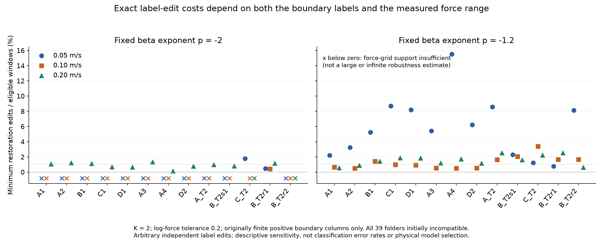
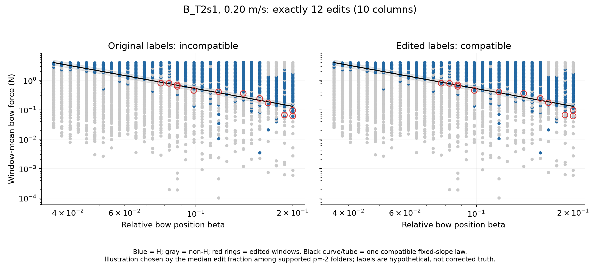

# 활 힘 법칙과 양립하는 데 필요한 최소 판정 변경

2026-10-21 · 구현·독립 검증·실측 적용 완료. **이미 본 자료에서 개발한 사후 방법**이다. 실행 규약은 비용 계산 전에 로컬 커밋 `37c1a46`으로 고정했다. 공개 사전등록이나 새 독립 확인 실험은 아니다.

## 무엇을 계산했는가

한 속도에서 활 위치 β별로 힘을 정렬하고, 처음으로 K개 연속 헬름홀츠(H) 판정이 나타나는 아래 경계를 구한다. 특정 지수 p의 법칙 `log F = a + p log β`가 모든 대상 경계와 허용 오차 ε 안에서 양립하는 공통 절편 a를 갖는지 판단한다. **이 판단을 반대로 바꾸는 데 필요한 H/비H 판정 변경의 최소 개수**를 정확히 계산한다.

이것은 이전 구간 우도 적합의 p값·신뢰구간을 뒤집는 최소 개수가 아니다. 기존 통계 결과는 그대로다. 새로 명시한 **모든 열의 구간과 양립하는가**라는 결정 규칙을 감사한다. 처음에 불양립이면 양립 복원 비용, 처음에 양립이면 배제 비용을 사용한다. 각 최소값에는 실제로 바꿀 창 ID·힘·β·방향을 담은 증거가 있고, 그보다 적게 바꿔서는 해당 결정을 바꿀 수 없다는 최적성 보장이 붙는다.

## 실측에서 얻은 결과

13도표, 39개 속도 폴더, 78,000개 원래 창을 사용했다. 주 분석은 K=2, ε=0.2 자연로그 힘(약 ×0.819–1.221), 양방향 변경이다. 원래 유한한 양의 경계가 있는 **1,132열·56,600창**을 고정해 분석했다. 왼쪽 검열 315열과 H-run 없음 113열은 제외했다. 39개 폴더 모두에서 원래 판정은 두 지수와 불양립이었다. 따라서 주 실측 결과는 모두 **양립 복원** 비용이다.

| 비교 모양 | 격자 안에서 양립 복원 가능 | 최소 변경 수 | 창 대비 변경 비율 중앙값 | 변경된 β 열 비율 중앙값 |
|---|---:|---:|---:|---:|
| p=−2, Schelleng 최소 힘 모양 | 14/39 폴더 | 2–20개; 중앙값 13.5 | 0.884% | 38.32% |
| p=−1.2, 앞선 실측에서 택한 기술적 비교 모양 | 39/39 폴더 | 5–163개; 중앙값 26 | 1.68% | 48.28% |

**작은 창 비율과 작은 경계 변화는 다르다.** −2의 경우 창은 약 0.9%만 바꾸지만 활 위치 열은 약 38%에서 바뀐다. 이는 '실제 오류가 0.9%다' 또는 '몇 군데만 고치면 된다'는 결과가 아니다. 경계를 정하는 소수 판정의 영향이 넓은 β 범위에 걸친다는 뜻이다.

**나머지 −2의 25폴더는 격자의 표현 범위가 부족하다.** 원래 선정된 열을 유지하고 변경 후에도 유한한 양의 첫-run 경계를 요구하면, 어떤 라벨 조합으로도 ε=0.2에서 해당 모양을 표현할 수 없다. 이 결과를 무한한 물리적 강건성이나 Schelleng 법칙의 결정적 반증으로 해석하지 않는다. 검열 열까지 허용하는 다른 문제에는 이 결론을 옮길 수 없다. `diagnostics.json`에는 각 불가능 사례를 설명하는 두 열과 필요한 최소 격자 허용 오차가 있다.

**최소 변경 수는 물리 모형 선택 점수가 아니다.** 두 지수가 모두 가능한 동일 14폴더에서 비용 중앙값은 −2:13.5, −1.2:20이고, −2가 더 저렴한 폴더가 10개다. 그러나 14개 중 11개가 최고 속도이고, 모두 원래 40열 중 13–32열만 남은 조건이다. 전체 표의 13.5 대 26은 서로 다른 집합이다. 어느 비교도 물리적 진실의 우열을 검정하지 않는다. −1.2는 Beigi의 정확한 −1 법칙과도 구별한다.

둘째 그림은 가능한 −2 폴더 중 변경 비율의 아래쪽 중앙값에 해당하는 B_T2s1, 0.2 m/s 사례다. 12개 창·10열을 변경하면 양립하며, 허용된 변경 11개 이하로는 불가능하다. 빨간 원은 가상의 변경 위치다. 수정한 물리적 정답이나 새 관측이 아니다.

## 계산 방법과 엄격한 검증

1. **열 안의 정확한 비용:** run 길이 상태를 갖는 동적계획법으로 모든 첫 K-run 위치의 최소 Hamming 비용을 O(nK)에 계산한다. 뒤의 run을 새로 만들거나 앞의 run을 지워야 하는 효과를 모두 포함한다. 힘 순서에서 인접한 서로 다른 긋기이며 시간상 연속 창이 아니다.
2. **법칙과 결합:** 각 경계 후보를 절편 구간으로 바꾼다. 모든 구간 끝점과 그 사이를 훑어, 공통 절편을 갖는 후보들의 최소 총비용을 찾는다. 절편을 대충 격자로 찍거나 국소 최적화하지 않는다.
3. **반대 방향:** 1차원 구간들의 교집합이 비려면 서로 다른 두 열의 구간이 떨어져 있어야 한다. 그 두 열과 나머지 열의 최소 비용을 결합해 양립→배제도 정확히 계산한다.
4. **독립 확인:** 아래 전수조사 코드는 생산 DP나 sweep를 정답 생성에 사용하지 않는다.

| 검증 | 확인 범위 | 결과 |
|---|---|---|
| 이진 열 전수조사 | 길이 0–9, K=1–4, 3변경 방향; 비용 92,238개 | 모두 일치; 유한 최적 증거 55,132개 확인 |
| 전역 후보 전수조사 | 3,016경우, 후보 조합 218,318개 | 양립·배제 양쪽 최솟값 일치 |
| 라벨→법칙 전체 전수조사 | 540경우, 목표 라벨 조합 107,742개 | 모두 일치 |
| 실측 증거 재적용 | 주 분석 방향별 234기록, 유한 증거 355개·변경 4,901개 | ID·방향·비용·최종 결정 모두 일치 |
| 입력·수치 경계 | 78,000개 고유 창, 힘 정렬·중복·잘못된 인수·극단 부동소수점 | 통과; 극단 절편 대표값 문제 수정 후 재검증 |

실측 계산은 총 1,092조건이며 주 계산 약 8.6초였다(이 노트북, 입력 추출·검증 제외). GPU가 필요 없다. '정확'은 선언한 이산 문제와 부동소수점 구간 비교에 대한 조합적 최적성이다. 측정 힘의 물리적 정확성을 뜻하지 않는다.

닫힌 경계를 기본으로 정의했다. 주 분석의 양방향 복원 53건은 모두 양의 폭을 가진 절편 교집합을 갖는다(최소 폭 0.0001193). 따라서 이 53건은 아래 끝점을 열린 것으로 바꾸어도 같은 비용의 내부점 증거가 존재한다. 다른 허용 오차·다른 자료까지 동일하다는 주장은 아니다.

## 민감도와 실패를 함께 공개한다

ε=0,0.1,0.2,0.4에서 −2의 복원 가능한 폴더 수는 12,13,14,20이다. 양방향 복원 비용 중앙값은 41.5,25,13.5,4로 바뀐다. ε=0.4에서는 −2의 4폴더와 −1.2의 1폴더가 처음부터 양립하여, 그 경우에는 복원 비용 0을 반전 비용으로 쓰지 않고 배제 비용을 사용한다. ε는 미리 택한 해상도이며 신뢰구간·센서 오차의 추정치가 아니다.

H 삭제만 허용하면 −2는 4/39, H 추가만 허용하면 8/39에서 복원 가능하다. −1.2는 각각 37/39,19/39다. 변경 방향에 따라 답이 다르다. K=1·3도 계산했으나 K에 따라 원래 유한 경계의 대상 열도 달라지므로 동일 모집단 비교가 아니다. 모든 조건은 `results.json`, 요약은 `diagnostics.json`에 있다.

합성 자료 26경우·156법칙/방향 조합에서도 모든 유한 증거를 확인했다. 무작위 3개 오류로 경계가 그대로인 경우에도 이후 결정을 바꾸는 거리는 2개에서 1개로 줄 수 있었다. 경계 부근 4개 오류는 생성 법칙을 배제하지만 이를 다시 양립시키는 데는 1–2개만 필요했다. 따라서 최소 결정 변경 수는 **원래 라벨을 전부 복원하는 오류 개수와 다르다**. 자세한 설계·음성 결과는 [SYNTHETIC.md](SYNTHETIC.md)에 있다.

## 새로움과 연구의 의미

최소 라벨 변경, 정규언어의 Hamming 거리, 동적계획법, fragility index는 이미 연구되어 있다. 선행을 [문헌 검토](literature/README.md)에 명시했다. 본 작업의 기여 후보는 **K-run으로 추출한 힘 경계와 연속 절편을 결합해 법칙 양립 결정의 최소 변경 수를 계산하고, 실제 변경 증거·영향받는 열·격자 부족을 함께 공개하는 감사 방법**이다. 새로운 일반 DP나 최초의 fragility 방법이라고 주장하지 않는다.

연구적으로는 판정 정확도 하나만 보고 추정 법칙을 신뢰할 수 없음을 구체적인 변경 증거와 하한으로 보여준다. 또한 작은 비용과 측정 범위 부족을 구별해, 결과가 라벨에 민감한지 또는 애초에 비교 가능한 격자가 없는지 분리한다. 설명 모형의 평균 오차 감소를 넘어, 명시한 결정 규칙에 대해 확인 가능한 최적성 보장을 추가한 것이 이번 진전이다.

제한은 명확하다. 임의의 독립 라벨 변경을 허용했고, 하나의 일관된 특징 문턱으로 그 변경을 실현할 수 있는지는 확인하지 않았다. 따라서 현재 비용은 그러한 일관된 판정 규칙으로 제한한 문제에 대한 **하한**이다. 적은 비용이 실제 오분류를 의미하지 않는다. 새 물리 법칙·새 현 예측 성능·바이올린 실측 결과도 아니다. 참신함의 범위는 확인한 문헌 안에 한정하며 학술지 채택 수준을 보장하지 않는다.

## 파일과 재현

- [실행 전 규약](PLAN.md), [열 DP 증명](THEORY.md), [전역 최적성 증명](GLOBAL_THEORY.md).
- `core.py`, `global_profile.py`: 두 솔버. `empirical.py`: 미리 정한 실측 전체 분석.
- `input_columns.json.gz`: 906 KiB의 공개 자료 파생 입력. 원파형 없이 재계산 가능. [출처와 변환](DATA.md).
- `results.json`: 전체 수치와 주 분석 변경 증거. `diagnostics.json`: 사후 지지집합·분모·짝비교 진단.
- [독립 검증](verification/REVIEW.md), [독립 해석 검토](literature/RESULT_REVIEW.md), [재현 실행](REPRODUCE.md).
- 원고 v2.7의 §3.12와 한국어 최종보고서 §10.12에 반영했다. 이전 문서는 `before_update/`에 보존했다. 기존 원자료·동결 채점은 수정하지 않았으며, 기존 PDF는 이번 내용을 포함하지 않는다.
